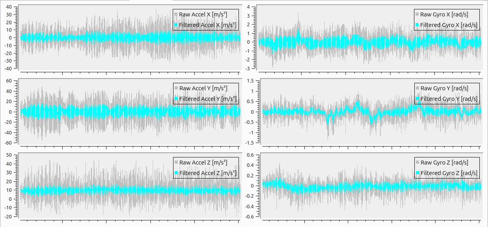
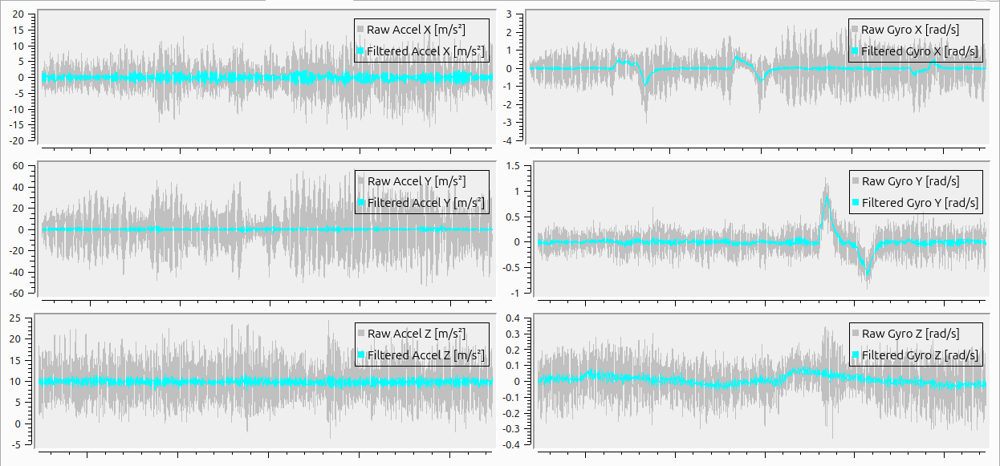
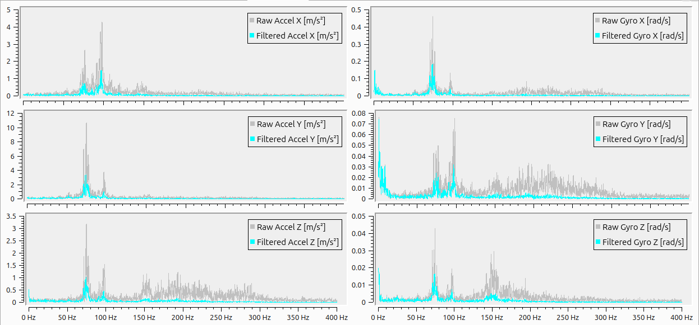
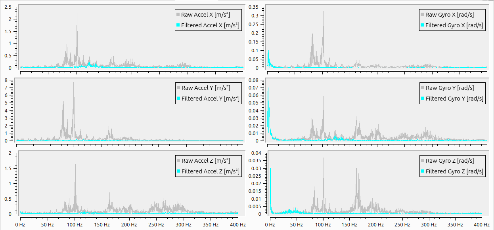
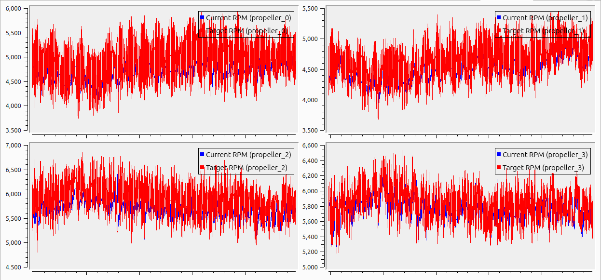
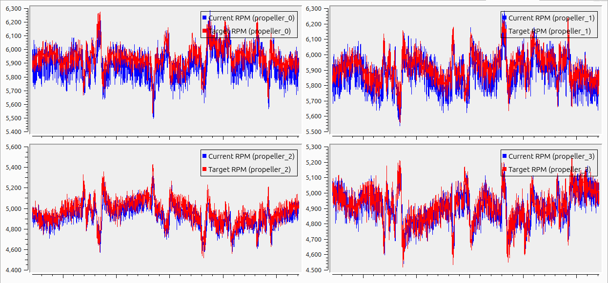
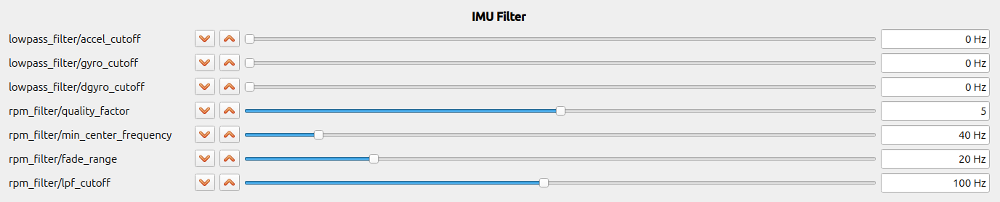

# RPM Filter

## **What Is an RPM Filter?**

---

An RPM filter is a notch filter whose center frequencies track the motor's rotational frequency and its harmonics.
In drones, particularly multicopters, most IMU vibration comes from the propellers.
Making the notch filter's center frequencies follow the rotational speed therefore removes these vibrations effectively.

## **Benefits of the RPM Filter**

---

The main advantage of an RPM filter is its very strong vibration attenuation.
A notch filter has zero gain at its center frequency, so ideally it completely eliminates vibrations at that frequency.
In practice, center-frequency errors and discretization errors prevent complete elimination,
but attenuation is still much greater than with a low-pass filter.

The images below show IMU time-series data and frequency analysis results from an F450 flight.
Gray represents raw data, and blue represents filtered data.
The left column uses only a low-pass filter (LPF) with a 40 Hz cutoff, while the right column uses only an RPM filter.
The LPF attenuates high frequencies, but strong vibrations at the motor's rotational frequency remain.
The RPM filter substantially attenuates vibrations at the motor's rotational frequency as well as its second and third harmonics.

{ width="49%" }
{ width="49%" }

{ width="49%" }
{ width="49%" }

Reducing IMU vibration, especially gyro vibration, also reduces motor speed fluctuations.
In the images below, blue shows measured speed and red shows target speed. The speed fluctuations are smaller when the notch filter is used.
This improves attitude control stability by reducing unwanted forces,
and also reduces motor heating and makes the propeller sound smoother.

{ width="49%" }
{ width="49%" }

## **Supported FMUs**

---

The RPM filter is available on the following FMUs:

- FC2xx

## **Parameters**

---

Configure the filter under `IMU Filter` in the GCS's `Param Tuning` tool.
The following sections describe each parameter, its initial setting, and how to tune it.

### **`lowpass_filter/*_cutoff`**

These are the cutoff frequencies of the low-pass filters that are separate from the RPM filter.
Start by setting all three to 0 Hz to disable those filters.
The RPM filter only attenuates vibrations originating from the motors and propellers. If strong vibrations remain, selectively enable the LPFs as needed.

### **`rpm_filter/quality_factor`**

This value determines the sharpness of the notch filter.
Higher values produce a sharper notch (narrower bandwidth) with less delay.
The default is 0, which disables the filter.
Start with 5, which provides a balance between delay and bandwidth.
After a test flight, confirm that vibration is attenuated enough that peaks are no longer visible in the FFT.
Then increase the value in steps of 1, stopping just before the peaks reappear.

### **`rpm_filter/min_center_frequency`, `rpm_filter/fade_range`**

These parameters determine the range of center frequencies over which the RPM filter is applied.
Let the first parameter be $f_\mathrm{m}$ and the second be $f_\mathrm{f}$. The notch filter is applied according to the center frequency $f_\mathrm{c}$ as follows:

- $f_\mathrm{c} \lt f_\mathrm{m}$: Filter disabled
- $f_\mathrm{m} \le f_\mathrm{c} \lt f_\mathrm{m} + f_\mathrm{f}$: Transition region (filtering becomes stronger as $f_\mathrm{c}$ increases)
- $f_\mathrm{m} + f_\mathrm{f} \le f_\mathrm{c}$: Filter enabled

The disabled region prevents filtering at low frequencies near the control bandwidth, which could adversely affect responsiveness and stability.
The transition region prevents abrupt changes in the overall filter characteristics when the RPM filter switches on or off.
For a hovering rotational frequency of $f_\mathrm{h}$,
start with approximately $f_\mathrm{m}=\frac{f_\mathrm{h}}{2}$ and $f_\mathrm{f}=\frac{f_\mathrm{h}}{4}$.

### **`rpm_filter/lpf_cutoff`**

This is the cutoff frequency of the low-pass filter applied to the RPM filter's center frequency.
Motor speed readings from the ESC fluctuate considerably. They are smoothed because using them directly as the center frequency would cause excessive changes in the filter characteristics.
The default value works well in most cases.
