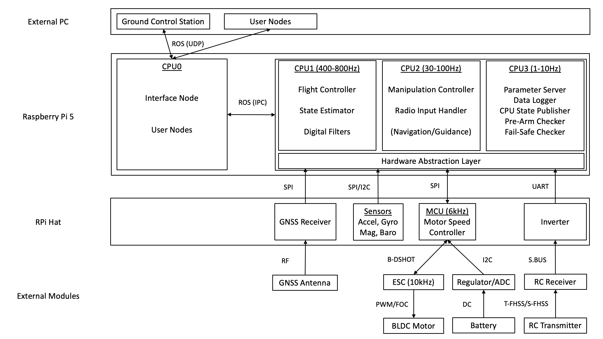
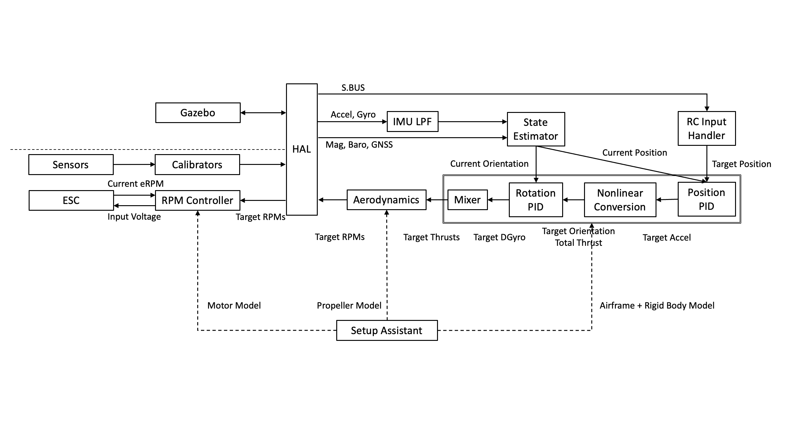

# System Architecture

This page provides an overview of Tobas's hardware and software architecture.

## **Hardware Architecture**

---

The diagram below shows the hardware architecture.
Sensor data sent from the HAT over a serial connection is converted into common ROS messages by the Hardware Abstraction Layer (HAL) on the Raspberry Pi,
then processed by the flight code running on CPU1-3.
Target motor speeds output by the flight code pass through the HAL again and are sent to the motor speed control MCU on the HAT.
The calculated throttle commands are sent digitally to the ESCs.
An interface node for remote communication runs on CPU0 in a separate process from the flight code.
All remote access to the flight controller, including access from a ground station, passes through this node.
Separating communication processing onto a different process and CPU core preserves the real-time behavior of the flight code and prevents unexpected behavior.

## **Software Architecture**

---

The diagram below shows the software architecture.
Sensor data from real hardware or an aircraft in Gazebo is converted into common ROS messages by the HAL.
The data is sent to the state estimator, which estimates the aircraft's position, attitude, velocity, and angular velocity.
The estimated state is sent to the controller shown with a double border in the diagram, where the target thrust for each propeller is calculated.
The target motor speed is calculated from the target thrust using the propeller model.
The target speeds pass through the HAL again and are sent to the real aircraft or the aircraft in Gazebo.
On real hardware, the motor controller on the MCU calculates the voltage to apply to each motor from its target speed and sends the commands to the ESCs.
The physical aircraft models required by the flight and motor controllers come from the Tobas project created in [Setup Assistant](../getting_started/airframe_config.md).

