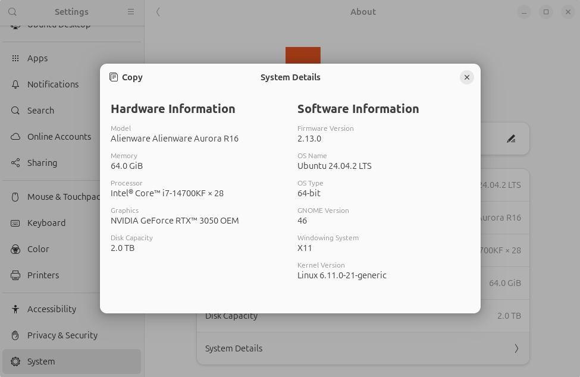

# Troubleshooting

This page summarizes reported issues and their solutions.

## **Gazebo Runs Slowly**

---

### **1. The Display Server May Not Be X11**

`Settings / System / About / System Details`
shows the display server. Check that it is X11.



If the display server is not X11, for example if it shows Wayland,
select your username on the Ubuntu login screen and use the gear icon at the lower right to select the display server as follows:

- If the options are `Ubuntu` and `Ubuntu on Wayland`, select `Ubuntu`.
- If the options are `Ubuntu on Xorg` and `Ubuntu`, select `Ubuntu on Xorg`.

## **ROS Communication Between the FC and PC Fails**

---

### **1. The Firewall May Be Blocking UDP**

ROS 2 uses UDP internally for communication across the network,
but the firewall may not allow it.
Check the firewall status with the following command.
If UDP ports in the 7400 range are missing from the allowed port list, this may be the cause.

```bash
$ sudo ufw status
```

Ideally, you should allow only the ports being used.
As an initial workaround, disable UFW and restart to restore communication.

```bash
$ sudo ufw disable
$ sudo reboot
```

## **The FC Does Not Run After Writing User Code**

---

A runtime error may have occurred.
Log in to the Raspberry Pi via SSH and inspect the console output with `journalctl` for clues.
Use the arrow keys to navigate and press `Q` to exit.

```bash
$ ssh pi@${hostname}.local  # or pi@${ip_address}
$ journalctl -u tobas_real_realtime.service -e  # or tobas_real_interface.service
```
