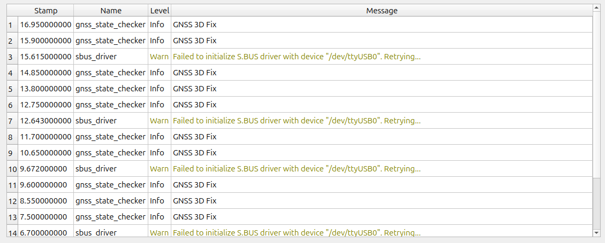
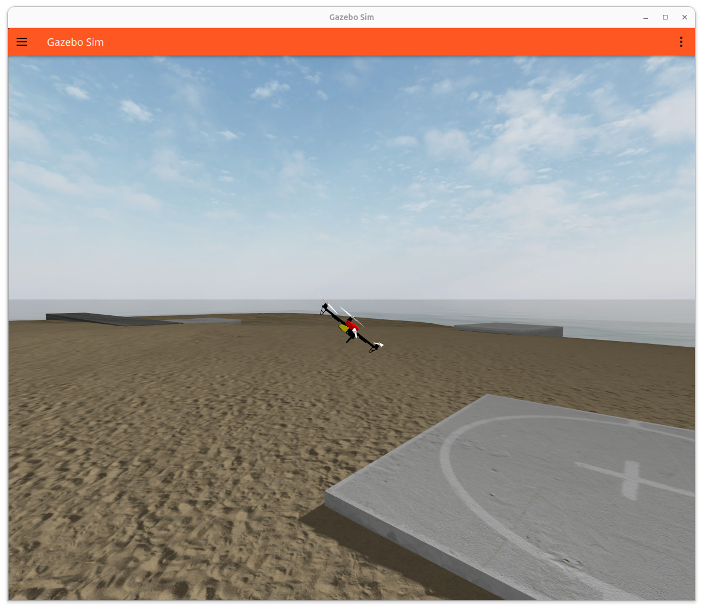
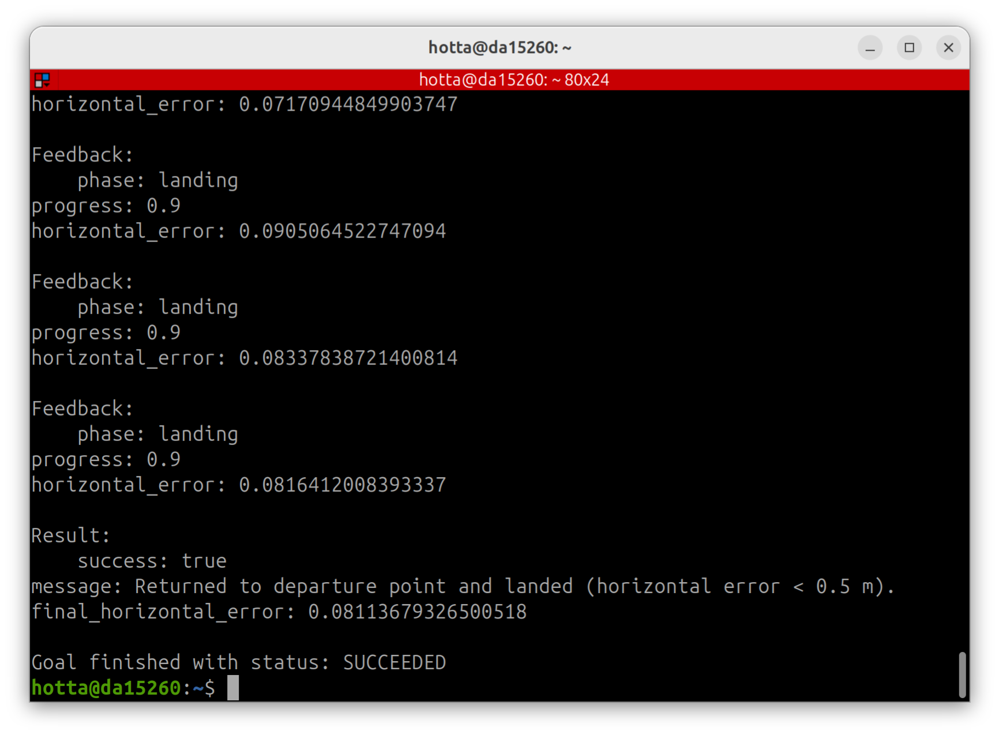

# User Code (C++)

This section assumes that you have a basic understanding of C++ and ROS 2.
To learn ROS 2, see
<a href=https://docs.ros.org/en/jazzy/Tutorials.html target="_blank">Tutorials | ROS 2 Documentation</a>
.

Among the ROS packages in a Tobas project created with Setup Assistant (e.g., tobas_f450.TBS),
the user C++ package (e.g., tobas_f450_user_cpp) is a C++ package that users can edit freely.
It contains the following five launch files.

- `common_(interface/realtime).launch.py`: Launched on both real hardware and in simulation.
- `real_(interface/realtime).launch.py`: Launched only on real hardware.
- `gazebo.launch.py`: Launched only in simulation.

`common` and `real` each contain two types of launch files: `interface` and `realtime`.
Nodes launched with the former can perform ROS communication across networks, whereas nodes launched with the latter cannot.
Therefore, for a node launched with `*_realtime.launch` to communicate across networks,
it must go through an interface node launched with `*_interface.launch`.
This design prevents the node discovery algorithm used by DDS, the ROS 2 backend, from adversely affecting real-time performance.

## Tutorial 1
As an example, let's create a C++ node that checks the GNSS status and outputs a message every second when a 3D fix is available.
Edit `tobas_f450_user_cpp/nodes/user_node.cpp` as follows.

```cpp
#include <tobas_constants/ros_interface.hpp>
#include <tobas_node/node.hpp>

#include <tobas_msgs_adapter/gnss.hpp>

class UserNode : public tobas::BaseNode
{
  using self = UserNode;
  using super = tobas::BaseNode;

public:
  explicit UserNode(const rclcpp::NodeOptions& options = rclcpp::NodeOptions());

private:
  tobas::ros2::SubscriberPtr<tobas_msgs::Gnss> gnss_sub_;

  void gnssCb(const tobas_msgs::Gnss::ConstSharedPtr& gnss);
};

UserNode::UserNode(const rclcpp::NodeOptions& options)
  : super("gnss_state_checker", nodeOptions_Default(options))
{
  gnss_sub_ = createSubscriber<tobas_msgs::Gnss>(tobas::topic::kGnss, &self::gnssCb, this);
}

void UserNode::gnssCb(const tobas_msgs::Gnss::ConstSharedPtr& gnss)
{
  if (gnss->fix_type == tobas_msgs::msg::Gnss::FIX_3D) {
    TOBAS_INFO_THROTTLE(1., "GNSS 3D Fix");
  }
}

RCLCPP_COMPONENTS_REGISTER_NODE(UserNode)
```

Add the dependency packages used by this node to `tobas_f450_user_cpp/package.xml`.

```xml
<depend>tobas_constants</depend>
<depend>tobas_node</depend>
<depend>tobas_msgs_adapter</depend>
```

Add this node as a build target.
Add the dependency packages to `tobas_f450_user_cpp/CMakeLists.txt` and uncomment the build instructions.

```cmake
cmake_minimum_required(VERSION 3.25)
project(tobas_f450_user_cpp)

if(NOT CMAKE_BUILD_TYPE AND NOT CMAKE_CONFIGURATION_TYPES)
  set(CMAKE_BUILD_TYPE "Release" CACHE STRING "Build type (default Release)" FORCE)
endif()

set(CMAKE_CXX_STANDARD 23)
set(CMAKE_CXX_STANDARD_REQUIRED ON)
set(CMAKE_CXX_EXTENSIONS OFF)
set(CMAKE_CXX_FLAGS "${CMAKE_CXX_FLAGS} -Wall -Wextra -Wpedantic -Wshadow -Wswitch-enum -Werror")
set(CMAKE_POSITION_INDEPENDENT_CODE ON)

set(AMENT_DEPENDENCIES
  rclcpp
  rclcpp_components
  tobas_constants
  tobas_node
  tobas_msgs_adapter
)

find_package(ament_cmake REQUIRED)

foreach(dependency IN ITEMS ${AMENT_DEPENDENCIES})
  find_package(${dependency} REQUIRED)
endforeach()

include_directories(include)

add_library(${PROJECT_NAME} SHARED nodes/user_node.cpp)
ament_target_dependencies(${PROJECT_NAME} ${AMENT_DEPENDENCIES})
target_link_options(${PROJECT_NAME} PRIVATE -Wl,--no-undefined)
rclcpp_components_register_node(${PROJECT_NAME} PLUGIN "UserNode" EXECUTABLE user_node)

install(
  TARGETS ${PROJECT_NAME}
  EXPORT ${PROJECT_NAME}
  LIBRARY DESTINATION lib
  ARCHIVE DESTINATION lib
  RUNTIME DESTINATION bin
  INCLUDES
  DESTINATION include
)

install(DIRECTORY launch DESTINATION share/${PROJECT_NAME})

ament_package()
```

Configure this node to start automatically.
Although it could be launched as a regular ROS node, this time we will launch it as a component to eliminate copying in topic communication.

In Tobas, three component managers (`component_manager_x (x = 1, 2, 3)`) run on separate CPUs,
and topic communication between their components is also zero-copy.
Lower-numbered managers handle faster processes that are less tolerant of latency. Their general roles are as follows.

- `component_manager_1`: IMU filtering, state estimation, attitude/position control, etc. (400-800Hz)
- `component_manager_2`: Path planning, mission execution, etc. (30-100Hz)
- `component_manager_3`: Parameter server, logging, failsafe, etc. (1-10Hz)

Because the processing performed by this node is not time-critical, plug it into `component_manager_3`, which handles the slowest processes.
Uncomment the `add_action` section in `tobas_f450_user_cpp/launch/common_realtime.launch.py`.

```python
# Do not delete or rename this file because it is executed in tobas_f450_config/common_realtime.launch.py.

from launch import LaunchDescription
from launch_ros.actions import LoadComposableNodes
from launch_ros.descriptions import ComposableNode


def generate_launch_description():
    ld = LaunchDescription()

    # Please add the nodes that run both on real hardware and in simulation, with real-time requirements.

    ld.add_action(
        LoadComposableNodes(
            target_container=f"f450/component_manager_3",
            composable_node_descriptions=[
                ComposableNode(
                    package="tobas_f450_user_cpp",
                    plugin="UserNode",
                    extra_arguments=[{"use_intra_process_comms": True}],
                ),
            ],
        )
    )

    return ld
```

When you start the simulation from the GCS, a message appears in the `Control System` console.



For details about the API, see [ROS API](./ros_api.md).


## Tutorial 2 
In this tutorial, use the GPS message received in the previous tutorial to make the drone take off, fly in a circle, and land. Modify `tobas_f450_user_cpp/nodes/user_node.cpp`, `tobas_f450_user_cpp/package.xml`, `tobas_f450_user_cpp/CMakeLists.txt`, and `common_realtime.launch.py`.  

#### Fly in a circle after acquiring a GNSS fix

In this example, the user node waits for a 3D fix from GNSS (a satellite positioning system such as GPS). Once 60 seconds have passed since the fix was confirmed and the command receiver is ready, the node automatically requests takeoff. It then sends commands to fly three laps around a circle and finally requests landing.

#### From startup to landing

The console logs show which stage the program has reached.

| Stage | Program behavior | Main console messages |
| --- | --- | --- |
| Startup | Waits for a message reporting a GNSS 3D fix (`FIX_3D`). | `Circle node started. Waiting for GNSS 3D Fix.` |
| Fix confirmed | Waits 60 seconds from the first `FIX_3D` message. | `GNSS 3D Fix received. Waiting 60 seconds before takeoff.` |
| Request takeoff | After 60 seconds have passed and the action server is ready, requests takeoff to an altitude of 3 m. | `Sending takeoff request.` |
| Fly in a circle | One second after receiving a successful takeoff result, starts sending commands to follow a horizontal circle at an altitude of 3 m with a radius of 5 m. Sends commands for three laps at 10 seconds per lap. | `Takeoff completed.` → `Following circle path.` |
| Land | Waits one second after sending the final circle command, then requests landing if the action server is ready. Ends the sequence once it receives a successful landing result. | `Circle path completed.` → `Landing completed. Sequence finished.` |

#### How GNSS messages and the timer work together

`gnssCb()` and `timerCb()` are functions in the same user node. They run at different times.

- `gnssCb()` is called when a GNSS message arrives.
- `timerCb()` is called approximately every 10 ms after the node starts.

The following code sets up the timer. `std::chrono::milliseconds(10)` sets the timer interval, and `std::bind(&self::timerCb, this)` tells the timer to call `timerCb()` on this node.

```cpp title="user_node.cpp"
timer_ = create_wall_timer(
  std::chrono::milliseconds(10), std::bind(&self::timerCb, this));
```

The variable `state_` records what the node is waiting for or what it is currently doing. Both functions use the same `state_`.

1. **While waiting for a fix**  
   `timerCb()` runs approximately every 10 ms. Because `state_` indicates that the node is waiting for a fix, the callback returns immediately.
2. **When the first 3D fix arrives**  
   `gnssCb()` sets the deadline to 60 seconds from the current time and updates `state_` to indicate that the 60-second wait has started.
3. **The next time the timer callback runs**  
   `timerCb()` reads the updated `state_` and checks whether the 60-second deadline has passed. It continues checking on each call until the deadline is reached.

```cpp title="Excerpt from gnssCb() in user_node.cpp"
gnss_wait_deadline_ =
  std::chrono::steady_clock::now() + std::chrono::seconds(60);
state_ = State::WaitingAfterGnss;
```

The first assignment records **when the wait ends**, and the second records **the current stage**.

#### How the node sends commands to the drone

- **Takeoff and landing** use ROS 2 **actions**. The user node sends a takeoff or landing request as a **Goal** and receives the outcome as a **Result**.
- **Circular flight** uses a ROS 2 **topic**. The user node repeatedly publishes messages containing the target position, velocity, and other values for the current point along the circular path.


To run the simulation, expand the section below and copy the code into the corresponding file. 


??? note "Show the full user_node.cpp file"

    ```cpp
    // SPDX-License-Identifier: GPL-3.0-or-later
    // Copyright (C) 2026 Tobas, Inc.

    #include <tobas_constants/ros_interface.hpp>
    #include <tobas_mission_items/mission.hpp>
    #include <tobas_node/node.hpp>
    #include <tobas_msgs_adapter/gnss.hpp>
    #include <tobas_ros2_tools/register.hpp>
    #include <tobas_std_tools/byte.hpp>

    #include <tobas_command_msgs/msg/pos_vel_acc_yaw.hpp>
    #include <tobas_mission_msgs/action/execute_mission.hpp>
    #include <rclcpp_action/rclcpp_action.hpp>
    #include <rclcpp_components/register_node_macro.hpp>

    #include <chrono>
    #include <exception>
    #include <functional>
    #include <memory>

    class CommandCircleTrajectoryNode : public tobas::BaseNode
    {
      using self = CommandCircleTrajectoryNode;
      using super = tobas::BaseNode;
      using ExecuteMission = tobas_mission_msgs::action::ExecuteMission;
      using GoalHandle = rclcpp_action::ClientGoalHandle<ExecuteMission>;
      using Command = tobas_command_msgs::msg::PosVelAccYaw;

    public:
      explicit CommandCircleTrajectoryNode(
        const rclcpp::NodeOptions& options = rclcpp::NodeOptions());

    private:
      enum class State
      {
        WaitingForGnss,
        WaitingAfterGnss,
        WaitingForServer,
        TakingOff,
        WaitingAfterTakeoff,
        FollowingCircle,
        WaitingBeforeLanding,
        Landing,
        Finished,
        Failed
      };

      static constexpr double kAltitude = 3.0;  // [m]
      static constexpr double kRadius = 5.0;    // [m]
      static constexpr double kPeriod = 10.0;   // [s]
      static constexpr double kPi = 3.14159265358979323846;
      static constexpr double kOmega = 2.0 * kPi / kPeriod;

      rclcpp_action::Client<ExecuteMission>::SharedPtr mission_client_;
      rclcpp::Publisher<Command>::SharedPtr command_pub_;
      rclcpp::TimerBase::SharedPtr timer_;
      State state_ = State::WaitingForGnss;
      tobas::ros2::SubscriberPtr<tobas_msgs::Gnss> gnss_sub_;
      std::chrono::steady_clock::time_point gnss_wait_deadline_;

      // Retry only rejected takeoff requests, at most 40 times.
      int takeoff_rejection_count_ = 0;
      std::chrono::steady_clock::time_point next_takeoff_attempt_ =
        std::chrono::steady_clock::now();
      // Accessed only after assignment from now(), using the node's clock type.
      rclcpp::Time state_start_time_;

      void gnssCb(const tobas_msgs::Gnss::ConstSharedPtr& gnss);
      void timerCb();
      void sendTakeoff();
      void sendLand();
      void sendMission(const ExecuteMission::Goal& goal, State active_state);
      void missionResultCb(const GoalHandle::WrappedResult& result, State active_state);
      void publishCircleCommand(const rclcpp::Time& stamp, double t);
      void fail(const char* message);
    };

    CommandCircleTrajectoryNode::CommandCircleTrajectoryNode(const rclcpp::NodeOptions& options)
      : super("command_circle_trajectory", nodeOptions_Default(options))
    {
      RCLCPP_INFO(get_logger(), "Circle node started. Waiting for GNSS 3D Fix.");
      gnss_sub_ = createSubscriber<tobas_msgs::Gnss>(
        tobas::topic::kGnss, &self::gnssCb, this);
      mission_client_ = rclcpp_action::create_client<ExecuteMission>(
        this, tobas::action::kExecuteMission);

      // All callbacks use the default mutually exclusive callback group.
      // No blocking wait, spin, or sleep is performed inside callbacks.
      timer_ = create_wall_timer(
        std::chrono::milliseconds(10), std::bind(&self::timerCb, this));
    }

    void CommandCircleTrajectoryNode::gnssCb(
      const tobas_msgs::Gnss::ConstSharedPtr& gnss)
    {
      if (gnss->fix_type == tobas_msgs::msg::Gnss::FIX_3D) {
      TOBAS_INFO_THROTTLE(1., "GNSS 3D Fix");
      }   
      // Latch only the first FIX_3D. Later GNSS messages do not reset the wait.
      if (state_ != State::WaitingForGnss ||
          gnss->fix_type != tobas_msgs::msg::Gnss::FIX_3D) {
        return;
      }

      gnss_wait_deadline_ =
        std::chrono::steady_clock::now() + std::chrono::seconds(60);
      state_ = State::WaitingAfterGnss;
      RCLCPP_INFO(get_logger(), "GNSS 3D Fix received. Waiting 60 seconds before takeoff.");
    }

    void CommandCircleTrajectoryNode::timerCb()
    {
      const auto current_time = now();

      switch (state_) {
        case State::WaitingForGnss:
          // The GNSS subscription callback starts the countdown.
          break;

        case State::WaitingAfterGnss:
          // Real elapsed time; no sleep or blocking wait in this callback.
          if (std::chrono::steady_clock::now() >= gnss_wait_deadline_) {
            state_ = State::WaitingForServer;
            RCLCPP_INFO(get_logger(), "60 seconds elapsed. Starting flight sequence.");
          }
          break;

        case State::WaitingForServer:
          // Defer shared_from_this() until construction has completed.
          if (!command_pub_) {
            command_pub_ = tobas::ros2::createPublisher<Command>(
              shared_from_this(), tobas::topic::kPosVelAccYawCmd);
          }
          // Wait without blocking other callbacks.
          if (std::chrono::steady_clock::now() < next_takeoff_attempt_) {
            break;
          }
          if (mission_client_->action_server_is_ready()) {
            RCLCPP_INFO(get_logger(), "Sending takeoff request.");
            sendTakeoff();
          } else {
            RCLCPP_INFO_THROTTLE(
              get_logger(), *get_clock(), 3000,
              "Waiting for mission action server...");
          }
          break;

        case State::WaitingAfterTakeoff:
          if ((current_time - state_start_time_).seconds() >= 1.0) {
            state_start_time_ = current_time;
            state_ = State::FollowingCircle;
            publishCircleCommand(current_time, 0.0);
            RCLCPP_INFO(get_logger(), "Following circle path.");
          }
          break;

        case State::FollowingCircle: {
          const double t = (current_time - state_start_time_).seconds();
          if (t >= kPeriod * 3.0) {
            state_start_time_ = current_time;
            state_ = State::WaitingBeforeLanding;
            RCLCPP_INFO(get_logger(), "Circle path completed.");
          } else {
            publishCircleCommand(current_time, t);
          }
          break;
        }

        case State::WaitingBeforeLanding:
          if ((current_time - state_start_time_).seconds() >= 1.0 &&
              mission_client_->action_server_is_ready()) {
            sendLand();
          }
          break;

        case State::TakingOff:
        case State::Landing:
        case State::Finished:
        case State::Failed:
          // Takeoff and landing advance through the action result callback.
          break;
      }
    }

    void CommandCircleTrajectoryNode::sendTakeoff()
    {
      tobas::mission::Takeoff takeoff;
      takeoff.altitude = kAltitude;
      takeoff.max_speed = 1.5;
      takeoff.max_accel = 4.0;
      takeoff.max_jerk = 4.0;
      takeoff.altitude_tolerance = 0.5;

      tobas_mission_msgs::msg::MissionItem item;
      item.type = tobas::mission::kTakeoff;
      item.data = tobas::st::toBytes(takeoff);

      ExecuteMission::Goal goal;
      goal.mission.items.push_back(item);
      sendMission(goal, State::TakingOff);
    }

    void CommandCircleTrajectoryNode::sendLand()
    {
      tobas::mission::Land land;
      land.speed = 0.7;

      tobas_mission_msgs::msg::MissionItem item;
      item.type = tobas::mission::kLand;
      item.data = tobas::st::toBytes(land);

      ExecuteMission::Goal goal;
      goal.mission.items.push_back(item);
      sendMission(goal, State::Landing);
    }

    void CommandCircleTrajectoryNode::sendMission(
      const ExecuteMission::Goal& goal, State active_state)
    {
      // Set the state before sending to prevent duplicate requests on timer ticks.
      state_ = active_state;

      rclcpp_action::Client<ExecuteMission>::SendGoalOptions options;
      options.goal_response_callback =
        [this, active_state](const GoalHandle::SharedPtr& handle) {
          if (state_ != active_state) {
            return;
          }
          if (!handle) {
            if (active_state == State::TakingOff &&
                ++takeoff_rejection_count_ <= 40) {
              RCLCPP_WARN(
                get_logger(),
                "Takeoff rejected. Retrying in 3 seconds (%d/40).",
                takeoff_rejection_count_);

              next_takeoff_attempt_ =
                std::chrono::steady_clock::now() + std::chrono::seconds(3);
              state_ = State::WaitingForServer;
              return;
            }
            fail("Mission goal was rejected; automatic sequence stopped.");
          }
        };
      options.result_callback =
        [this, active_state](const GoalHandle::WrappedResult& result) {
          missionResultCb(result, active_state);
        };

      try {
        // Return immediately; goal acceptance and completion arrive as callbacks.
        (void)mission_client_->async_send_goal(goal, options);
      } catch (const std::exception& error) {
        fail(error.what());
      }
    }

    void CommandCircleTrajectoryNode::missionResultCb(
      const GoalHandle::WrappedResult& result, State active_state)
    {
      if (state_ != active_state) {
        return;
      }
      if (result.code != rclcpp_action::ResultCode::SUCCEEDED || !result.result) {
        if (result.result) {
          RCLCPP_ERROR(get_logger(), "Mission failed: %s", result.result->error_message.c_str());
        }
        fail("Mission did not succeed; automatic sequence stopped.");
        return;
      }

      if (active_state == State::TakingOff) {
        state_start_time_ = now();
        state_ = State::WaitingAfterTakeoff;
        RCLCPP_INFO(get_logger(), "Takeoff completed.");
      } else if (active_state == State::Landing) {
        state_ = State::Finished;
        timer_->cancel();
        // Do not shut down other nodes that may share this process/context.
        RCLCPP_INFO(get_logger(), "Landing completed. Sequence finished.");
      }
    }

    void CommandCircleTrajectoryNode::publishCircleCommand(const rclcpp::Time& stamp, double t)
    {
      const double theta = kOmega * t;
      const double sin_theta = std::sin(theta);
      const double cos_theta = std::cos(theta);
      constexpr double kSpeed = kRadius * kOmega;
      constexpr double kAccel = kRadius * kOmega * kOmega;

      Command cmd;
      cmd.header.stamp = stamp;
      cmd.pos.x = kRadius * sin_theta;
      cmd.pos.y = kRadius * (1.0 - cos_theta);
      cmd.pos.z = kAltitude;
      cmd.vel.x = kSpeed * cos_theta;
      cmd.vel.y = kSpeed * sin_theta;
      cmd.vel.z = 0.0;
      cmd.acc.x = -kAccel * sin_theta;
      cmd.acc.y = kAccel * cos_theta;
      cmd.acc.z = 0.0;
      cmd.yaw = theta;
      command_pub_->publish(cmd);
    }

    void CommandCircleTrajectoryNode::fail(const char* message)
    {
      state_ = State::Failed;
      timer_->cancel();
      RCLCPP_ERROR(get_logger(), "%s", message);
    }

    // CMake generates the user_node executable for this component.
    RCLCPP_COMPONENTS_REGISTER_NODE(CommandCircleTrajectoryNode)
    ```


Add the additional dependencies to `tobas_f450_user_cpp/package.xml`. Expand and copy the code below. 


```xml
<package format="3">

  <name>tobas_f450_user_cpp</name>
  <version>0.0.0</version>
  <description>Tobas user C++ package for f450</description>
  <maintainer email="todo@todo.todo">YOUR NAME</maintainer>
  <license>BSD-3-Clause</license>

  <buildtool_depend>ament_cmake</buildtool_depend>

  <depend>rclcpp</depend>
  <depend>rclcpp_components</depend>
  <depend>rclcpp_action</depend>
  <depend>tobas_constants</depend>
  <depend>tobas_node</depend>
  <depend>tobas_ros2_tools</depend>
  <depend>tobas_mission_items</depend>
  <depend>tobas_std_tools</depend>
  <depend>tobas_command_msgs</depend>
  <depend>tobas_mission_msgs</depend>
  <depend>tobas_msgs_adapter</depend>

  <export>
    <build_type>ament_cmake</build_type>
  </export>

</package>
```


Include these dependencies in the build.


```xml
  <depend>rclcpp</depend>
  <depend>rclcpp_components</depend>
  <depend>rclcpp_action</depend>
  <depend>tobas_constants</depend>
  <depend>tobas_node</depend>
  <depend>tobas_ros2_tools</depend>
  <depend>tobas_mission_items</depend>
  <depend>tobas_std_tools</depend>
  <depend>tobas_command_msgs</depend>
  <depend>tobas_mission_msgs</depend>
  <depend>tobas_msgs_adapter</depend>
```


Add the additional dependencies to `tobas_f450_user_cpp/CMakeLists.txt`, which you edited in Tutorial 1. Expand the section below and copy the code. 


??? note "Full CMakeLists.txt file"

    ```cmake
    cmake_minimum_required(VERSION 3.25)
    project(tobas_f450_user_cpp)

    if(NOT CMAKE_BUILD_TYPE AND NOT CMAKE_CONFIGURATION_TYPES)
      set(CMAKE_BUILD_TYPE "Release" CACHE STRING "Build type (default Release)" FORCE)
    endif()

    set(CMAKE_CXX_STANDARD 23)
    set(CMAKE_CXX_STANDARD_REQUIRED ON)
    set(CMAKE_CXX_EXTENSIONS OFF)
    set(CMAKE_CXX_FLAGS "${CMAKE_CXX_FLAGS} -Wall -Wextra -Wpedantic -Wshadow -Wswitch-enum -Werror")
    set(CMAKE_POSITION_INDEPENDENT_CODE ON)

    set(AMENT_DEPENDENCIES
      rclcpp
      rclcpp_action
      rclcpp_components
      tobas_constants
      tobas_node
      tobas_ros2_tools
      tobas_mission_items
      tobas_std_tools
      tobas_command_msgs
      tobas_mission_msgs
      tobas_msgs_adapter
    )

    find_package(ament_cmake REQUIRED)

    foreach(dependency IN ITEMS ${AMENT_DEPENDENCIES})
      find_package(${dependency} REQUIRED)
    endforeach()

    include_directories(include)

    add_library(${PROJECT_NAME} SHARED nodes/user_node.cpp)

    ament_target_dependencies(${PROJECT_NAME} ${AMENT_DEPENDENCIES})

    target_link_options(${PROJECT_NAME} PRIVATE -Wl,--no-undefined)

    rclcpp_components_register_node(
      ${PROJECT_NAME}
      PLUGIN "CommandCircleTrajectoryNode"
      EXECUTABLE user_node
    )

    install(
      TARGETS ${PROJECT_NAME}
      EXPORT ${PROJECT_NAME}
      LIBRARY DESTINATION lib
      ARCHIVE DESTINATION lib
      RUNTIME DESTINATION bin
      INCLUDES DESTINATION include
    )

    install(DIRECTORY launch DESTINATION share/${PROJECT_NAME})

    ament_package()
    ```


In `common_realtime.launch.py`, change `plugin` to `"CommandCircleTrajectoryNode"` and try loading it into `component_manager_2`. 
```python
from launch import LaunchDescription
from launch_ros.actions import LoadComposableNodes
from launch_ros.descriptions import ComposableNode


def generate_launch_description():
    ld = LaunchDescription()

    # Please add the nodes that run both on real hardware and in simulation, with real-time requirements.

    ld.add_action(
        LoadComposableNodes(
            target_container=f"f450/component_manager_2",
            composable_node_descriptions=[
                ComposableNode(
                    package="tobas_f450_user_cpp",
                    plugin="CommandCircleTrajectoryNode",
                    extra_arguments=[{"use_intra_process_comms": True}],
                ),
            ],
        )
    )

    return ld
```


## Tutorial 3
In the previous tutorials, the flight logic was contained entirely in `user_node.cpp`. In practice, you may want to control the drone through user input. This final example uses a ROS 2 action to make the drone respond to a request from the user. 　

This tutorial accepts input from a terminal, so you can run it without an RC transmitter. The input is a `Goal` sent from the PC, which acts as the action client, to the drone, which acts as the action server. By changing the values in the `Goal`, you can switch between circular and figure-eight flight and set the altitude and duration. 

Tutorial 3 uses different versions of `package.xml`, `CMakeLists.txt`, and the launch files. Copy each example below into the corresponding file. To let the user interact with the drone by sending a `Goal`, edit and use `tobas_f450_user_cpp/launch/common_interface.launch.py`. The earlier `tobas_f450_user_cpp/launch/common_realtime.launch.py` setup loaded the node as a plugin into `component_manager_x (x = 1, 2, 3)`. 


```py title="common_realtime.launch.py"
# Do not delete or rename this file because it is executed in tobas_f450_config/real_realtime.launch.py.

from launch import LaunchDescription


def generate_launch_description():
    ld = LaunchDescription()

    # Please add nodes that runs only on real hardware and has real-time requirements.

    return ld
```


```py title="common_interface.launch.py"
from launch import LaunchDescription
from launch_ros.actions import Node


def generate_launch_description():
    # The parent Tobas launch supplies the vehicle namespace and use_sim_time.
    return LaunchDescription([
        Node(
            package="tobas_f450_user_cpp",
            executable="user_node",
            name="user_node",
            output="screen",
        ),
    ])
```


#### Use an action to fly a circle or a figure eight

In this example, the user node waits for a flight request after startup. If the vehicle is ready when the request arrives, it takes off, flies the specified trajectory, returns to a point above the departure point, and lands.

The following message appears immediately after startup. The vehicle remains on the ground while waiting for a flight request.

```text
Waiting for user action. No automatic takeoff.
```

#### Parameters to specify in a flight request

A flight request is called a **Goal**. Send the Goal to the ROS 2 action `user/execute_maneuver`. If the node namespace is `/f450`, the full action name is `/f450/user/execute_maneuver`.

| Parameter | Meaning | Accepted values |
| --- | --- | --- |
| `maneuver` | Type of flight | Circular flight (`CIRCLE`) or figure-eight flight (`FIGURE_EIGHT`) |
| `altitude` | Height to climb above the takeoff position | 1–8 m |
| `radius` | Radius of the circle. For a figure eight, this determines the horizontal size of the trajectory | 0.5–4 m |
| `period` | Time allotted per lap | 3–180 seconds |
| `cycles` | Number of laps | 1–3 laps |
| `vertical_amplitude` | How far the vehicle rises above the baseline altitude during figure-eight flight | 0–1 m. Use `0` for level flight |

For example, setting `period` to `20` and `cycles` to `2` gives a total trajectory flight time of 40 seconds. Takeoff, alignment, and landing take additional time. During circular flight, the altitude stays constant, and `vertical_amplitude` has no effect on the trajectory.

#### From startup to landing

| Stage | Node behavior |
| --- | --- |
| 1. Wait for a request | After startup, waits for a Goal on `user/execute_maneuver`. |
| 2. Check readiness | Checks that the parameters are within range, that the vehicle position and status are up to date, and that the receivers for the takeoff and trajectory commands are ready. If any check fails, rejects the Goal and logs the reason. |
| 3. Take off | Checks readiness again immediately before takeoff and records the current position as the departure point. If the checks pass, immediately requests takeoff from Tobas. |
| 4. Align with the start of the trajectory | After receiving a successful takeoff result, checks that the vehicle is above the departure point and moving slowly enough. Starts flying the trajectory once these conditions are met and adjusts the vehicle's position if needed. |
| 5. Fly a circle or figure eight | Uses the elapsed time to calculate the current target position, velocity, and acceleration, and sends them along with the vehicle heading. The trajectory starts and ends above the departure point. |
| 6. Land | Confirms that the vehicle has returned near the end of the trajectory and slowed down sufficiently before requesting landing from Tobas. |
| 7. Return the result | After landing, confirms that the vehicle is disarmed and measures the horizontal distance from the departure point. Reports success if the flight completed normally and the horizontal distance is less than 0.5 m. |

The node reads the vehicle's current position and velocity from the **odometry** data published by Tobas. For example, `Odometry missing or stale.` means that the position and velocity data has yet to arrive or that too much time has passed since the last update.

#### What happens after the node receives a Goal

The node stores the current stage in `stage_`. When it accepts a Goal, it saves the request in `goal_` and calls `move(Stage::Prepare)` to enter the takeoff preparation stage.

```cpp title="Excerpt from the Goal acceptance callback in user_node.cpp"
goal_ = *handle_->get_goal();
// 中略
move(Stage::Prepare);
```

The timer set up by the following code calls `tick()` approximately every 10 ms after startup.

```cpp title="Timer setup in user_node.cpp"
timer_ = create_wall_timer(10ms, [this]() { tick(); });
```

`tick()` returns immediately when there is no active Goal. When a Goal is active, it reads `stage_` to decide what to do. For example, in `Prepare` it checks readiness for takeoff, and in `Fly` it calculates the next target along the trajectory.

#### How takeoff, trajectory, and landing commands are sent

- **Requests for the entire flight** use the `user/execute_maneuver` action. The user node accepts the Goal, reports the current stage and progress as **Feedback**, and returns success or failure as a **Result**.
- **Takeoff and landing requests** use the Tobas `execute_mission` action. For this action, the user node sends the requests. `sendMission(true)` builds a takeoff Goal, and `sendMission(false)` builds a landing Goal. The node sends the Goal with `mission_->async_send_goal(m, options)`.
- **Commands for following the trajectory** use the `command/pos_vel_acc_yaw` topic. The user node puts the target position and other values into a message and repeatedly sends it with `pub_->publish(m)`.


To run the simulation, copy the code below into the corresponding files under `tobas_f450.TBS/tobas_f450_user_cpp`. 


??? note "Full user_node.cpp file"

    ```cpp
    // SPDX-License-Identifier: GPL-3.0-or-later
    #include <rclcpp/rclcpp.hpp>
    #include <rclcpp_action/rclcpp_action.hpp>
    #include <rclcpp_components/register_node_macro.hpp>
    #include <tobas_f450_user_cpp/action/execute_maneuver.hpp>
    #include <tobas_command_msgs/msg/pos_vel_acc_yaw.hpp>
    #include <tobas_mission_msgs/action/execute_mission.hpp>
    #include <tobas_mission_items/mission.hpp>
    #include <tobas_msgs/msg/odometry_with_covariance_stamped.hpp>
    #include <tobas_msgs/msg/arming.hpp>
    #include <tobas_msgs/msg/vehicle_health.hpp>
    #include <tobas_msgs/msg/rc_input.hpp>
    #include <algorithm>
    #include <cmath>
    #include <chrono>
    #include <cstdint>
    #include <cstring>
    #include <type_traits>
    #include <exception>
    #include <limits>
    #include <memory>
    #include <string>
    #include <utility>
    namespace maneuver {
    constexpr double pi = 3.14159265358979323846;
    struct Vec {
      double x = 0;
      double y = 0;
      double z = 0;
    };
    struct Point {
      Vec p;
      Vec v;
      Vec a;
      double yaw = 0;
    };
    inline double norm(Vec v) {
      return std::sqrt(v.x * v.x + v.y * v.y + v.z * v.z);
    }
    inline Vec subtract(Vec a, Vec b) {
      return {a.x - b.x, a.y - b.y, a.z - b.z};
    }
    struct Scale {
      double s;
      double ds;
      double dds;
    };
    // Smooth time scaling.
    // Velocity and acceleration are zero at both ends.
    inline Scale scale(double t, double duration) {
      const double u = std::clamp(t / duration, 0.0, 1.0);
      return {u * u * u * (10 + u * (-15 + 6 * u)), 30 * u * u * (1 - u) * (1 - u) / duration,
              60 * u * (1 - u) * (1 - 2 * u) / (duration * duration)};
    }
    // Generate the selected trajectory.
    // kind == 1: circle
    // kind == 2: figure eight
    inline Point trajectory(Vec home, double yaw, unsigned kind, double radius, double vertical,
                            double period, unsigned cycles, double t) {
      const auto w = scale(t, period * cycles);
      const double total = 2 * pi * cycles;
      const double q = total * w.s;
      const double dq = total * w.ds;
      const double ddq = total * w.dds;
      const double s = std::sin(q);
      const double c = std::cos(q);
      Point out;
      out.p.x = home.x + radius * s;
      out.v.x = radius * c * dq;
      out.a.x = radius * (-s * dq * dq + c * ddq);
      if (kind == 1) {
        // Circle passing through the departure point.
        out.p.y = home.y + radius * (1 - c);
        out.p.z = home.z;
        out.v.y = radius * s * dq;
        out.a.y = radius * (c * dq * dq + s * ddq);
      } else {
        // Figure eight with optional vertical motion.
        const double s2 = std::sin(2 * q);
        const double c2 = std::cos(2 * q);
        out.p.y = home.y + 0.5 * radius * s2;
        out.p.z = home.z + 0.5 * vertical * (1 - c2);
        out.v.y = radius * c2 * dq;
        out.v.z = vertical * s2 * dq;
        out.a.y = radius * (-2 * s2 * dq * dq + c2 * ddq);
        out.a.z = vertical * (2 * c2 * dq * dq + s2 * ddq);
      }
      out.yaw = yaw;
      return out;
    }
    // Smooth transition to a tarros2 action send_goal \
  /f450/user/execute_maneuver \
  tobas_f450_user_cpp/action/ExecuteManeuver \
  "{maneuver: 2, altitude: 2.0, radius: 3.0, period: 10.0, cycles: 1, vertical_amplitude: 0.0}" \
  --feedbackget position.
    // Initial position/velocity/acceleration are preserved.
    // Terminal velocity and acceleration are zero.
    inline Point transition(Point from, Vec to, double t, double duration) {
      Point out;
      const double T = duration;
      const double x = std::clamp(t, 0.0, T);
      auto axis = [T, x](double p, double v, double a, double target) {
        const double d = target - p;
        const double c3 = (20 * d - 12 * v * T - 3 * a * T * T) / (2 * T * T * T);
        const double c4 = (-30 * d + 16 * v * T + 3 * a * T * T) / (2 * T * T * T * T);
        const double c5 = (12 * d - 6 * v * T - a * T * T) / (2 * T * T * T * T * T);
        return Vec{p + v * x + a * x * x / 2 + c3 * x * x * x + c4 * x * x * x * x +
                      c5 * x * x * x * x * x,
                  v + a * x + 3 * c3 * x * x + 4 * c4 * x * x * x + 5 * c5 * x * x * x * x,
                  a + 6 * c3 * x + 12 * c4 * x * x + 20 * c5 * x * x * x};
      };
      const auto a = axis(from.p.x, from.v.x, from.a.x, to.x);
      const auto b = axis(from.p.y, from.v.y, from.a.y, to.y);
      const auto c = axis(from.p.z, from.v.z, from.a.z, to.z);
      out.p = {a.x, b.x, c.x};
      out.v = {a.y, b.y, c.y};
      out.a = {a.z, b.z, c.z};
      out.yaw = from.yaw;
      return out;
    }
    } // namespace maneuver
    using namespace std::chrono_literals;
    using Steady = std::chrono::steady_clock;
    using maneuver::Point;
    using maneuver::Vec;
    class UserNode : public rclcpp::Node {
      using Action = tobas_f450_user_cpp::action::ExecuteManeuver;
      using Handle = rclcpp_action::ServerGoalHandle<Action>;
      using Mission = tobas_mission_msgs::action::ExecuteMission;
      using Child = rclcpp_action::ClientGoalHandle<Mission>;
      using Odom = tobas_msgs::msg::OdometryWithCovarianceStamped;
      using Arming = tobas_msgs::msg::Arming;
      using Health = tobas_msgs::msg::VehicleHealth;
      using Rc = tobas_msgs::msg::RCInput;
      using Command = tobas_command_msgs::msg::PosVelAccYaw;
      enum class Stage { Idle, Prepare, Takeoff, Align, Fly, SettleAfterFly, Return, Land, Disarm, Fault };

    public:
      explicit UserNode(const rclcpp::NodeOptions &options = rclcpp::NodeOptions())
          : Node("user_node", options) {
        // The parent Tobas launch supplies the /f450 namespace.
        const auto prefix = declare_parameter<std::string>("tobas_interface", "remote_interface");
        const auto qos = rclcpp::QoS(1).best_effort().durability_volatile();
        pub_ = create_publisher<Command>(prefix + "/command/pos_vel_acc_yaw", qos);
        odom_sub_ = create_subscription<Odom>(prefix + "/odom", qos, [this](Odom::ConstSharedPtr m) {
          const auto &p = m->odom.odom.frame.trans;
          const auto &r = m->odom.odom.frame.rot.data;
          const auto &v = m->odom.odom.twist.linear;
          if (!std::isfinite(p.x) || !std::isfinite(p.y) || !std::isfinite(p.z) ||
              !std::isfinite(r[3]) || !std::isfinite(r[0]) || !std::isfinite(v.x) ||
              !std::isfinite(v.y) || !std::isfinite(v.z)) {
            return;
          }
          pos_ = {p.x, p.y, p.z};
          speed_ = maneuver::norm({v.x, v.y, v.z});
          // Tobas Rotation is serialized in row-major order.
          yaw_ = std::atan2(r[3], r[0]);
          frame_ = m->header.frame_id;
          odom_at_ = Steady::now();
          have_odom_ = true;
        });
        arm_sub_ =
            create_subscription<Arming>(prefix + "/arming", qos, [this](Arming::ConstSharedPtr m) {
              armed_ = m->data;
              have_arm_ = true;
              arm_at_ = Steady::now();
            });
        health_sub_ = create_subscription<Health>(prefix + "/vehicle_health", qos,
                                                  [this](Health::ConstSharedPtr m) {
                                                    healthy_ = m->ok;
                                                    health_at_ = Steady::now();
                                                  });
        rc_sub_ = create_subscription<Rc>(prefix + "/rc_input", qos, [this](Rc::ConstSharedPtr m) {
          manual_ = m->ok && (m->enable || m->kill);
        });
        mission_ = rclcpp_action::create_client<Mission>(this, prefix + "/execute_mission");
        server_ = rclcpp_action::create_server<Action>(
            this, "user/execute_maneuver",
            // Goal reception.
            [this](const rclcpp_action::GoalUUID &, std::shared_ptr<const Action::Goal> g) {
              if (reserved_ || stage_ == Stage::Fault || !valid(*g)) {
                RCLCPP_WARN(get_logger(), "Goal rejected: busy, fault-latched, or invalid parameters.");
                return rclcpp_action::GoalResponse::REJECT;
              }
              const auto reason = notReadyReason();
              if (!reason.empty()) {
                RCLCPP_WARN(get_logger(), "Goal rejected: %s", reason.c_str());
                return rclcpp_action::GoalResponse::REJECT;
              }
              reserved_ = true;
              return rclcpp_action::GoalResponse::ACCEPT_AND_EXECUTE;
            },
            // Cancel reception.
            [this](const std::shared_ptr<Handle>) {
              // Do not interrupt a running Tobas takeoff/landing action.
              if (stage_ == Stage::Takeoff || stage_ == Stage::Land || stage_ == Stage::Disarm) {
                return rclcpp_action::CancelResponse::REJECT;
              }
              return rclcpp_action::CancelResponse::ACCEPT;
            },
            // Accepted goal.
            [this](std::shared_ptr<Handle> h) {
              handle_ = std::move(h);
              goal_ = *handle_->get_goal();
              failure_.clear();
              cancel_ = false;
              home_set_ = false;
              progress_ = 0;
              move(Stage::Prepare);
              RCLCPP_INFO(get_logger(), "User action accepted. Preparing immediate takeoff request.");
            });
        timer_ = create_wall_timer(10ms, [this]() { tick(); });
        RCLCPP_INFO(get_logger(), "Waiting for user action. No automatic takeoff.");
      }

    private:
      Stage stage_ = Stage::Idle;
      bool reserved_ = false;
      bool have_odom_ = false;
      bool have_arm_ = false;
      bool healthy_ = false;
      bool armed_ = false;
      bool manual_ = false;
      bool home_set_ = false;
      bool cancel_ = false;
      std::uint64_t token_ = 0;
      Vec pos_;
      Vec home_;
      Vec cruise_;
      Point last_;
      Point from_;
      double yaw_ = 0;
      double home_yaw_ = 0;
      double speed_ = 0;
      double progress_ = 0;
      double settled_since_ = -1;
      std::string frame_;
      std::string failure_;
      Action::Goal goal_;
      rclcpp::Time stage_at_{0, 0, RCL_ROS_TIME};
      Steady::time_point odom_at_{};
      Steady::time_point arm_at_{};
      Steady::time_point health_at_{};
      Steady::time_point feedback_at_{};
      std::shared_ptr<Handle> handle_;
      Child::SharedPtr child_;
      rclcpp_action::Server<Action>::SharedPtr server_;
      rclcpp_action::Client<Mission>::SharedPtr mission_;
      rclcpp::Publisher<Command>::SharedPtr pub_;
      rclcpp::Subscription<Odom>::SharedPtr odom_sub_;
      rclcpp::Subscription<Arming>::SharedPtr arm_sub_;
      rclcpp::Subscription<Health>::SharedPtr health_sub_;
      rclcpp::Subscription<Rc>::SharedPtr rc_sub_;
      rclcpp::TimerBase::SharedPtr timer_;
      static double age(Steady::time_point t) {
        return std::chrono::duration<double>(Steady::now() - t).count();
      }
      static bool valid(const Action::Goal &g) {
        const auto inRange = [](double x, double lo, double hi) {
          return std::isfinite(x) && x >= lo && x <= hi;
        };
        return (g.maneuver == Action::Goal::CIRCLE || g.maneuver == Action::Goal::FIGURE_EIGHT) &&
              inRange(g.altitude, 1, 8) && inRange(g.radius, 0.5, 4) && inRange(g.period, 3, 180) &&
              g.cycles >= 1 && g.cycles <= 3 && inRange(g.vertical_amplitude, 0, 1);
      }
      bool followingTrajectory() const {
        return stage_ == Stage::Align || stage_ == Stage::Fly ||
              stage_ == Stage::SettleAfterFly || stage_ == Stage::Return;
      }
      bool freshOdom() const { return have_odom_ && age(odom_at_) < 2; }
      bool atCruise() const {
        return freshOdom() &&
              maneuver::norm(maneuver::subtract(pos_, cruise_)) < 0.3 && speed_ < 0.4;
      }
      std::string notReadyReason() const {
        if (!freshOdom()) {
          return "Odometry missing or stale.";
        }
        if (!have_arm_ || age(arm_at_) >= 5) {
          return "Arming status missing or stale.";
        }
        if (armed_) {
          return "Vehicle must be disarmed before takeoff.";
        }
        if (!healthy_ || age(health_at_) >= 5) {
          return "Pre-arm health check not ready.";
        }
        if (manual_) {
          return "Manual control is enabled.";
        }
        if (!mission_->action_server_is_ready()) {
          return "Tobas mission server not ready.";
        }
        if (pub_->get_subscription_count() == 0) {
          return "Trajectory command bridge not connected.";
        }
        return {};
      }
      void move(Stage s) {
        stage_ = s;
        stage_at_ = now();
        settled_since_ = -1;
      }
      double elapsed() const { return (now() - stage_at_).seconds(); }
      double error() const {
        if (!home_set_) {
          return std::numeric_limits<double>::quiet_NaN();
        }
        return std::hypot(pos_.x - home_.x, pos_.y - home_.y);
      }
      void publish(const Point &p) {
        Command m;
        m.header.stamp = now();
        m.header.frame_id = frame_;
        const auto assign = [](auto &dst, const Vec &src) {
          dst.x = src.x;
          dst.y = src.y;
          dst.z = src.z;
        };
        assign(m.pos, p.p);
        assign(m.vel, p.v);
        assign(m.acc, p.a);
        m.yaw = p.yaw;
        pub_->publish(m);
        last_ = p;
      }
      void feedback(const char *phase) {
        if (!handle_ || age(feedback_at_) < 0.5) {
          return;
        }
        feedback_at_ = Steady::now();
        auto f = std::make_shared<Action::Feedback>();
        f->phase = phase;
        f->progress = progress_;
        f->horizontal_error = error();
        handle_->publish_feedback(f);
      }
      void finish(bool success, const std::string &text, bool fault = false) {
        auto result = std::make_shared<Action::Result>();
        result->success = success;
        result->message = text;
        result->final_horizontal_error = error();
        if (handle_) {
          if (handle_->is_canceling()) {
            handle_->canceled(result);
          } else if (success) {
            handle_->succeed(result);
          } else {
            handle_->abort(result);
          }
        }
        handle_.reset();
        child_.reset();
        reserved_ = false;
        stage_ = fault ? Stage::Fault : Stage::Idle;
        RCLCPP_INFO(get_logger(), "%s", text.c_str());
      }
      void fault(const std::string &text) {
        // Prevent another mission when the current outcome is unknown.
        ++token_;
        if (child_) {
          (void)mission_->async_cancel_goal(child_);
        }
        finish(false, text + " Operator intervention required; server is fault-latched.", true);
      }
      void returnHome() {
        from_ = last_;
        move(Stage::Return);
      }
      void recover(const std::string &why) {
        failure_ = why;
        RCLCPP_ERROR(get_logger(), "%s Attempting landing at current location.", why.c_str());
        if (!mission_->action_server_is_ready()) {
          fault(why);
          return;
        }
        sendMission(false);
      }
      void sendMission(bool takeoff) {
        Mission::Goal m;
        m.priority.data = tobas_mission_msgs::msg::Priority::NORMAL;
        tobas_mission_msgs::msg::MissionItem item;
        auto setItem = [&item](auto type, const auto &value) {
          static_assert(std::is_trivially_copyable_v<std::decay_t<decltype(value)>>);
          item.type = type;
          item.data.resize(sizeof(value));
          std::memcpy(item.data.data(), &value, sizeof(value));
        };
        if (takeoff) {
          tobas::mission::Takeoff x;
          x.altitude = goal_.altitude;
          x.max_speed = 1;
          x.max_accel = 2;
          x.max_jerk = 2;
          x.altitude_tolerance = 0.25;
          x.timeout = 30;
          setItem(tobas::mission::kTakeoff, x);
          move(Stage::Takeoff);
        } else {
          tobas::mission::Land x;
          x.speed = 0.5;
          x.timeout = 60;
          setItem(tobas::mission::kLand, x);
          move(Stage::Land);
        }
        m.mission.items.push_back(item);
        const auto id = ++token_;
        rclcpp_action::Client<Mission>::SendGoalOptions options;
        options.goal_response_callback = [this, id, takeoff](Child::SharedPtr h) {
          if (id != token_) {
            if (h) {
              (void)mission_->async_cancel_goal(h);
            }
            return;
          }
          child_ = h;
          if (h) {
            return;
          }
          finish(false,
                "Tobas mission was rejected. "
                "Send a new user action after checking readiness.",
                !takeoff);
        };
        options.result_callback = [this, id, takeoff](const Child::WrappedResult &r) {
          if (id != token_) {
            return;
          }
          child_.reset();
          RCLCPP_WARN(
              get_logger(),
              "Mission result: takeoff=%d, status=%d, error_code=%d, message=%s",
              static_cast<int>(takeoff),
              static_cast<int>(r.code),
              r.result ? static_cast<int>(r.result->error_code.data) : -1,
              r.result ? r.result->error_message.c_str() : "No result");
          if (r.code != rclcpp_action::ResultCode::SUCCEEDED || !r.result ||
              r.result->error_code.data != tobas_mission_msgs::msg::ErrorCode::NO_ERROR) {
            const auto why = r.result ? r.result->error_message : "No mission result";
            if (manual_ || (r.result && (r.result->error_code.data ==
                                            tobas_mission_msgs::msg::ErrorCode::MANUAL_OVERRIDE ||
                                        r.result->error_code.data ==
                                            tobas_mission_msgs::msg::ErrorCode::MISSION_SUPERSEDED))) {
              finish(false, "Mission interrupted by another controller: " + why, true);
              return;
            }
            if (takeoff && armed_) {
              recover("Takeoff failed: " + why);
            } else {
              finish(false, "Tobas mission failed: " + why, !takeoff);
            }
            return;
          }
          if (takeoff) {
            from_ = {pos_, {}, {}, home_yaw_};
            last_ = from_;
            move(Stage::Align);
          } else {
            move(Stage::Disarm);
          }
        };
        try {
          (void)mission_->async_send_goal(m, options);
        } catch (const std::exception &e) {
          fault(e.what());
        }
      }
      void tick() {
        if (!handle_) {
          return;
        }
        double t = elapsed();
        if (t < 0) {
          fault("ROS clock moved backwards.");
          return;
        }
        if (handle_->is_canceling() && !cancel_) {
          cancel_ = true;
          if (stage_ == Stage::Prepare) {
            finish(false, "Canceled before takeoff.");
            return;
          }
          if (followingTrajectory()) {
            returnHome();
            t = 0;
          }
        }
        if (followingTrajectory()) {
          if (manual_) {
            finish(false, "Manual control took over.", true);
            return;
          }
          if (!freshOdom()) {
            recover("Odometry stale.");
            return;
          }
          if (age(arm_at_) > 5) {
            recover("Arming status stale.");
            return;
          }
          if (!armed_) {
            finish(false, "Vehicle disarmed during maneuver.");
            return;
          }
        }
        switch (stage_) {
        case Stage::Prepare: {
          feedback("preparing_takeoff");
          // Recheck immediately before sending the takeoff mission.
          // Abort if not ready instead of starting later unexpectedly.
          const auto reason = notReadyReason();
          if (!reason.empty()) {
            finish(false, "Takeoff canceled before sending request: " + reason);
            return;
          }
          home_ = pos_;
          home_yaw_ = yaw_;
          home_set_ = true;
          cruise_ = {home_.x, home_.y, home_.z + goal_.altitude};
          RCLCPP_INFO(get_logger(), "Sending takeoff request without countdown.");
          sendMission(true);
          break;
        }
        case Stage::Takeoff: {
          progress_ = 0.05;
          feedback("taking_off");
          if (t > 90) {
            fault("Takeoff action timeout; result unknown.");
          }
          break;
        }
        case Stage::Align:
        case Stage::Return: {
          const bool returning = stage_ == Stage::Return;
          // After takeoff, skip alignment as soon as measured position/speed are ready.
          // Cancellation still completes the smooth return and its settling check.
          if (!returning && atCruise()) {
            publish(Point{cruise_, {}, {}, home_yaw_});
            move(Stage::Fly);
            break;
          }
          const double duration = returning ? 10.0 : 5.0;
          publish(maneuver::transition(from_, cruise_, elapsed(), duration));
          feedback(returning ? "returning_to_departure_point" : "settling_after_takeoff");
          if (returning && elapsed() >= duration) {
            if (atCruise()) {
              if (settled_since_ < 0) {
                settled_since_ = elapsed();
              }
              if (elapsed() - settled_since_ >= 1) {
                sendMission(false);
              }
            } else {
              settled_since_ = -1;
            }
          }
          if ((stage_ == Stage::Align || stage_ == Stage::Return) && elapsed() > 40) {
            recover("Could not settle at departure point.");
          }
          break;
        }
        case Stage::SettleAfterFly: {
          // The normal trajectory already ends at cruise_ with zero velocity/acceleration.
          // Keep that endpoint command until the measured vehicle catches up.
          publish(Point{cruise_, {}, {}, home_yaw_});
          feedback("settling_after_trajectory");
          if (atCruise()) {
            sendMission(false);
          } else if (t > 40) {
            recover("Could not settle after trajectory.");
          }
          break;
        }
        case Stage::Fly: {
          const double duration = goal_.period * goal_.cycles;
          const double x = std::min(t, duration);
          publish(maneuver::trajectory(cruise_, home_yaw_, goal_.maneuver, goal_.radius,
                                      goal_.vertical_amplitude, goal_.period, goal_.cycles, x));
          progress_ = 0.1 + 0.7 * x / duration;
          feedback(goal_.maneuver == Action::Goal::CIRCLE ? "circle" : "figure_eight");
          if (t >= duration) {
            // Normal completion needs no timed return: the trajectory ends at cruise_.
            if (atCruise()) {
              sendMission(false);
            } else {
              move(Stage::SettleAfterFly);
            }
          }
          break;
        }
        case Stage::Land: {
          progress_ = 0.9;
          feedback(failure_.empty() ? "landing" : "recovery_landing");
          if (t > 90) {
            fault("Landing action timeout; result unknown.");
          }
          break;
        }
        case Stage::Disarm: {
          feedback("confirming_disarm");
          if (have_arm_ && age(arm_at_) < 5 && !armed_ && freshOdom()) {
            const bool good = failure_.empty() && error() < 0.5 && !cancel_;
            progress_ = 1;
            finish(good, cancel_            ? "Canceled; returned and landed."
                        : good             ? "Returned to departure point and landed "
                                              "(horizontal error < 0.5 m)."
                        : failure_.empty() ? "Landed, but final horizontal error exceeded 0.5 m."
                                            : failure_);
          } else if (t > 15) {
            fault("Landing result received but "
                  "disarm/position confirmation missing.");
          }
          break;
        }
        case Stage::Idle:
        case Stage::Fault:
          break;
        }
      }
    };
    RCLCPP_COMPONENTS_REGISTER_NODE(UserNode)
    ```


??? note "Full package.xml file"

    ```xml
        <?xml version="1.0"?>
    <package format="3">
      <name>tobas_f450_user_cpp</name>
      <version>0.0.0</version>
      <description>Action-based Tobas flight maneuvers</description>

      <maintainer email="todo@todo.todo">hotta</maintainer>
      <license>GPL-3.0-or-later</license>

      <buildtool_depend>ament_cmake</buildtool_depend>
      <buildtool_depend>rosidl_default_generators</buildtool_depend>

      <exec_depend>rosidl_default_runtime</exec_depend>

      <member_of_group>rosidl_interface_packages</member_of_group>

      <depend>action_msgs</depend>
      <depend>rclcpp</depend>
      <depend>rclcpp_action</depend>
      <depend>rclcpp_components</depend>

      <depend>tobas_msgs</depend>
      <depend>tobas_command_msgs</depend>
      <depend>tobas_mission_msgs</depend>
      <depend>tobas_mission_items</depend>
      <depend>tobas_std_tools</depend>

      <exec_depend>launch</exec_depend>
      <exec_depend>launch_ros</exec_depend>

      <export>
        <build_type>ament_cmake</build_type>
      </export>
    </package>
    ```

??? note "Full CMakaLists.txt file"

    ```cmake
    cmake_minimum_required(VERSION 3.25)
    project(tobas_f450_user_cpp)

    set(CMAKE_CXX_STANDARD 23)
    set(CMAKE_CXX_STANDARD_REQUIRED ON)
    set(CMAKE_CXX_EXTENSIONS OFF)

    find_package(ament_cmake REQUIRED)
    find_package(rosidl_default_generators REQUIRED)
    find_package(action_msgs REQUIRED)

    set(DEPS
      rclcpp
      rclcpp_action
      rclcpp_components
      tobas_msgs
      tobas_command_msgs
      tobas_mission_msgs
      tobas_mission_items
      tobas_std_tools
    )

    foreach(dep IN LISTS DEPS)
      find_package(${dep} REQUIRED)
    endforeach()

    rosidl_generate_interfaces(${PROJECT_NAME}
      "action/ExecuteManeuver.action"
    )

    add_library(user_node_component SHARED
      nodes/user_node.cpp
    )

    ament_target_dependencies(user_node_component ${DEPS})

    rosidl_get_typesupport_target(cpp_typesupport_target
      ${PROJECT_NAME} rosidl_typesupport_cpp
    )

    target_link_libraries(user_node_component
      "${cpp_typesupport_target}"
    )

    rclcpp_components_register_node(user_node_component
      PLUGIN "UserNode"
      EXECUTABLE user_node
    )

    if(CMAKE_CXX_COMPILER_ID MATCHES "GNU|Clang")
      target_compile_options(user_node_component PRIVATE
        -Wall
        -Wextra
        -Wpedantic
      )
    endif()

    install(
      TARGETS user_node_component
      ARCHIVE DESTINATION lib
      LIBRARY DESTINATION lib
      RUNTIME DESTINATION bin
    )

    install(
      DIRECTORY launch
      DESTINATION share/${PROJECT_NAME}
    )

    ament_export_dependencies(rosidl_default_runtime)

    ament_package()
    ```


Finally, follow these steps to run the simulation. 

**1. Start the simulation from TobasGCS**

1. Run the following command in a terminal to start `TobasGCS` (the `~$` prompt is omitted).
```bash
RMW_IMPLEMENTATION=rmw_cyclonedds_cpp ros2 launch tobas_gcs gcs.launch.py
```
2. Click `Load Project` and open `tobas_f450.TBS`.
3. Open `Simulation` from the toolbar and click `Start`. This also runs the build. 
4. Wait for Gazebo to open and display RMW_IMPLEMENTATION=rmw_cyclonedds_cpp ros2 launch tobas_gcs gcs.launch.pythe vehicle in the simulation. On the first run, downloading the environment data may take some time.

For illustrated instructions, see the [simulation section of the official Tobas manual](https://tobasflightcontrol.github.io/tobas/getting_started/simulation/).


**2. Send a flight request**

A Goal is a flight request sent to the user node. Run one of the following commands in a separate terminal from the one running `TobasGCS`. The two commands request different maneuvers. 

**Fly one lap around a circle**

These settings make the vehicle climb 2 m above its takeoff position and complete one lap around a horizontal circle with a radius of 3 m in 10 seconds.

```bash
ros2 action send_goal \
  /f450/user/execute_maneuver \
  tobas_f450_user_cpp/action/ExecuteManeuver \
  "{maneuver: 1, altitude: 2.0, radius: 3.0, period: 10.0, cycles: 1, vertical_amplitude: 0.0}" \
  --feedback
```

**Fly one lap around a horizontal figure eight**

Set `maneuver: 2` to select the figure-eight maneuver. Set `vertical_amplitude: 0.0` to keep the altitude constant throughout the figure eight.

```bash
ros2 action send_goal \
  /f450/user/execute_maneuver \
  tobas_f450_user_cpp/action/ExecuteManeuver \
  "{maneuver: 2, altitude: 2.0, radius: 3.0, period: 10.0, cycles: 1, vertical_amplitude: 0.0}" \
  --feedback
```

Once the node accepts the Goal and the final readiness check passes, it requests takeoff without a countdown. If you try both maneuvers, wait for the vehicle to land and the first result to appear before sending the next Goal.

**3. Check the flight result**

With `--feedback`, the terminal shows the current stage, such as `taking_off`, `circle` or `figure_eight`, and `landing`. Check the `success` and `message` fields in the final `Result` to see the outcome.

If you see `Goal rejected`, check the user node logs for the reason. For example, `Odometry missing or stale.` means that the node has yet to receive valid position and velocity data, or that at least two seconds have passed since its last valid update.

{ style="width: 48%; height: auto;" } { style="width: 48%; height: auto;" }


**4. Stop the simulation**

Once the flight result appears, click `Terminate` in the TobasGCS `Simulation` window. If you started the user node manually in step 2, press `Ctrl+C` in that terminal to stop it.