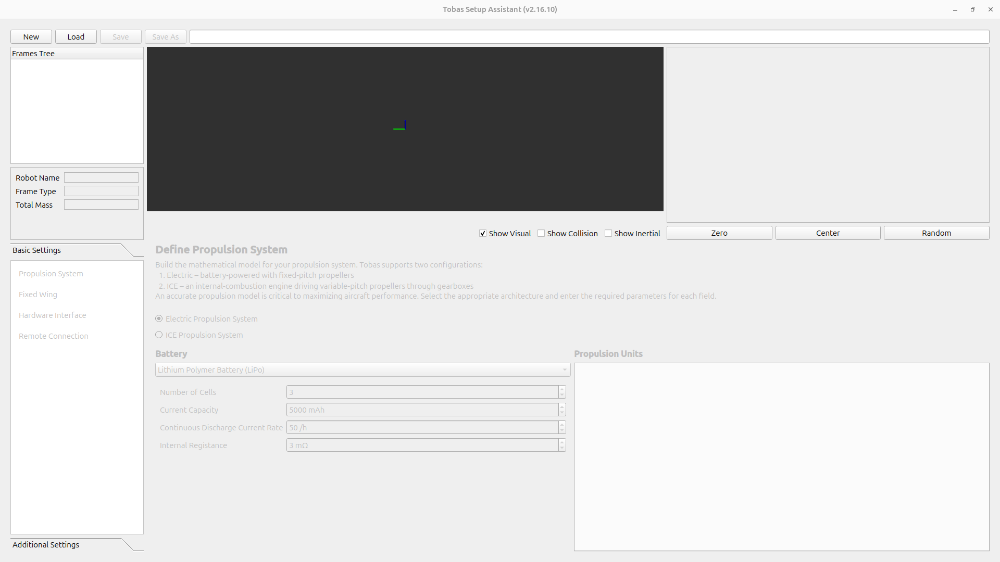
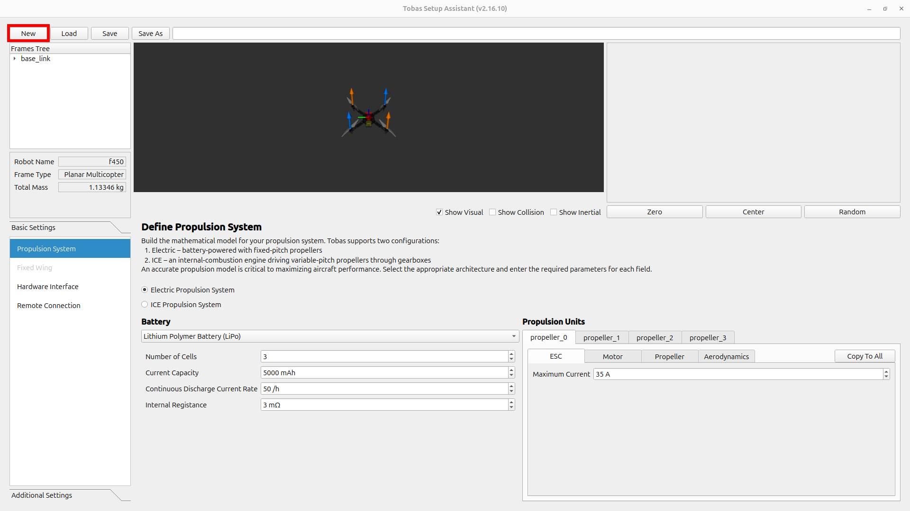
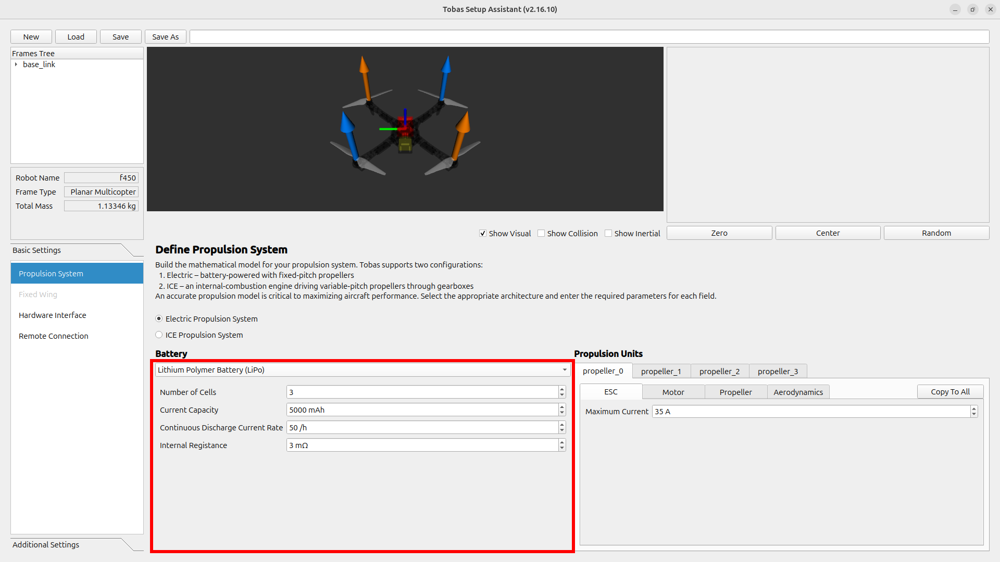
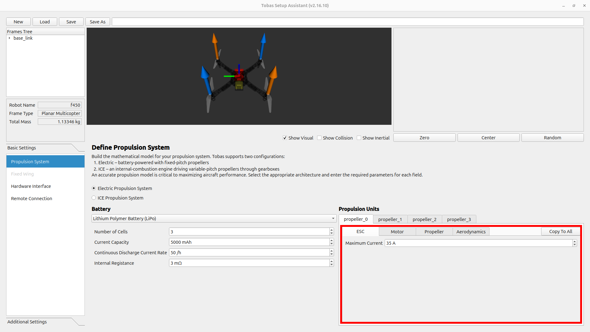
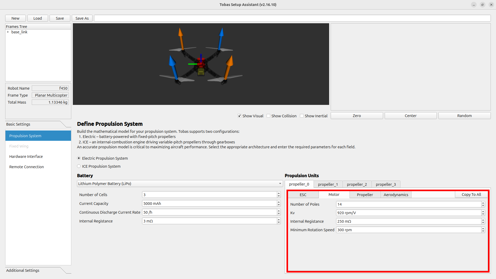
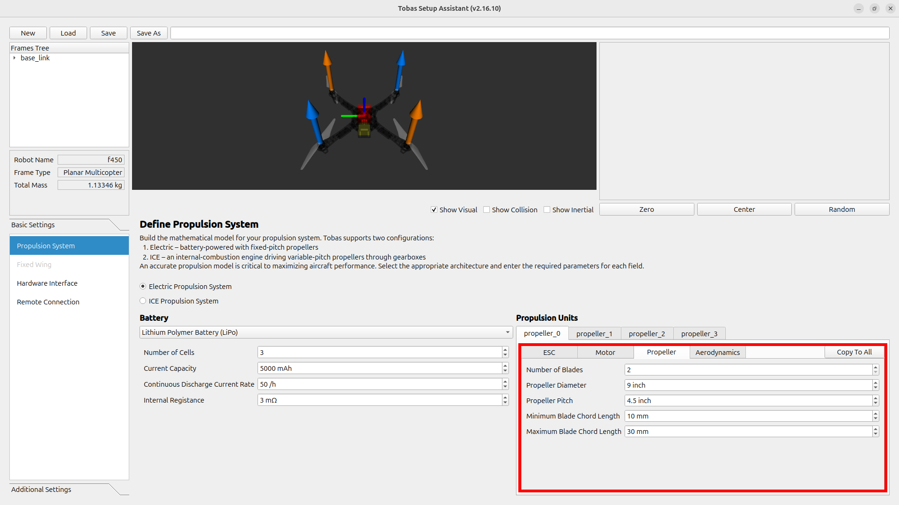
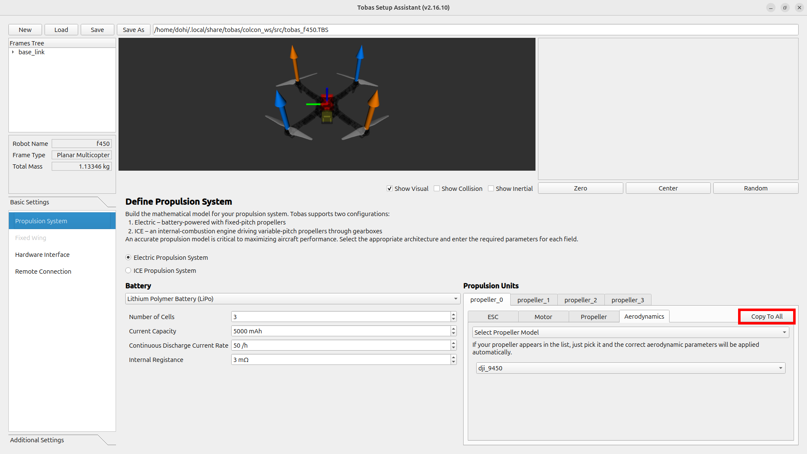
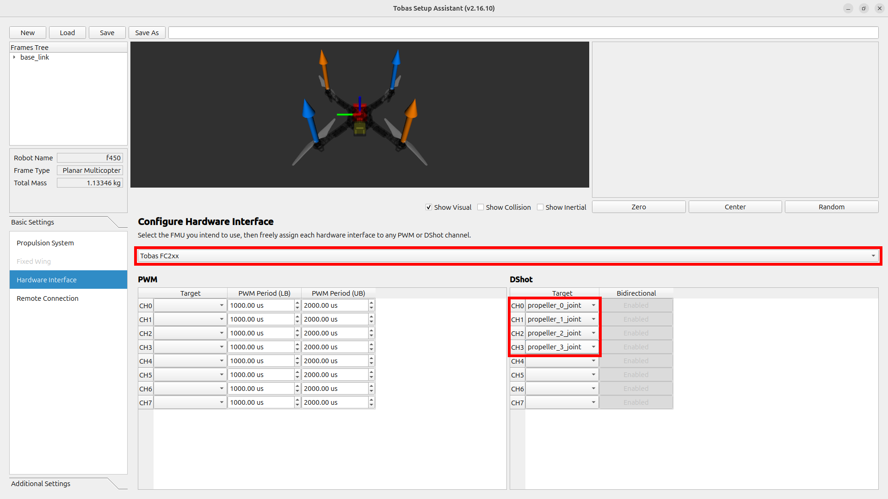
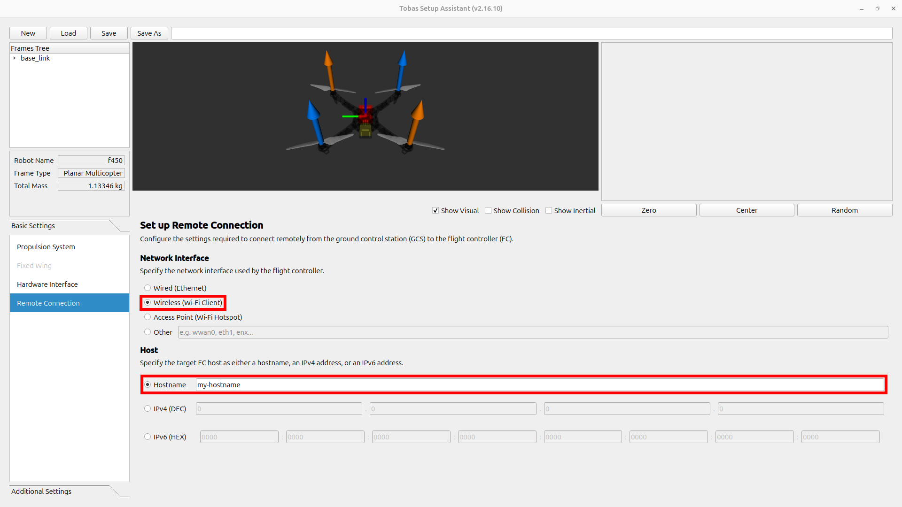
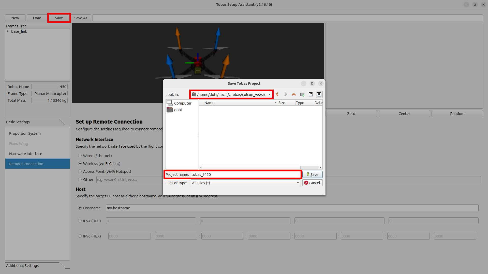

# Airframe Configuration

<!-- As with a game advertisement, making it easy to get started matters more than understanding everything at once. -->
<!-- Show the interesting parts first and leave the more involved tasks for later. -->

Use Tobas Setup Assistant to configure your aircraft.
Tobas Setup Assistant is a GUI for creating the project folder needed to fly a drone with Tobas.
The project folder contains all the information needed for flight, including aircraft mass properties, propeller aerodynamics, and motor electrical characteristics.
To use Tobas Setup Assistant, you need a Universal Aircraft Description Format (UADF) file describing your aircraft.
For details about UADF, see [What is UADF](../additional_information/what_is_uadf.md).

## **Preparation**

---

This tutorial uses a DJI F450, a conventional quadcopter.
Its components are:

- Flight controller: <a href=https://tobas.jp/product-fc201-jp target="_blank">Tobas FC201</a>
- Power module: <a href=https://tobas.jp/product-pm201-jp target="_blank">Tobas PM201</a>
- Frame: <a href=https://www.hawks-work.com/products/f450-drone-frame-450mm-wheelbase-quadcopter-frame-kit-with-landing-skid-gear target="_blank">DJI F450 Frame</a>
- Motors: <a href=https://www.hawks-work.com/products/a2212-brushless-motor-920kv-for-multirotor-drone-and-others target="_blank">A2212 920KV</a> (CW x 2, CCW x 2)
- Propellers: <a href=https://www.hawks-work.com/products/9450-propellers-self-tightening-cw-ccw-propeller-for-multirotor-f450 target="_blank">DJI 9450</a> (CW x 2, CCW x 2)
- ESC: <a href="https://www.fly-color.net/index.php?c=category&id=234" target="_blank">Flycolor Raptor5 35A</a> x 4
- Battery: <a href=https://hrb-power.com/products/11-1v-5000mah-6000mah-50c-trx target="_blank">HRB 3S 5000mAh 50C</a>
- GNSS antenna: <a href=https://www.topgnss.store/en-jp/products/top901-gnss-l1-l2-l5-unmanned-vehicle-high-precision-drone-measurement-full-frequency-rtk-antenna-new-small-high-gain-helical target="_blank">TOPGNSS TOP901</a>
- RC receiver: <a href=https://www.rc.futaba.co.jp/products/detail/I00000021 target="_blank">Futaba R2000SBM</a>

You normally need to create a UADF for your aircraft, but this tutorial uses one that is already provided.

## **Launching the Assistant**

---

Run the following commands in a terminal to launch Tobas Setup Assistant.

```bash
$ source /opt/ros/jazzy/setup.bash
$ ros2 launch tobas_setup_assistant setup_assistant.launch.py
```



## **Loading the UADF**

---

Click `New`, select `/opt/ros/jazzy/share/tobas_description/urdf/f450.uadf` in the file dialog, then click `Open`.
The aircraft appears in the model view and the configuration pages become available.



## **Propulsion System**

---

Configure the propulsion system.
Since this aircraft is electrically powered, leave `Electric Propulsion System` checked.

### **Battery**

Configure the battery.
Check the battery specifications and enter the appropriate values in each field.



### **Propulsion Units**

Configure each propulsion unit.

Start with the `propeller_0` link.
Check each component's specifications and enter the appropriate values under `ESC`, `Motor`, and `Propeller`.

<!-- prettier-ignore-start -->
!!! tip
    If you are unsure which propeller corresponds to a displayed link name,
    click the link name in the `Frame Tree` at the upper left to highlight it in the model view.
<!-- prettier-ignore-end -->







Use `Aerodynamics` to configure the propeller's aerodynamic characteristics.
Several configuration methods are available. For the DJI 9450 propeller used here, a predefined model is provided.
Select `Select Propeller Model` from the first list, then select `dji_9450` from the list below it.


All four propulsion units on this aircraft are identical, so click `Copy To All` to copy the `propeller_0` settings to the other three units.
Confirm that the `propeller_0` settings are reflected in the other tabs.



## **Hardware Interface**

---

Configure the hardware connections.
Make sure `Tobas FC2xx` is selected,
then assign the appropriate DShot channel to each of the four propulsion units.



<!-- prettier-ignore-start -->
!!! note
    If you do not specify an interface here, for example when using CAN ESCs,
    the hardware will not be driven by the default configuration.
    You will need to write your own ROS node to connect the hardware to the Tobas software.
<!-- prettier-ignore-end -->

## **Remote Connection**

---

Configure remote access from the ground station to the FC.

### **Network Interface**

Specify the network interface the FC uses to communicate with external devices.
This tutorial uses a portable Wi-Fi router for communication between the FC and GCS, so select `Wireless`.
Select `Wired` if you use wired Ethernet.
Select `Access Point` if you use the Raspberry Pi's built-in access point without an external communication module.
For other configurations, such as a VPN interface named `tun0`, select `Other` and enter the interface name directly.

### **Host**

Configure the address the GCS uses to identify the FC on the LAN.
You can use a static IP address directly if one is configured, but this tutorial uses a hostname for convenience.
Select `Hostname` and enter the FC hostname configured in [Boot Device Configuration](./bootmedia_config.md).



## **Saving the Project**

Click `Save` and save the project as `tobas_f450.TBS` under `~/.local/share/tobas/colcon_ws/src/` in the file dialog.



## **Next Steps**

---

Configuration is now complete.
Close Setup Assistant.
Next, assemble the aircraft and set up the hardware.
