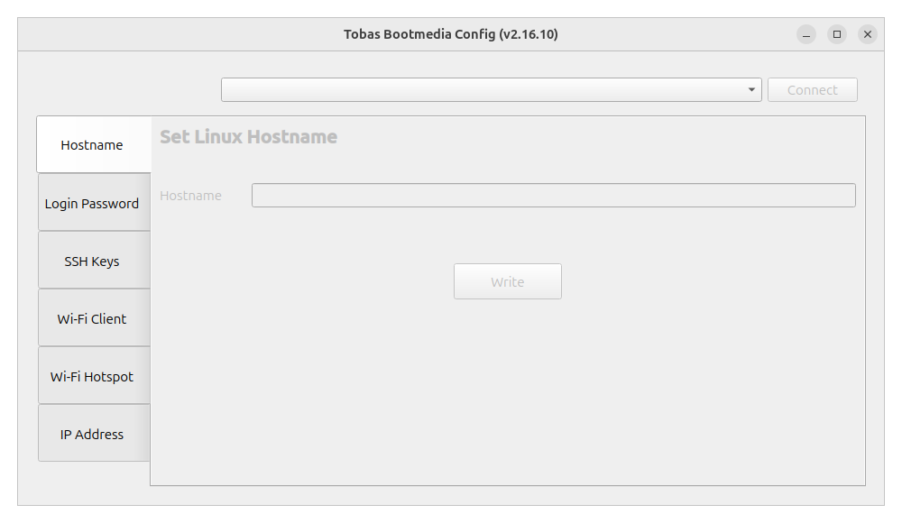
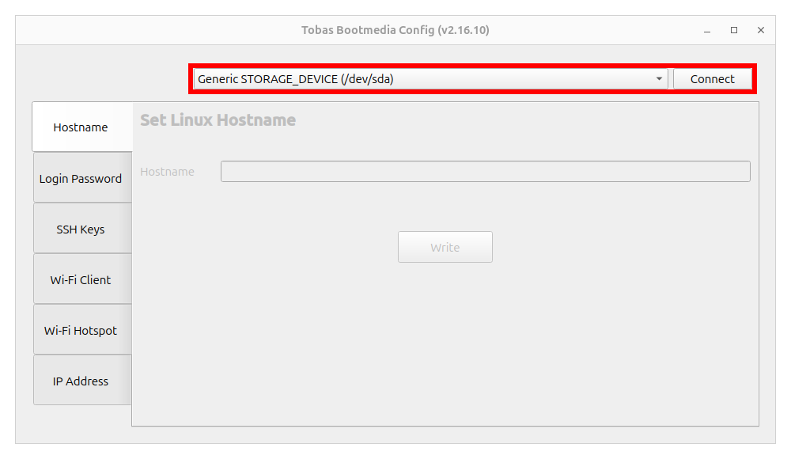
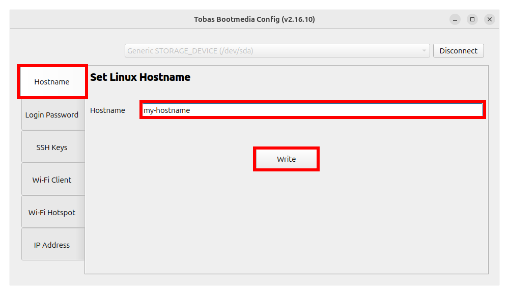
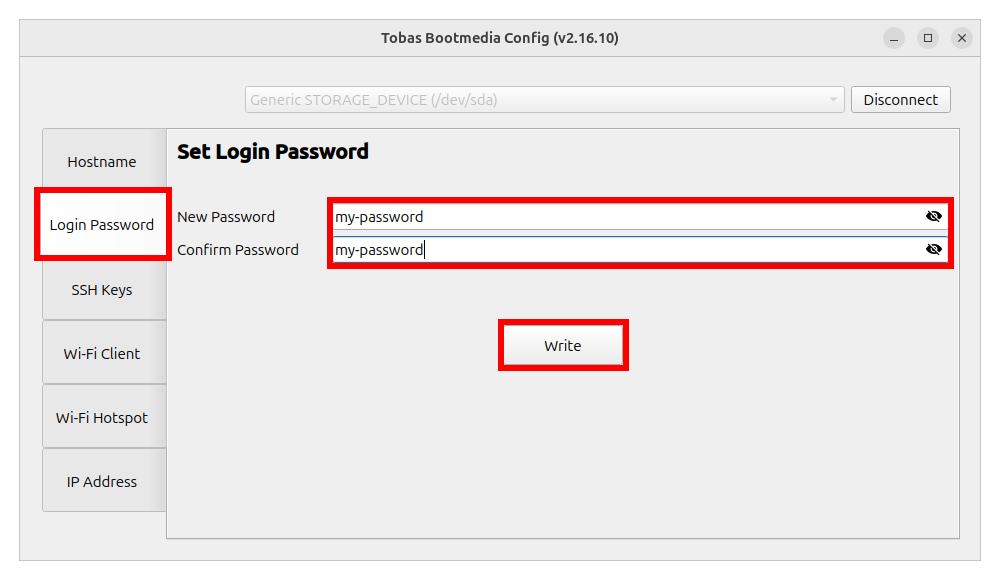
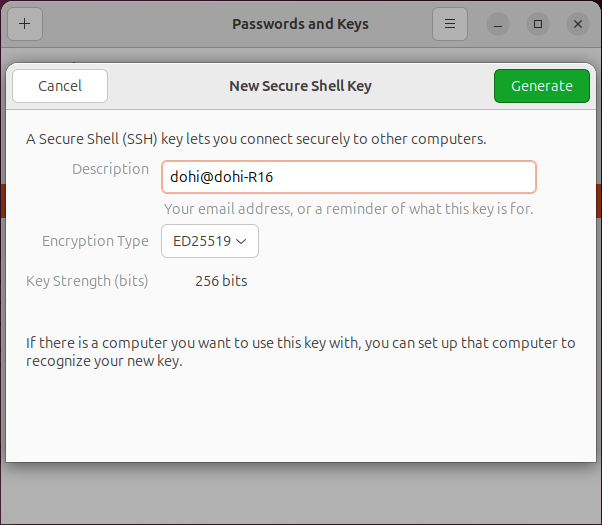
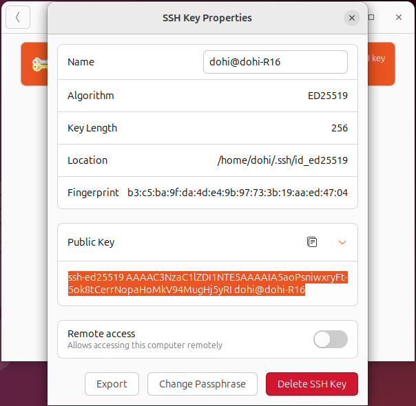
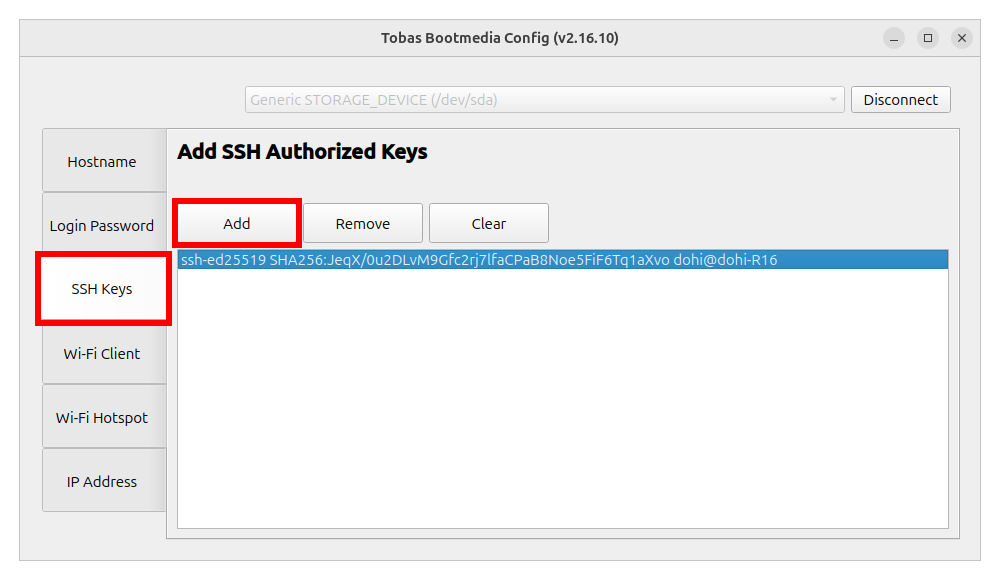
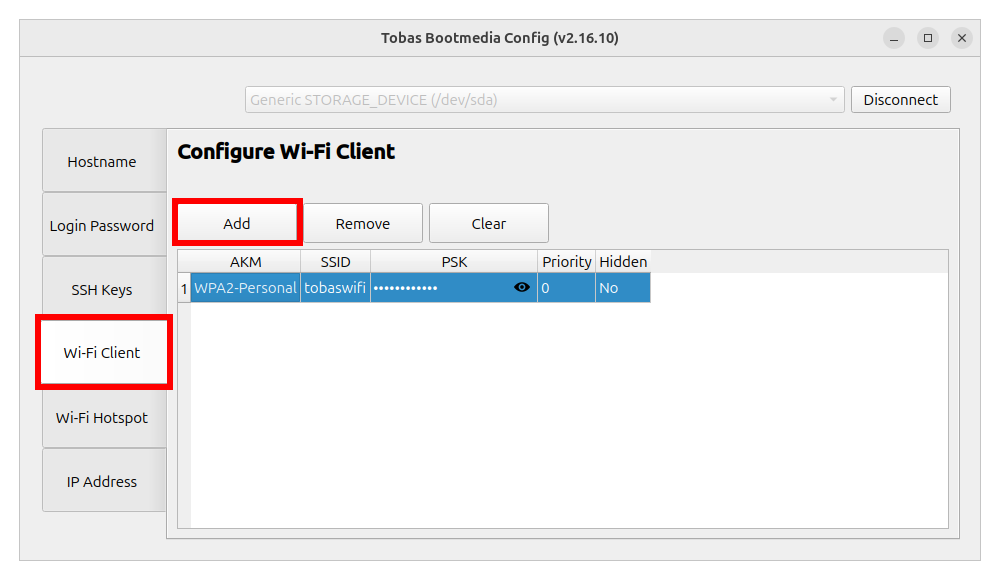
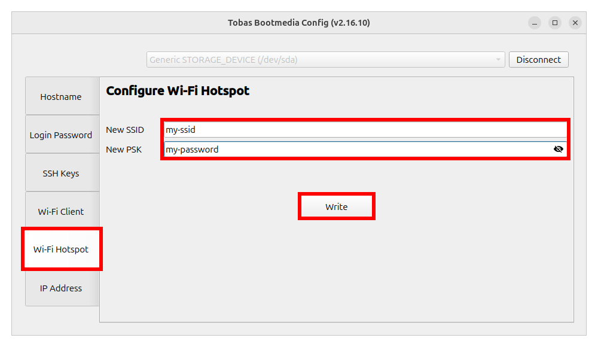
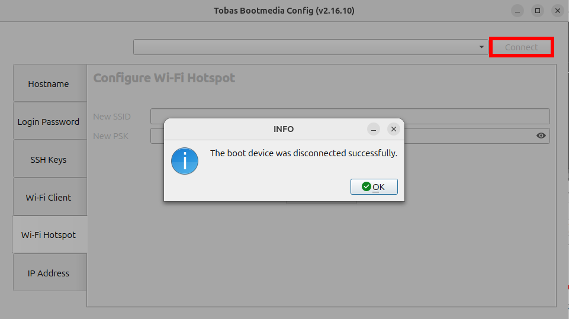

# Boot Device Configuration

First, configure the initial communication settings by editing the boot device directly.
Prepare the microSD card containing the Tobas image.

## **Preparation**

---

### **Launching the Configuration GUI**

Run the following command in a terminal to launch Tobas Bootmedia Config.
Root privileges are required to work with external volumes.

```bash
$ sudo bash -c 'source /opt/ros/jazzy/setup.bash && ros2 run tobas_bootmedia_config TobasBootmediaConfig'
```



### **Connecting to the Boot Device**

Insert the SD card into your PC using a suitable USB card reader.
If the Tobas image was flashed correctly, the SD card will be available in the selection list at the top of the GUI.

Make sure the correct SD card is selected, then click `Connect`.
The SD card will be mounted on your PC and the current settings will be loaded.



## **Configuration**

---

### **Hostname**

Edit the Linux hostname.

By default, Tobas uses hostnames to identify devices on the network,
so the hostname must be unique within the subnet you plan to use.
You can also use a static IP address, but keeping hostnames unique is a good precaution when operating multiple aircraft at once.

Edit the hostname and click `Write` to write the new hostname to the SD card.



### **Login Password**

Edit the login password.

The default password, `tobas`, will work,
but changing it is recommended for security.

Enter the login password in `New Password`, then enter it again in `Confirm Password`.
The `Write` button becomes available when both entries match and the password is valid.
Click `Write` to write the password to the SD card.



### **SSH Keys**

Configure SSH key authentication.

Tobas uses SSH key authentication for some operations from the ground station to the flight controller (FC),
so you need to register the public key of your ground station PC on the FC.

First, create an SSH key pair.
Run the following command in a terminal to launch `Passwords and Keys`.

```bash
$ seahorse
```

Click the `+` button in the upper left and select `Secure Shell key`.
In the dialog, enter an identifier such as `<username>@<hostname>` in `Description`, then click `Generate`.
Click `OK` in the next dialog to generate the SSH public and private keys. You can leave the password blank.
Click `OpenSSH keys` to confirm that the newly created key is listed.
Double-click the key, copy the `Public key` from the dialog, then close `Passwords and Keys`.

{ width="49%" }
{ width="49%" }

Return to `Tobas Bootmedia Config`, click `Add`, and paste the public key into the dialog.
Click `OK` to add the public key to the list and write it to the SD card.



### **Wi-Fi Client**

Configure the FC to operate as a Wi-Fi client.

Tobas uses ROS 2 (DDS) for remote communication,
so all devices that need to communicate, including the FC and ground station, must be on the same subnet.
You can skip this section if you only use Ethernet or operate the FC as an access point.

Click `Add` and enter the SSID and PSK of the access point you want to connect to in the dialog.
`Priority` determines the connection priority. When multiple networks are available, higher values take precedence.
Click `OK` to add the access point to the table and write it to the SD card.



### **Wi-Fi Hotspot**

Configure the FC to operate as a Wi-Fi access point.

As described above, the FC and ground station must be on the same subnet to communicate.
Using the FC itself as an access point is convenient for outdoor flight tests because it eliminates the need for an external router.
You can skip this section if the FC will only operate as a Wi-Fi client.

Enter your chosen SSID and PSK in `New SSID` and `New PSK`, respectively.
The `Write` button becomes available when both values are valid.
Click `Write` to write the SSID and PSK to the SD card.



## **Finishing Up**

---

Once configuration is complete, click `Disconnect`.
The boot device will be unmounted and can be safely removed.
Close the GUI and remove the SD card from your PC.



## **Next Steps**

---

Configuration is now complete.
Next, use Tobas Setup Assistant to create your first project.
