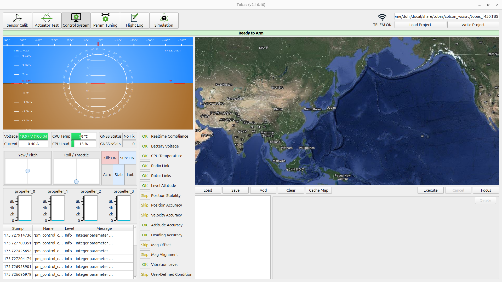
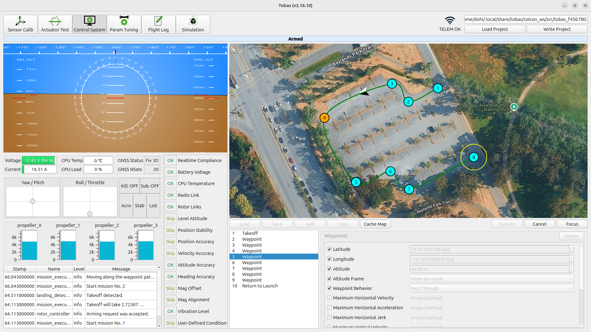
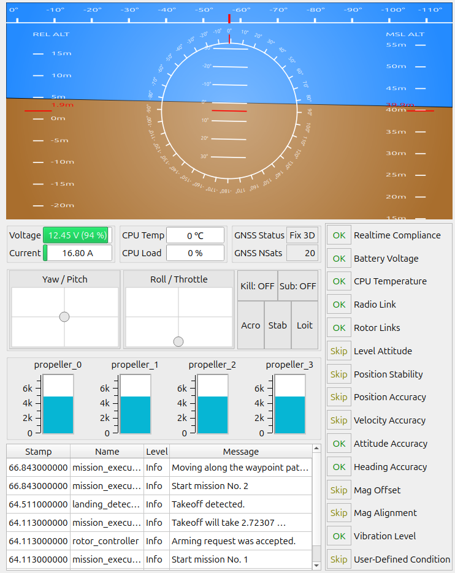
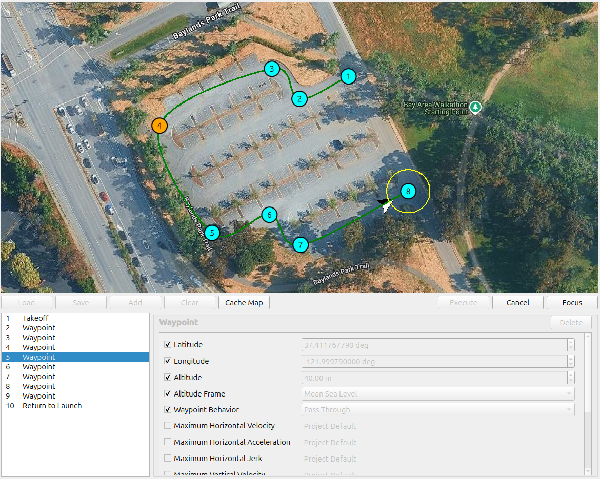
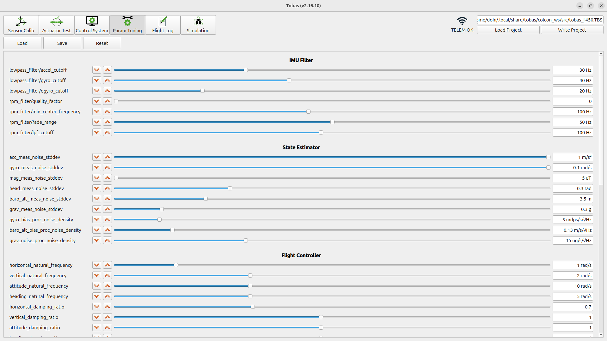
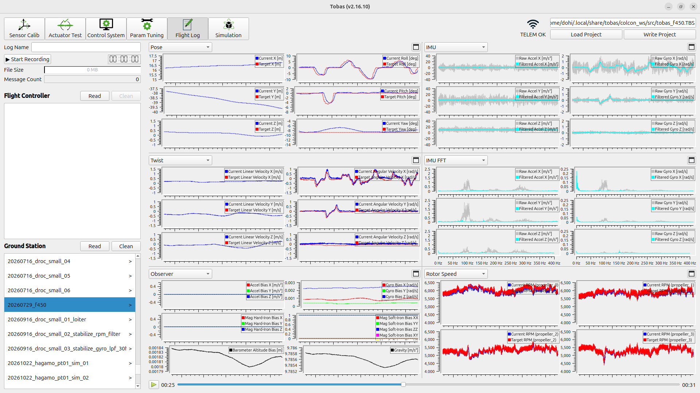

# Flight Test

## **Starting and Stopping**

---

### **Starting**

1. Connect power to the aircraft.
1. Launch Tobas GCS.
1. Click `Load Project` and load `tobas_f450.TBS`.
1. Click the `Control System` tool button to open it.
1. Make sure the pre-arm safety checks pass and `Ready to Arm` appears at the top of the window.
1. Turn on the RC transmitter, turn the `Enable` switch on, and turn the `Kill` switch off.
1. Select the flight mode using the transmitter switch. `Stabilize` (attitude control mode) is a safe choice to start with.
1. Hold the throttle stick down and the yaw stick to the right for one second to arm.
1. Once armed, center the yaw stick and gradually raise the throttle stick.

<iframe width="560" height="315" src="https://www.youtube.com/embed/sHoA8yKJPs4?si=CCOEPsu6z9hd7zOb" title="YouTube video player" frameborder="0" allow="accelerometer; autoplay; clipboard-write; encrypted-media; gyroscope; picture-in-picture; web-share" referrerpolicy="strict-origin-when-cross-origin" allowfullscreen></iframe>
 

<!-- prettier-ignore-start -->
!!! note
    In environments where GNSS is unavailable, such as indoors, the position and velocity checks cannot pass.
    You need to disable those checks in the Fail-Safe tab of Setup Assistant.
<!-- prettier-ignore-end -->

### **Stopping**

1. Hold the throttle stick down and the yaw stick to the left for one second to disarm.
   Alternatively, turn the `Kill` switch on to disarm immediately.
1. Turn off power to the aircraft, taking all necessary safety precautions.

The following sections describe the ground station's features.

## **Control System**

---

`Control System` is a tool for monitoring drone status and planning missions.

### **Status Monitoring**

The left side of the window displays the following status information:

- Position and attitude: roll, pitch, yaw, and altitude
- Battery status: voltage and current
- CPU status: temperature and load
- GNSS status: receiver status and satellite count
- RC input: sticks, kill switch, flight mode, and other switches
- Motor status: speed and communication status for each motor
- Pre-Arm Check: battery voltage, state estimation accuracy, and other checks
- Messages from each node

### **Mission Planning**

The right side of the window lets you plan and execute flight missions.

1. Click `Add` to add commands.
   The example below plans a mission that takes off, visits eight waypoints, returns to the takeoff point, and lands.
1. Set the parameters for each command in the dialog at the lower right.
   You can also change waypoint coordinates by dragging their icons on the map.
1. Click `Execute` to run the mission.

<!-- prettier-ignore-start -->
!!! note
    Always turn the transmitter's `Enable` switch off before executing a mission, because transmitter commands take priority when it is on.
<!-- prettier-ignore-end -->

## **Param Tuning**

---

`Param Tuning` is a tool for adjusting flight parameters online.

### **Procedure**

1. Click `Load` to read the current parameters from the FC.
1. Adjust parameters online using the increment/decrement buttons or sliders.
1. Click `Save` to save the current parameters to the project folder on your local PC.
1. After the flight, click `Write Project` to flash the saved parameters to the FC.

### **Main Parameters**

#### attitude_natural_frequency

This parameter controls the responsiveness of attitude control.
Higher values produce a faster response to the target attitude, but excessively high values make attitude control unstable.
Increase the value gradually while checking that no oscillations occur.
For this aircraft, the value could be increased to 25 rad/s.

#### heading_natural_frequency

This parameter controls the responsiveness of heading control.
Higher values produce a faster response to the target heading, but excessively high values make heading control unstable.
Increase the value gradually while checking that no oscillations occur.
The default value is used in this example.

#### horizontal_natural_frequency

This parameter controls the responsiveness of horizontal position control.
Higher values produce a faster response to the target position, but excessively high values make position control unstable.
Increase the value gradually while checking that no oscillations occur.
The default value is used in this example.

#### vertical_natural_frequency

This parameter controls the responsiveness of vertical position control.
Higher values produce a faster response to the target altitude, but excessively high values make altitude control unstable.
Increase the value gradually while checking that no oscillations occur.
The default value is used in this example.

#### lowpass_filter/gyro_cutoff

This is the cutoff frequency of the gyro sensor's low-pass filter.
Lower values suppress gyro noise more strongly, but excessively low values introduce signal delay that makes angular velocity control unstable.
Check the flight log (described below).
If **the target motor speed oscillates with an amplitude of 10% or more of the hovering speed**, the filtered angular velocity oscillations are too large; reduce this value.
The default value is used in this example.

<!-- prettier-ignore-start -->
!!! tip
    Some FMUs support an [RPM filter](../additional_information/rpm_filter.md) that efficiently attenuates propeller vibrations.
    You can configure it here in the same way as the parameters above.
    We recommend enabling this powerful feature.
<!-- prettier-ignore-end -->

## **Flight Log**

---

`Flight Log` is a tool for recording and replaying aircraft state data during flight.

### **Recording a Flight Log**

1. Enter a log name in `Log Name` (e.g., 20260101_f450_hover).
1. Click `Start Recording` to start recording the log.
1. Click `Stop Recording` to stop recording.

### **Viewing a Flight Log**

1. Click the `Read` buttons on the FC and PC sides to display the logs stored on each.
1. Click `Download` to the right of a log name in the FC list to download that log to your PC.
1. Click a log name in the PC list to plot the recorded data on the right.
1. Use the play/stop buttons and slider at the lower right to change the displayed log time.
