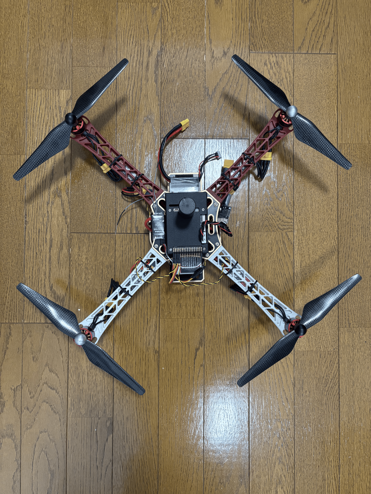
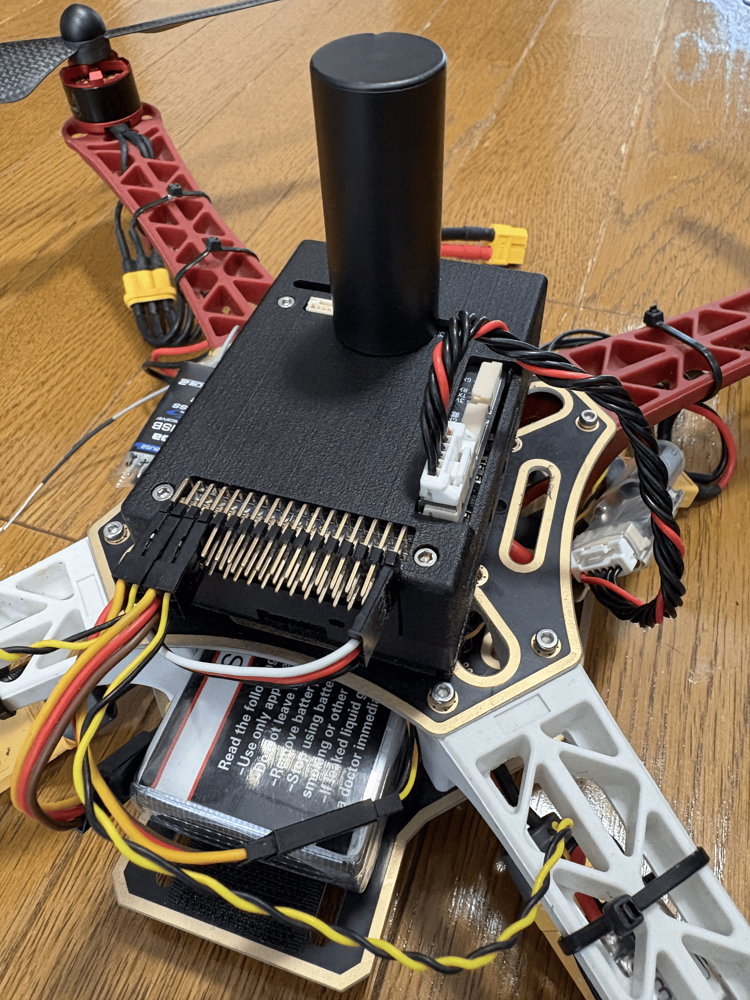
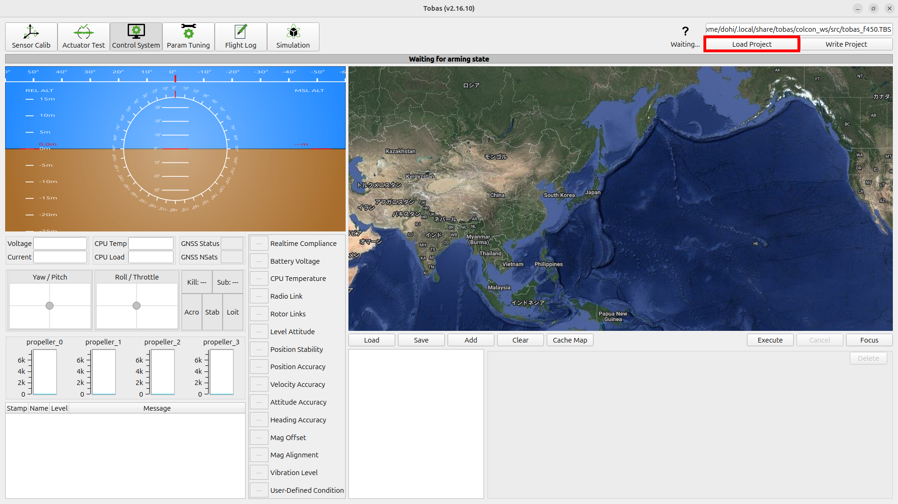
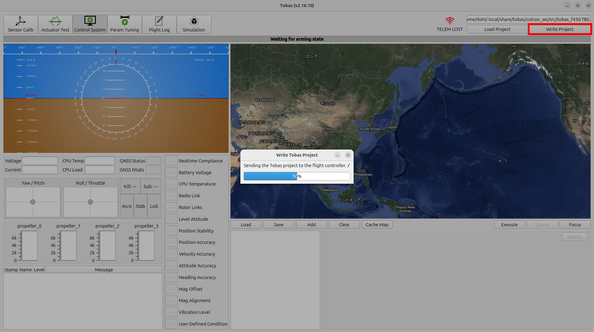
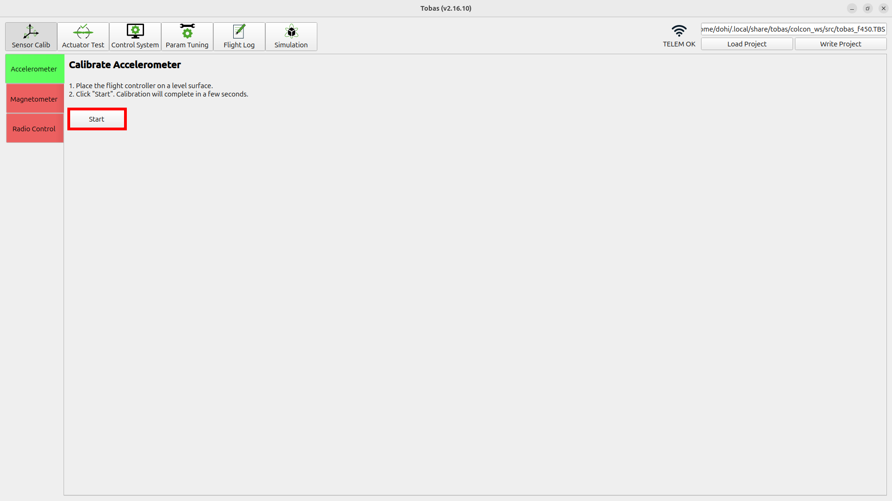
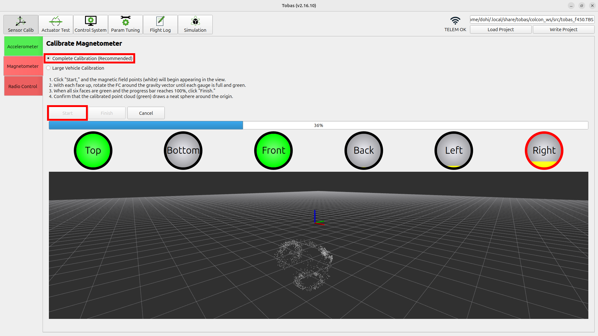
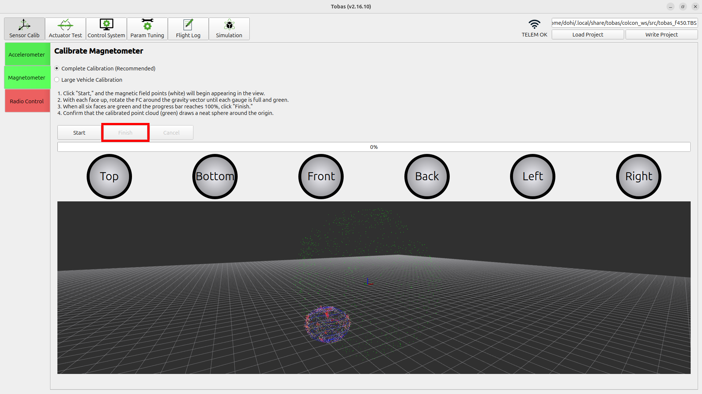
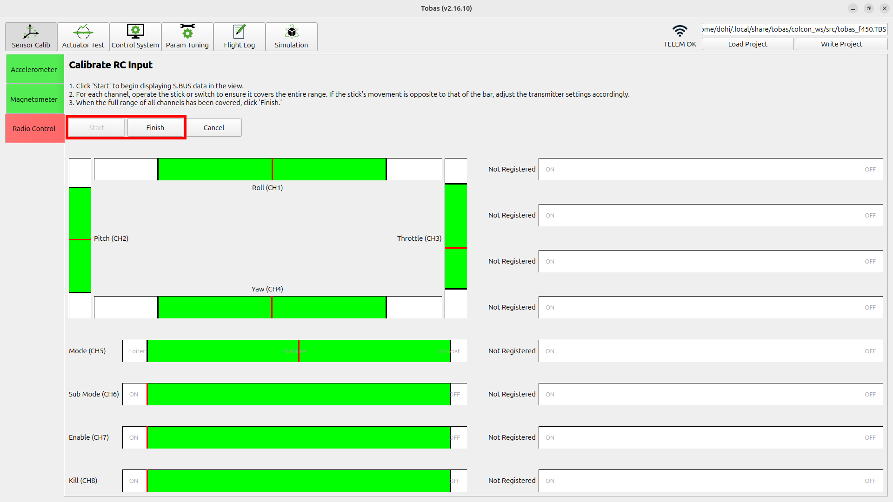
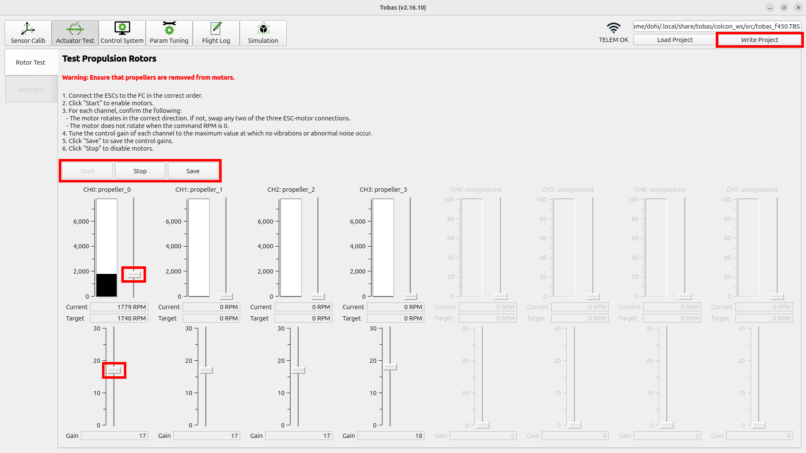

# Hardware Setup

## **Assembling the Aircraft**

---

Assemble the aircraft according to the configuration you created in Setup Assistant.

<!-- TODO: Add detailed instructions like the Navio2 guide. -->
<!-- cf. https://docs.emlid.com/navio2/hardware-setup/ -->
<!-- cf. https://docs.emlid.com/navio2/ardupilot/typical-setup-schemes/ -->

{ width="49%" }
{ width="49%" }

<!-- prettier-ignore-start -->
!!! note
    Always provide at least basic vibration isolation when mounting the flight controller on the aircraft.
    An overly rigid mount can transmit motor and propeller vibrations to the accelerometer, reducing attitude estimation accuracy.
    An overly soft mount can delay the gyro response and cause oscillations in angular velocity control.
    For easy-to-use mounting materials, we recommend
    <a href=https://holybro.com/products/foam-pads-20pcs target="_blank">Holybro Foam Pads</a> or
    <a href=https://rc.kyosho.com/ja/z8006b.html target="_blank">Kyosho Z8006B</a>.
<!-- prettier-ignore-end -->

## **RC Transmitter Configuration**

---

The S.BUS signal is expected to provide at least eight channels.
Tobas assigns the following roles to the RC input channels:

| Channel | Role            | Interface             |
| :------ | :-------------- | :-------------------- |
| CH1     | Roll            | Stick                 |
| CH2     | Pitch           | Stick                 |
| CH3     | Throttle        | Stick                 |
| CH4     | Yaw             | Stick                 |
| CH5     | Flight mode     | Three-position switch |
| CH6     | Sub-flight mode | Two-position switch   |
| CH7     | Enable/disable  | Two-position switch   |
| CH8     | Kill            | Two-position switch   |
| CH9-16  | GPSw            | Two-position switch   |

<br>

The sub-flight mode switch selects more specific modes within certain flight modes.
It is used when the four basic stick axes do not provide enough command degrees of freedom, such as when switching modes on aircraft capable of controlling five or more axes simultaneously.
GPSw (General Purpose Switch) channels are freely available for user-defined purposes.
You can set their number in Setup Assistant to suit your transmitter, receiver, and application.

<a href=https://www.rc.futaba.co.jp/products/detail/I00000006 target="_blank">Futaba T10J</a>
has fixed assignments for channels 1 through 4 as shown in the table above,
while switches can be freely assigned to channels 5 and above.
Hold the transmitter's `+` button to open the menu, then select `AUX Channel`.
The following assignments are used in this tutorial.

| Channel | Switch |
| :------ | :----- |
| CH5     | SwE    |
| CH6     | SwG    |
| CH7     | SwA    |
| CH8     | SwC    |
| CH9     | NULL   |
| CH10    | NULL   |

<br>

When using a Futaba transmitter, you also need to reverse the throttle stick.
Hold the transmitter's `+` button to open the menu, then select `Reverse`.
Set only the throttle stick (`THR`) to reverse (`REV`).

## **Loading and Writing the Tobas Project**

---

Connect your ground station PC to the same network as the FC.
If you configured multiple networks in [Boot Device Configuration](./bootmedia_config.md),
remember that the available network with the highest priority is selected.

Run the following commands in a terminal to launch Tobas GCS.

```bash
$ source /opt/ros/jazzy/setup.bash
$ RMW_IMPLEMENTATION=rmw_cyclonedds_cpp ros2 launch tobas_gcs gcs.launch.py
```


Click `Load Project`, then double-click the `tobas_f450.TBS` project created in Setup Assistant to load it.



Click `Write Project` to send the project to the FC and build it there. This takes a few minutes.



## **Sensor Calibration**

Calibrate each sensor.
Click `Sensor Calib` among the tool buttons at the top of the window.

---

### **Accelerometer Calibration**

Calibrate the accelerometer.
Place the aircraft on a level surface and click `Start`.
Calibration completes in a few seconds, and the tab changes from red to green shortly afterward.



### **Magnetometer Calibration**

Calibrate the magnetometer.
The magnetometer is strongly affected by its surroundings, so perform calibration with the FC mounted on the aircraft.
Preferably, choose an area free of magnetic materials such as steel reinforcement.

1. Click `Start` to begin displaying magnetometer readings as a white point cloud.
1. For each of the FC's six faces, hold that face upward and slowly rotate the aircraft about the vertical axis.
   Calibration is complete when the progress bar reaches 100%.
1. Click `Finish` when done. The estimated ellipsoid is shown in blue, and the corrected point cloud is shown in green.
   Calibration is successful if the blue ellipsoid overlaps the white point cloud and the green point cloud forms a sphere around the origin.




### **Radio Calibration**

Calibrate the radio input (S.BUS).

1. Click `Start` to begin displaying the values of each S.BUS channel.
1. Move each stick or switch through its full operating range.
   If a stick and its GUI bar move in opposite directions, adjust the transmitter settings accordingly.
1. Click `Finish` when done.



## **Actuator Test**

Test each actuator.
Click `Actuator Test` among the tool buttons at the top of the window.

---

### **Rotor Test**

<span style="color: red;"><strong>Warning: This operation spins the motors. Use extreme caution if you perform it with propellers attached.</strong></span>



1. Click `Start` to enable all motors to spin.
1. For each motor, move the slider to command its speed and verify that the connection and rotation direction are correct.
1. Tune each motor's control gain.
   Increase the gains one at a time while changing the target speed and checking that no oscillations occur.
   In this example, all gains are set to 17.
1. Click `Save` to save the control gains to the project on your PC.
1. Click `Stop` to end the test.
1. Click `Write Project` to flash the saved control gains to the FC.

<!-- prettier-ignore-start -->
!!! note
    If the motors do not spin, check whether the `ERR` indicator on the top of the FC is lit.
    If it is lit, try turning the power off and then back on.
<!-- prettier-ignore-end -->

### **Joint Test**

If your aircraft has actuated joints, such as tilt rotors or fixed-wing control surfaces, you can test position commands for each joint.
The aircraft in this tutorial has no movable joints other than the propellers, so skip this step.

## **Next Steps**

---

Hardware setup is now complete.
Close Tobas GCS and turn off the aircraft.
In the next step, you will fly the aircraft.
