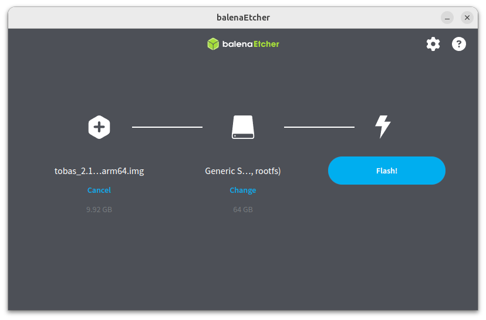

# Installation

## **Installing Tobas on Your PC**

---

### **Installing ROS 2 Jazzy**

Follow the <a href=https://docs.ros.org/en/jazzy/Installation/Ubuntu-Install-Debs.html target="_blank">official ROS 2 Jazzy instructions</a>
to install ROS 2.
This guide uses `ros-jazzy-desktop`.

### **Installing Tobas**

Install Tobas from the ROS 2 apt repository.

```bash
$ sudo apt update
$ sudo apt install ros-jazzy-tobas
```

## **Flashing the Flight Controller Image**

---

### **What You Need**

- <a href=https://www.raspberrypi.com/products/raspberry-pi-5/ target="_blank">Raspberry Pi 5 (2 GB or more)</a>
- A microSD card with at least 16 GB (e.g., <a href=https://www.sandisk.com/products/memory-cards/microsd-cards/sandisk-extreme-uhs-i-microsd target="_blank">SanDisk Extreme microSDXC™ UHS-I CARD - 32GB</a>)
- An SD card reader (e.g., <a href=https://www.sandisk.com/products/accessories/memory-card-readers/sandisk-quickflow-microsd-memory-card-reader-usb-c target="_blank">SANDISK QuickFlow microSD Card Reader with USB-C</a>)

### **Procedure**

Download the <a href=https://drive.google.com/file/d/1z0_PBSmW7GaoakMl81ZoP50CtI2rSmT-/view target="_blank">Tobas image file</a>
before proceeding.

Install an image flashing tool. For example, you can use:

- <a href=https://etcher.balena.io/ target="_blank">balenaEtcher</a>
- <a href=https://www.raspberrypi.com/software/ target="_blank">Raspberry Pi Imager</a>

Connect the SD card to your PC using the card reader.

Launch the flashing tool, select the downloaded image and the target SD card, and start flashing.
The following screenshot shows balenaEtcher.



Once flashing completes successfully, remove the SD card from your PC.

## **Next Steps**

---

Installation is now complete.
We recommend restarting your PC before proceeding so that the changes made during installation take effect.
Next, use Tobas Bootmedia Config to configure the initial settings before booting.
