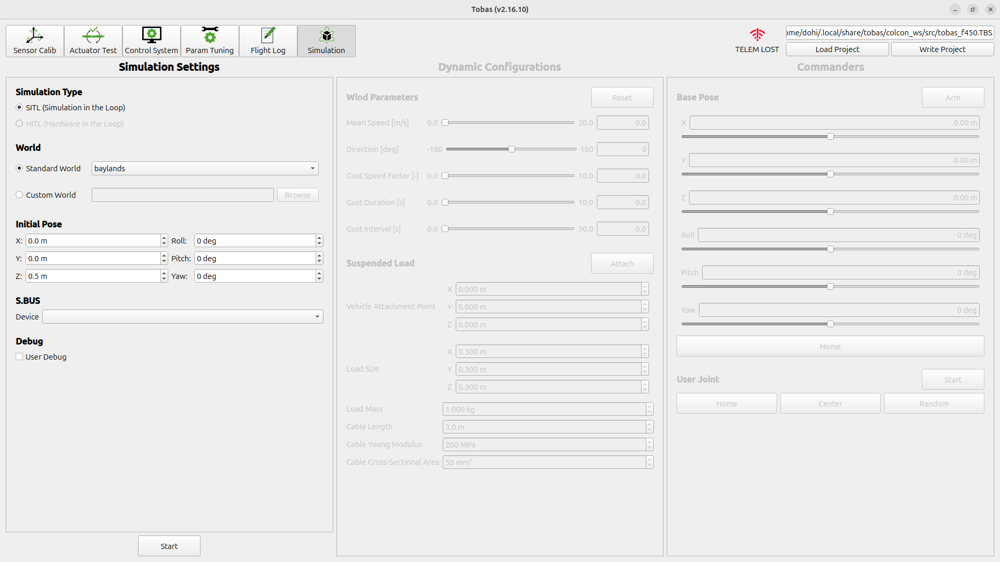
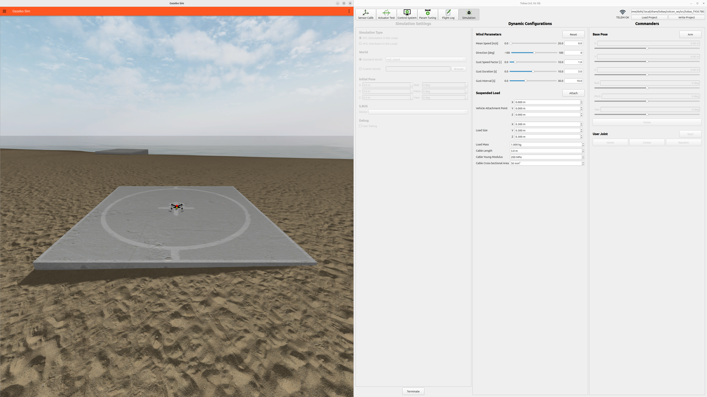
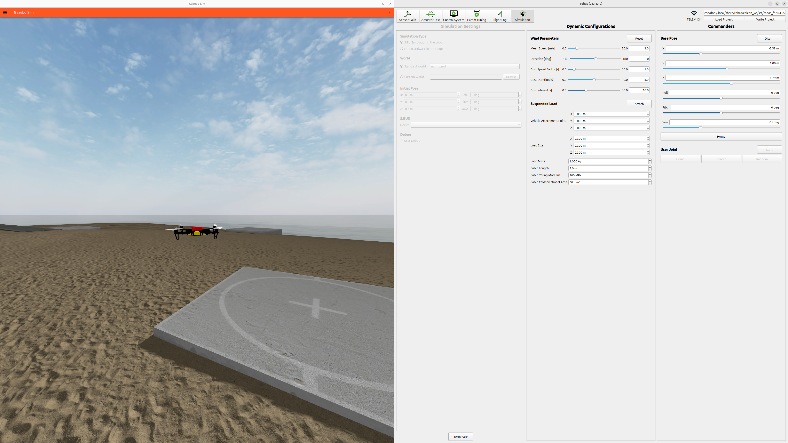
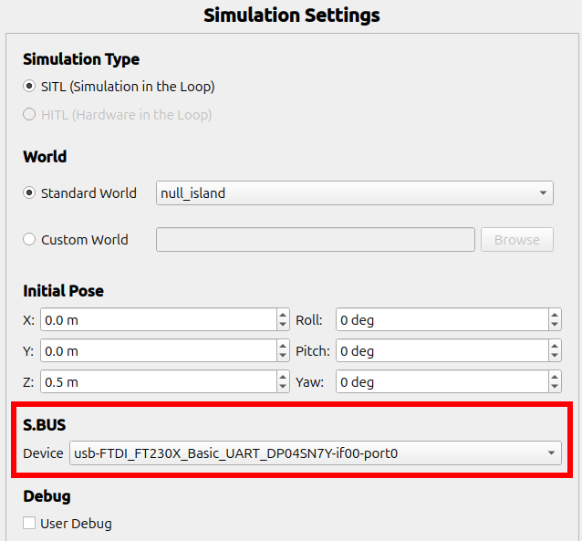

# Simulation

## **Starting and Stopping**

---

Launch Tobas GCS, load `tobas_f450.TBS`, and open `Simulation` from the tool buttons.



Click `Start` to build the project and launch the simulation.
The first launch takes longer because environment data needs to be downloaded.
Startup time depends on the complexity of the environment and your network connection, but it usually takes no more than 10 minutes.



Use `Dynamic Configurations` to adjust environmental settings such as wind speed, and `Commanders` to send commands to the aircraft.
You can also use mission planning, parameter tuning, and the other features introduced in [Flight Test](./flight_test.md), just as with real hardware.



Click `Terminate` to stop the simulation.

## **Control with an RC Transmitter**

---

You can control the simulated aircraft with an RC transmitter.
The simulation uses the RC calibration results saved on your PC,
so complete calibration on that PC before proceeding.

### **Preparing a USB-to-Serial Module**

<a href=https://akizukidenshi.com/catalog/g/g108461/ target="_blank">FTDI FT234X</a>
is one example of a suitable USB-to-serial module. Configure the module to invert the signal's high and low levels.

### **Joining the `dialout` Group**

To access USB serial devices, add your current user to the `dialout` group with the following command.

```bash
$ sudo usermod -aG dialout "${USER}"
```

Restart your PC after running the command for the change to take effect.
You only need to do this once.

### **Steps for Each Simulation Run**

1. Connect the USB-to-serial module to your PC and RC receiver.
1. Select your device in the `S.BUS/Device` field under `Simulation Settings`.
1. Start the simulation. If transmitter signals appear in `Control System`, setup is successful and you can control the aircraft just as you would with real hardware.



## **Control via ROS**

---

All communication between the flight controller's components uses ROS,
so you can control the aircraft from your own programs.
See [User Code (Python)](../for_developers/user_code_py.md) and [User Code (C++)](../for_developers/user_code_cpp.md) for details.
