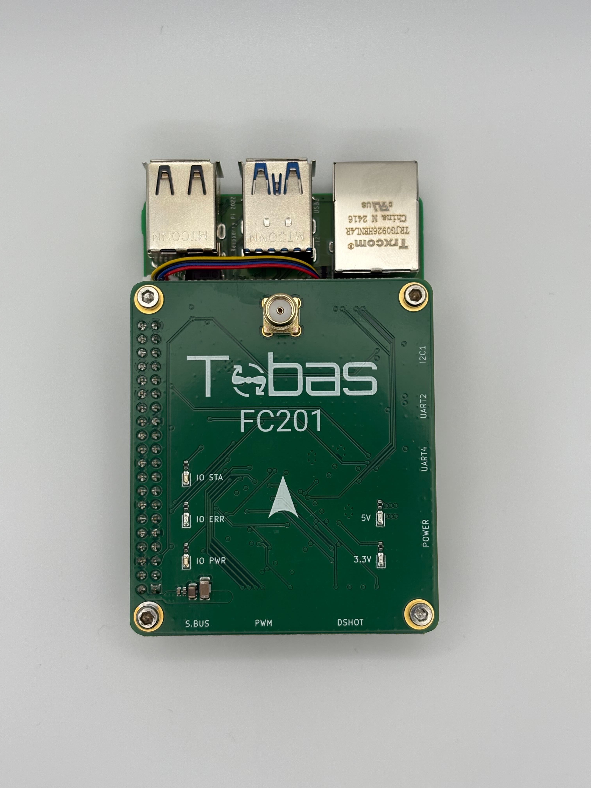
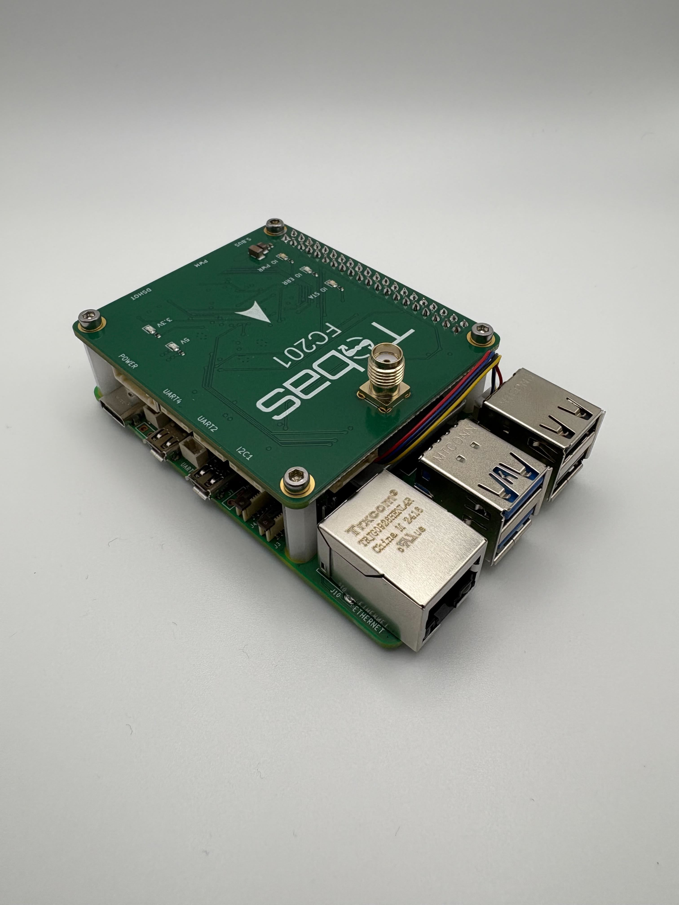

# Tobas User Guide

Tobas is a flight controller for drones and robotic aircraft, built on model-based design and Linux.
Its control system is designed with detailed consideration of each aircraft's structure,
enabling precise flight even for aircraft that are difficult to control with conventional flight controllers.

## **Features**

---

- Define the aircraft structure in a dedicated format so the controller accurately accounts for it
- Improve responsiveness and tracking accuracy through motor speed control
- Compensate for gravity loads and reaction forces as movable joint angles change
- Compensate for disturbances such as gusts and ground effect
- Configure the aircraft and control parameters through a GUI
- Support ROS 2 with the same interface for simulation and real hardware

## **Capabilities**

---

### **Improved Control Performance**

Tobas makes accurate use of your aircraft's physical properties in its control system,
allowing it to deliver better control performance than conventional flight controllers.
For example, it takes the following information into account:

- Mechanical parameters of each rigid link in the aircraft: mass, center of mass, and inertia tensor
- Battery specifications: cell count, discharge capacity, and discharge rate
- Motor specifications: KV rating, internal resistance, and number of magnetic poles
- Propeller specifications: diameter, pitch, thrust coefficient, and reaction torque coefficient

### **More Aircraft Design Options**

Tobas defines aircraft structures using [UADF (Universal Aircraft Description Format)](./additional_information/what_is_uadf.md),
allowing a wide range of aircraft that are difficult to fly with conventional flight controllers.
For example, Tobas supports unconventional configurations such as:

- Aircraft with a center of mass significantly offset by a payload
- Aircraft with asymmetrically arranged propellers to keep the camera's field of view clear
- Aircraft equipped with robotic arms
- Aircraft equipped with tilt rotors

### **Less Gain Tuning**

Accurate aircraft modeling allows the translational and rotational dynamics to be expressed in an aircraft-independent form and analyzed in advance.
This allows Tobas to provide conservative default gains, so users can generally fly without tuning gains themselves.
All parameters can also be adjusted online during flight if necessary.

### **Realistic Simulation**

Accounting for aircraft mass properties and propulsion aerodynamics enables realistic physics simulation.
This can significantly reduce the cost of testing with real hardware.

You can easily simulate factors that strongly affect flight, such as:

- Wind (steady wind, turbulence, and gusts)
- Battery voltage drop
- ESC current limits
- Sensor delays and noise
- Suspended payloads

## **Flight Management Unit (FMU)**

### **Tobas FC201**

{ width="49%" }
{ width="49%" }

#### Sensors & Processors

- 6-axis IMU: <a href=https://www.st.com/ja/mems-and-sensors/ism330dlc.html target="_blank">ISM330DLC | STMicroelectronics</a>
- Magnetometer: <a href=https://www.st.com/ja/mems-and-sensors/iis2mdc.html target="_blank">IIS2MDC | STMicroelectronics</a>
- Barometer: <a href=https://www.st.com/ja/mems-and-sensors/ilps22qs.html target="_blank">ILPS22QS | STMicroelectronics</a>
- GNSS Receiver: <a href=https://www.u-blox.com/en/product/zed-f9p-module target="_blank">ZED-F9P | u-blox</a>
- Voltage/Current Sensor: <a href=https://www.ti.com/product/ja-jp/INA228 target="_blank">INA228 | Texas Instruments</a>
- Main Computer: <a href=https://www.raspberrypi.com/products/raspberry-pi-5 target="_blank">Raspberry Pi 5</a>
- I/O Controller: <a href=https://www.st.com/ja/microcontrollers-microprocessors/stm32h7a3-7b3.html target="_blank">STM32H7A3 | STMicroelectronics</a>

#### Interface

- GNSS Antenna: SMA
- Power Module: Molex 2.0mm 6pin
- UART, I2C Interface: JST-GH 4pin

## **Examples**

---

### **Quadcopter**

A conventional quadcopter
built with a DJI F450 frame kit.

<iframe width="560" height="315" src="https://www.youtube.com/embed/sHoA8yKJPs4?si=CCOEPsu6z9hd7zOb" title="YouTube video player" frameborder="0" allow="accelerometer; autoplay; clipboard-write; encrypted-media; gyroscope; picture-in-picture; web-share" referrerpolicy="strict-origin-when-cross-origin" allowfullscreen></iframe>
 

### **Hexacopter with Noncoplanar Rotors**

A hexacopter with all propellers tilted 30 degrees from the horizontal plane.
While multicopters with coplanar rotors must change attitude to change position,
multicopters with noncoplanar rotors can control position and attitude independently.
They can therefore translate while remaining level, or change attitude while hovering.
They can also generate horizontal thrust directly, providing high positioning accuracy and strong wind resistance.

<iframe width="560" height="315" src="https://www.youtube.com/embed/1RIXLGmx1RA?si=ADkOlZsAMb1tHyNr" title="YouTube video player" frameborder="0" allow="accelerometer; autoplay; clipboard-write; encrypted-media; gyroscope; picture-in-picture; web-share" allowfullscreen></iframe>
 

### **Active-Tilt Hexacopter**

A hexacopter whose arms can each rotate 120 degrees in either direction.
It can make large attitude changes while hovering.
Mounted equipment can be held at any attitude, making it a promising platform for applications such as nondestructive inspection of inclined walls.

<iframe width="560" height="315" src="https://www.youtube.com/embed/UYwoFjf6ubc?si=RsDKgr98DVvdhaWB" title="YouTube video player" frameborder="0" allow="accelerometer; autoplay; clipboard-write; encrypted-media; gyroscope; picture-in-picture; web-share" referrerpolicy="strict-origin-when-cross-origin" allowfullscreen></iframe>
 

### **Drone with a Robotic Arm**

A tilt hexacopter equipped with a four-axis robotic arm.
By dynamically compensating for reaction forces and changes in the center of mass caused by the arm,
it keeps its position and attitude within a limited range even during large arm movements.

<iframe width="560" height="315" src="https://www.youtube.com/embed/3peWIltNV3o?si=OLdfuQGEHEI1L_N-" title="YouTube video player" frameborder="0" allow="accelerometer; autoplay; clipboard-write; encrypted-media; gyroscope; picture-in-picture; web-share" referrerpolicy="strict-origin-when-cross-origin" allowfullscreen></iframe>

## **System Requirements**

---

### **PC** <!-- cf. https://www.solidworks.com/ja/support/system-requirements -->

The following requirements must be met.

| Requirement        | Required                       | Recommended        | Notes                           |
| :----------------- | :----------------------------- | ------------------ | ------------------------------- |
| OS                 | Ubuntu 24.04 LTS (ROS 2 Jazzy) |                    | Native installation recommended |
| RAM                | 8GB                            | 16GB               |                                 |
| CPU                | AMD64 (x86-64)                 |                    |                                 |
| GPU                |                                | NVIDIA GeForce RTX |                                 |
| Display resolution | FHD (1080p)                    | 4K UHD (2160p)     |                                 |

 

### **ESC**

The ESC must support the Bidirectional DShot protocol.
Examples of compatible firmware include:

- <a href=https://github.com/bitdump/BLHeli/tree/master/BLHeli_32%20ARM target="_blank">BLHeli_32</a> (support ended in June 2024)
- <a href=https://github.com/AlkaMotors/AM32-MultiRotor-ESC-firmware target="_blank">AM32</a>
- <a href=https://github.com/bird-sanctuary/bluejay target="_blank">bluejay</a>

### **GNSS Antenna**

The antenna must match the frequency bands and connector of the GNSS receiver on the FMU.

### **RC Receiver**

The receiver must support S.BUS with at least eight channels.
