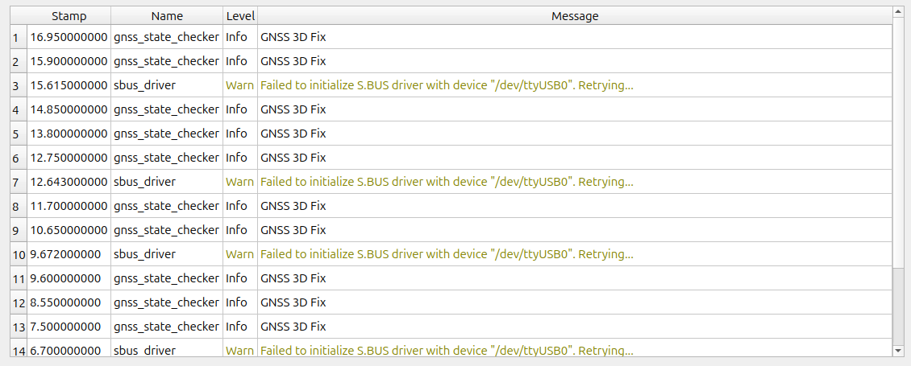
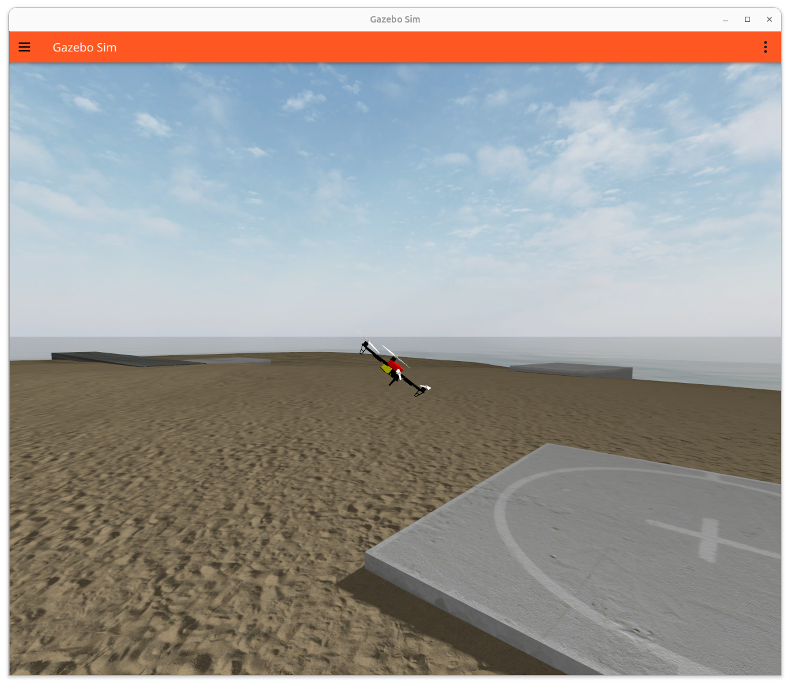
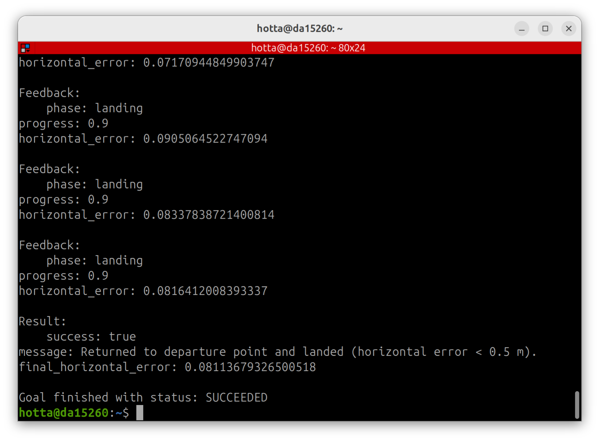

# ユーザコード (C++)

ここでは，ユーザが C++ と ROS 2 の基礎を習得していることを前提にしています．
ROS 2 の学習には
<a href=https://docs.ros.org/en/jazzy/Tutorials.html target="_blank">Tutorials | ROS 2 Documentation</a>
をご参照ください．

Setup Assistant で作成した Tobas プロジェクト (例: tobas_f450.TBS) に含まれる ROS パッケージのうち，
ユーザ C++ パッケージ (例: tobas_f450_user_cpp) はユーザが自由に編集できる C++ パッケージです．
以下の 5 つの launch ファイルが含まれます．

- `common_(interface/realtime).launch.py`: 実機とシミュレーションの両方で起動されます．
- `real_(interface/realtime).launch.py`: 実機でのみ起動されます．
- `gazebo.launch.py`: シミュレーション時のみ起動されます．

`common`と`real`にはそれぞれ`interface`と`realtime`の 2 種類の launch ファイルがありますが，
前者で立ち上げたノードはネットワーク間の ROS 通信ができるのに対し，後者で立ち上げたノードはできません．
そのため`*_realtime.launch`で立ち上げたノードがネットワーク間通信を行うためには，
`*_interface.launch`で立ち上げたインターフェースノードを介する必要があります．
このような仕組みになっているのは，ROS 2 のバックエンドである DDS のノード探索アルゴリズムがリアルタイム性に悪影響を及ぼすのを避けるためです．
## チュートリアル 1 
試しに GNSS の状態を確認し，3 次元測位できている場合に 1 秒おきにメッセージを発する C++ ノードを作成してみます．
`tobas_f450_user_cpp/nodes/user_node.cpp`を以下のように編集してください．

```cpp
#include <tobas_constants/ros_interface.hpp>
#include <tobas_node/node.hpp>

#include <tobas_msgs_adapter/gnss.hpp>

class UserNode : public tobas::BaseNode
{
  using self = UserNode;
  using super = tobas::BaseNode;

public:
  explicit UserNode(const rclcpp::NodeOptions& options = rclcpp::NodeOptions());

private:
  tobas::ros2::SubscriberPtr<tobas_msgs::Gnss> gnss_sub_;

  void gnssCb(const tobas_msgs::Gnss::ConstSharedPtr& gnss);
};

UserNode::UserNode(const rclcpp::NodeOptions& options)
  : super("gnss_state_checker", nodeOptions_Default(options))
{
  gnss_sub_ = createSubscriber<tobas_msgs::Gnss>(tobas::topic::kGnss, &self::gnssCb, this);
}

void UserNode::gnssCb(const tobas_msgs::Gnss::ConstSharedPtr& gnss)
{
  if (gnss->fix_type == tobas_msgs::msg::Gnss::FIX_3D) {
    TOBAS_INFO_THROTTLE(1., "GNSS 3D Fix");
  }
}

RCLCPP_COMPONENTS_REGISTER_NODE(UserNode)
```

このノードで使用する依存パッケージを`tobas_f450_user_cpp/package.xml`に追加してください．

```xml
<depend>tobas_constants</depend>
<depend>tobas_node</depend>
<depend>tobas_msgs_adapter</depend>
```

このノードをビルド対象に追加します．
`tobas_f450_user_cpp/CMakeLists.txt`に依存パッケージを追加し，ビルド処理のコメントアウトを外してください．

```cmake
cmake_minimum_required(VERSION 3.25)
project(tobas_f450_user_cpp)

if(NOT CMAKE_BUILD_TYPE AND NOT CMAKE_CONFIGURATION_TYPES)
  set(CMAKE_BUILD_TYPE "Release" CACHE STRING "Build type (default Release)" FORCE)
endif()

set(CMAKE_CXX_STANDARD 23)
set(CMAKE_CXX_STANDARD_REQUIRED ON)
set(CMAKE_CXX_EXTENSIONS OFF)
set(CMAKE_CXX_FLAGS "${CMAKE_CXX_FLAGS} -Wall -Wextra -Wpedantic -Wshadow -Wswitch-enum -Werror")
set(CMAKE_POSITION_INDEPENDENT_CODE ON)

set(AMENT_DEPENDENCIES
  rclcpp
  rclcpp_components
  tobas_constants
  tobas_node
  tobas_msgs_adapter
)

find_package(ament_cmake REQUIRED)

foreach(dependency IN ITEMS ${AMENT_DEPENDENCIES})
  find_package(${dependency} REQUIRED)
endforeach()

include_directories(include)

add_library(${PROJECT_NAME} SHARED nodes/user_node.cpp)
ament_target_dependencies(${PROJECT_NAME} ${AMENT_DEPENDENCIES})
target_link_options(${PROJECT_NAME} PRIVATE -Wl,--no-undefined)
rclcpp_components_register_node(${PROJECT_NAME} PLUGIN "UserNode" EXECUTABLE user_node)

install(
  TARGETS ${PROJECT_NAME}
  EXPORT ${PROJECT_NAME}
  LIBRARY DESTINATION lib
  ARCHIVE DESTINATION lib
  RUNTIME DESTINATION bin
  INCLUDES
  DESTINATION include
)

install(DIRECTORY launch DESTINATION share/${PROJECT_NAME})

ament_package()
```

このノードが自動で起動するよう設定します．
通常の ROS ノードを立ち上げてもよいのですが，今回はトピック通信のコピーをなくすためにコンポーネントとして立ち上げます．

Tobas では 3 つのコンポーネントマネージャー (`component_manager_x (x = 1, 2, 3)`) がそれぞれ別々の CPU で動作し，
それぞれのコンポーネント間のトピック通信もゼロコピーで行われるようになっています．
番号が若いほど遅延が許されない高速な処理を担当しており，それぞれの大まかな役割は以下のとおりです．

- `component_manager_1`: IMU フィルタ，状態推定，姿勢/位置制御など (400-800Hz)
- `component_manager_2`: パス計画，ミッション実行など (30-100Hz)
- `component_manager_3`: パラメータサーバ，ログ記録，フェイルセーフなど (1-10Hz)

今回立ち上げるノードで行う処理はリアルタイム性が重要なものではないため，最も低速な処理を担当する`component_manager_3`にプラグインします．
`tobas_f450_user_cpp/launch/common_realtime.launch.py`の`add_action`の部分のコメントアウトを外してください．

```python
# Do not delete or rename this file because it is executed in tobas_f450_config/common_realtime.launch.py.

from launch import LaunchDescription
from launch_ros.actions import LoadComposableNodes
from launch_ros.descriptions import ComposableNode


def generate_launch_description():
    ld = LaunchDescription()

    # Please add the nodes that run both on real hardware and in simulation, with real-time requirements.

    ld.add_action(
        LoadComposableNodes(
            target_container=f"f450/component_manager_3",
            composable_node_descriptions=[
                ComposableNode(
                    package="tobas_f450_user_cpp",
                    plugin="UserNode",
                    extra_arguments=[{"use_intra_process_comms": True}],
                ),
            ],
        )
    )

    return ld
```

GCS からシミュレーションを起動すると，`Control System`のコンソールにメッセージが表示されます．



API の詳細については[ROS API](./ros_api.md)をご覧ください．


## チュートリアル 2 
続いて, 前のチュートリアルで取得した GPS からのメッセージを入力としてドローンが離陸, 円運動, 着陸をするように`tobas_f450_user_cpp/nodes/user_node.cpp`, `tobas_f450_user_cpp/package.xml`, `tobas_f450_user_cpp/CMakeLists.txt`, さらに今回は`common_realtime.launch.py`も変更して理解を深めましょう.  

#### GNSSの測位をきっかけに円運動する

このサンプルでは, ユーザーノードを起動すると, GNSS（GPSなどの衛星測位システム）で3次元測位ができるまで待ちます. 測位を確認してから60秒が経過し, 指令の受け付け先が準備できると, ノードは自動で離陸を要求します. その後, 円を3周するための指令を送り, 最後に着陸を要求します.

#### 起動から着陸までの流れ

コンソールのログを見ると, プログラムがどの段階まで進んだかを確認できます.

| 段階 | プログラムの動作 | コンソールに表示される主なログ |
| --- | --- | --- |
| 起動 | GNSSの3次元測位（`FIX_3D`）を知らせるメッセージを待ちます. | `Circle node started. Waiting for GNSS 3D Fix.` |
| 測位を確認 | 最初に `FIX_3D` を受け取った時点から60秒待ちます. | `GNSS 3D Fix received. Waiting 60 seconds before takeoff.` |
| 離陸を要求 | 60秒が経過し, アクションサーバーが準備できたら, 高さ3 mへの離陸を要求します. | `Sending takeoff request.` |
| 円運動 | 離陸成功の結果を受け取って1秒後に, 高さ3 m, 半径5 mの水平円を描くように指令を送り始めます. 1周10秒で, 3周分の指令を送ります. | `Takeoff completed.` → `Following circle path.` |
| 着陸 | 円運動の指令を送り終えてから1秒待ち, アクションサーバーが準備できていれば着陸を要求します. 着陸成功の結果を受け取ると終了します. | `Circle path completed.` → `Landing completed. Sequence finished.` |

#### GNSSの受信とタイマーの関係

`gnssCb()` と `timerCb()` は, 同じユーザーノードの中にある関数です. それぞれが呼ばれるきっかけは次のとおりです.

- `gnssCb()` は, GNSSメッセージが届いたときに呼ばれます.
- `timerCb()` は, ノードの起動時から約10 msごとに呼ばれます.

このタイマーを設定しているのが, 次のコードです. `std::chrono::milliseconds(10)` がタイマーの間隔で, `std::bind(&self::timerCb, this)` が「このノードの `timerCb()` を呼ぶ」という指定です.

```cpp title="user_node.cpp"
timer_ = create_wall_timer(
  std::chrono::milliseconds(10), std::bind(&self::timerCb, this));
```

`state_` は「いま何を待っているか, 何を実行しているか」を記録する変数です. 2つの関数は, 同じ `state_` を使います.

1. **測位を待っている間**  
   `timerCb()` は約10 msごとに呼ばれます. `state_` が「測位待ち」なので, その回の処理を終えます.
2. **最初の3次元測位を受け取ったとき**  
   `gnssCb()` が「現在時刻から60秒後」を待機期限として保存し, `state_` を「60秒待機中」に書き換えます.
3. **次にタイマーが呼ばれたとき**  
   `timerCb()` は書き換わった `state_` を読み, 「60秒待機中」と分かるので, 期限に達したかを確認します. 期限に達するまで, 呼ばれるたびに確認します.

```cpp title="user_node.cpp の gnssCb() から抜粋"
gnss_wait_deadline_ =
  std::chrono::steady_clock::now() + std::chrono::seconds(60);
state_ = State::WaitingAfterGnss;
```

1つ目の代入は**いつまで待つか**を記録し, 2つ目の代入は**いま何をする段階か**を記録しています.

#### ドローンへの指令の送り方

- **離陸と着陸**には, ROS 2の**アクション**を使います. ユーザーノードは「離陸して」「着陸して」という依頼を **Goal** として送り, 動作の結果を **Result** として受け取ります.
- **円運動**には, ROS 2の**トピック**を使います. ユーザーノードは円軌道に沿って, その時点で目指す位置や速度などをメッセージとして繰り返し送ります.


実際にシミュレーションを行う場合は下の折返しを展開してコードをコピーして書き換えてください. 


??? note "user_node.cpp全体を表示"

    ```cpp
    // SPDX-License-Identifier: GPL-3.0-or-later
    // Copyright (C) 2026 Tobas, Inc.

    #include <tobas_constants/ros_interface.hpp>
    #include <tobas_mission_items/mission.hpp>
    #include <tobas_node/node.hpp>
    #include <tobas_msgs_adapter/gnss.hpp>
    #include <tobas_ros2_tools/register.hpp>
    #include <tobas_std_tools/byte.hpp>

    #include <tobas_command_msgs/msg/pos_vel_acc_yaw.hpp>
    #include <tobas_mission_msgs/action/execute_mission.hpp>
    #include <rclcpp_action/rclcpp_action.hpp>
    #include <rclcpp_components/register_node_macro.hpp>

    #include <chrono>
    #include <exception>
    #include <functional>
    #include <memory>

    class CommandCircleTrajectoryNode : public tobas::BaseNode
    {
      using self = CommandCircleTrajectoryNode;
      using super = tobas::BaseNode;
      using ExecuteMission = tobas_mission_msgs::action::ExecuteMission;
      using GoalHandle = rclcpp_action::ClientGoalHandle<ExecuteMission>;
      using Command = tobas_command_msgs::msg::PosVelAccYaw;

    public:
      explicit CommandCircleTrajectoryNode(
        const rclcpp::NodeOptions& options = rclcpp::NodeOptions());

    private:
      enum class State
      {
        WaitingForGnss,
        WaitingAfterGnss,
        WaitingForServer,
        TakingOff,
        WaitingAfterTakeoff,
        FollowingCircle,
        WaitingBeforeLanding,
        Landing,
        Finished,
        Failed
      };

      static constexpr double kAltitude = 3.0;  // [m]
      static constexpr double kRadius = 5.0;    // [m]
      static constexpr double kPeriod = 10.0;   // [s]
      static constexpr double kPi = 3.14159265358979323846;
      static constexpr double kOmega = 2.0 * kPi / kPeriod;

      rclcpp_action::Client<ExecuteMission>::SharedPtr mission_client_;
      rclcpp::Publisher<Command>::SharedPtr command_pub_;
      rclcpp::TimerBase::SharedPtr timer_;
      State state_ = State::WaitingForGnss;
      tobas::ros2::SubscriberPtr<tobas_msgs::Gnss> gnss_sub_;
      std::chrono::steady_clock::time_point gnss_wait_deadline_;

      // Retry only rejected takeoff requests, at most 40 times.
      int takeoff_rejection_count_ = 0;
      std::chrono::steady_clock::time_point next_takeoff_attempt_ =
        std::chrono::steady_clock::now();
      // Accessed only after assignment from now(), using the node's clock type.
      rclcpp::Time state_start_time_;

      void gnssCb(const tobas_msgs::Gnss::ConstSharedPtr& gnss);
      void timerCb();
      void sendTakeoff();
      void sendLand();
      void sendMission(const ExecuteMission::Goal& goal, State active_state);
      void missionResultCb(const GoalHandle::WrappedResult& result, State active_state);
      void publishCircleCommand(const rclcpp::Time& stamp, double t);
      void fail(const char* message);
    };

    CommandCircleTrajectoryNode::CommandCircleTrajectoryNode(const rclcpp::NodeOptions& options)
      : super("command_circle_trajectory", nodeOptions_Default(options))
    {
      RCLCPP_INFO(get_logger(), "Circle node started. Waiting for GNSS 3D Fix.");
      gnss_sub_ = createSubscriber<tobas_msgs::Gnss>(
        tobas::topic::kGnss, &self::gnssCb, this);
      mission_client_ = rclcpp_action::create_client<ExecuteMission>(
        this, tobas::action::kExecuteMission);

      // All callbacks use the default mutually exclusive callback group.
      // No blocking wait, spin, or sleep is performed inside callbacks.
      timer_ = create_wall_timer(
        std::chrono::milliseconds(10), std::bind(&self::timerCb, this));
    }

    void CommandCircleTrajectoryNode::gnssCb(
      const tobas_msgs::Gnss::ConstSharedPtr& gnss)
    {
      if (gnss->fix_type == tobas_msgs::msg::Gnss::FIX_3D) {
      TOBAS_INFO_THROTTLE(1., "GNSS 3D Fix");
      }   
      // Latch only the first FIX_3D. Later GNSS messages do not reset the wait.
      if (state_ != State::WaitingForGnss ||
          gnss->fix_type != tobas_msgs::msg::Gnss::FIX_3D) {
        return;
      }

      gnss_wait_deadline_ =
        std::chrono::steady_clock::now() + std::chrono::seconds(60);
      state_ = State::WaitingAfterGnss;
      RCLCPP_INFO(get_logger(), "GNSS 3D Fix received. Waiting 60 seconds before takeoff.");
    }

    void CommandCircleTrajectoryNode::timerCb()
    {
      const auto current_time = now();

      switch (state_) {
        case State::WaitingForGnss:
          // The GNSS subscription callback starts the countdown.
          break;

        case State::WaitingAfterGnss:
          // Real elapsed time; no sleep or blocking wait in this callback.
          if (std::chrono::steady_clock::now() >= gnss_wait_deadline_) {
            state_ = State::WaitingForServer;
            RCLCPP_INFO(get_logger(), "60 seconds elapsed. Starting flight sequence.");
          }
          break;

        case State::WaitingForServer:
          // Defer shared_from_this() until construction has completed.
          if (!command_pub_) {
            command_pub_ = tobas::ros2::createPublisher<Command>(
              shared_from_this(), tobas::topic::kPosVelAccYawCmd);
          }
          // Wait without blocking other callbacks.
          if (std::chrono::steady_clock::now() < next_takeoff_attempt_) {
            break;
          }
          if (mission_client_->action_server_is_ready()) {
            RCLCPP_INFO(get_logger(), "Sending takeoff request.");
            sendTakeoff();
          } else {
            RCLCPP_INFO_THROTTLE(
              get_logger(), *get_clock(), 3000,
              "Waiting for mission action server...");
          }
          break;

        case State::WaitingAfterTakeoff:
          if ((current_time - state_start_time_).seconds() >= 1.0) {
            state_start_time_ = current_time;
            state_ = State::FollowingCircle;
            publishCircleCommand(current_time, 0.0);
            RCLCPP_INFO(get_logger(), "Following circle path.");
          }
          break;

        case State::FollowingCircle: {
          const double t = (current_time - state_start_time_).seconds();
          if (t >= kPeriod * 3.0) {
            state_start_time_ = current_time;
            state_ = State::WaitingBeforeLanding;
            RCLCPP_INFO(get_logger(), "Circle path completed.");
          } else {
            publishCircleCommand(current_time, t);
          }
          break;
        }

        case State::WaitingBeforeLanding:
          if ((current_time - state_start_time_).seconds() >= 1.0 &&
              mission_client_->action_server_is_ready()) {
            sendLand();
          }
          break;

        case State::TakingOff:
        case State::Landing:
        case State::Finished:
        case State::Failed:
          // Takeoff and landing advance through the action result callback.
          break;
      }
    }

    void CommandCircleTrajectoryNode::sendTakeoff()
    {
      tobas::mission::Takeoff takeoff;
      takeoff.altitude = kAltitude;
      takeoff.max_speed = 1.5;
      takeoff.max_accel = 4.0;
      takeoff.max_jerk = 4.0;
      takeoff.altitude_tolerance = 0.5;

      tobas_mission_msgs::msg::MissionItem item;
      item.type = tobas::mission::kTakeoff;
      item.data = tobas::st::toBytes(takeoff);

      ExecuteMission::Goal goal;
      goal.mission.items.push_back(item);
      sendMission(goal, State::TakingOff);
    }

    void CommandCircleTrajectoryNode::sendLand()
    {
      tobas::mission::Land land;
      land.speed = 0.7;

      tobas_mission_msgs::msg::MissionItem item;
      item.type = tobas::mission::kLand;
      item.data = tobas::st::toBytes(land);

      ExecuteMission::Goal goal;
      goal.mission.items.push_back(item);
      sendMission(goal, State::Landing);
    }

    void CommandCircleTrajectoryNode::sendMission(
      const ExecuteMission::Goal& goal, State active_state)
    {
      // Set the state before sending to prevent duplicate requests on timer ticks.
      state_ = active_state;

      rclcpp_action::Client<ExecuteMission>::SendGoalOptions options;
      options.goal_response_callback =
        [this, active_state](const GoalHandle::SharedPtr& handle) {
          if (state_ != active_state) {
            return;
          }
          if (!handle) {
            if (active_state == State::TakingOff &&
                ++takeoff_rejection_count_ <= 40) {
              RCLCPP_WARN(
                get_logger(),
                "Takeoff rejected. Retrying in 3 seconds (%d/40).",
                takeoff_rejection_count_);

              next_takeoff_attempt_ =
                std::chrono::steady_clock::now() + std::chrono::seconds(3);
              state_ = State::WaitingForServer;
              return;
            }
            fail("Mission goal was rejected; automatic sequence stopped.");
          }
        };
      options.result_callback =
        [this, active_state](const GoalHandle::WrappedResult& result) {
          missionResultCb(result, active_state);
        };

      try {
        // Return immediately; goal acceptance and completion arrive as callbacks.
        (void)mission_client_->async_send_goal(goal, options);
      } catch (const std::exception& error) {
        fail(error.what());
      }
    }

    void CommandCircleTrajectoryNode::missionResultCb(
      const GoalHandle::WrappedResult& result, State active_state)
    {
      if (state_ != active_state) {
        return;
      }
      if (result.code != rclcpp_action::ResultCode::SUCCEEDED || !result.result) {
        if (result.result) {
          RCLCPP_ERROR(get_logger(), "Mission failed: %s", result.result->error_message.c_str());
        }
        fail("Mission did not succeed; automatic sequence stopped.");
        return;
      }

      if (active_state == State::TakingOff) {
        state_start_time_ = now();
        state_ = State::WaitingAfterTakeoff;
        RCLCPP_INFO(get_logger(), "Takeoff completed.");
      } else if (active_state == State::Landing) {
        state_ = State::Finished;
        timer_->cancel();
        // Do not shut down other nodes that may share this process/context.
        RCLCPP_INFO(get_logger(), "Landing completed. Sequence finished.");
      }
    }

    void CommandCircleTrajectoryNode::publishCircleCommand(const rclcpp::Time& stamp, double t)
    {
      const double theta = kOmega * t;
      const double sin_theta = std::sin(theta);
      const double cos_theta = std::cos(theta);
      constexpr double kSpeed = kRadius * kOmega;
      constexpr double kAccel = kRadius * kOmega * kOmega;

      Command cmd;
      cmd.header.stamp = stamp;
      cmd.pos.x = kRadius * sin_theta;
      cmd.pos.y = kRadius * (1.0 - cos_theta);
      cmd.pos.z = kAltitude;
      cmd.vel.x = kSpeed * cos_theta;
      cmd.vel.y = kSpeed * sin_theta;
      cmd.vel.z = 0.0;
      cmd.acc.x = -kAccel * sin_theta;
      cmd.acc.y = kAccel * cos_theta;
      cmd.acc.z = 0.0;
      cmd.yaw = theta;
      command_pub_->publish(cmd);
    }

    void CommandCircleTrajectoryNode::fail(const char* message)
    {
      state_ = State::Failed;
      timer_->cancel();
      RCLCPP_ERROR(get_logger(), "%s", message);
    }

    // CMake generates the user_node executable for this component.
    RCLCPP_COMPONENTS_REGISTER_NODE(CommandCircleTrajectoryNode)
    ```


追加で必要になった依存パッケージを`tobas_f450_user_cpp/package.xml`に追加してください. 下のコードを展開してコピーしてください. 


```xml
<package format="3">

  <name>tobas_f450_user_cpp</name>
  <version>0.0.0</version>
  <description>Tobas user C++ package for f450</description>
  <maintainer email="todo@todo.todo">YOUR NAME</maintainer>
  <license>BSD-3-Clause</license>

  <buildtool_depend>ament_cmake</buildtool_depend>

  <depend>rclcpp</depend>
  <depend>rclcpp_components</depend>
  <depend>rclcpp_action</depend>
  <depend>tobas_constants</depend>
  <depend>tobas_node</depend>
  <depend>tobas_ros2_tools</depend>
  <depend>tobas_mission_items</depend>
  <depend>tobas_std_tools</depend>
  <depend>tobas_command_msgs</depend>
  <depend>tobas_mission_msgs</depend>
  <depend>tobas_msgs_adapter</depend>

  <export>
    <build_type>ament_cmake</build_type>
  </export>

</package>
```


これらのノードをビルド対象に追加します.


```xml
  <depend>rclcpp</depend>
  <depend>rclcpp_components</depend>
  <depend>rclcpp_action</depend>
  <depend>tobas_constants</depend>
  <depend>tobas_node</depend>
  <depend>tobas_ros2_tools</depend>
  <depend>tobas_mission_items</depend>
  <depend>tobas_std_tools</depend>
  <depend>tobas_command_msgs</depend>
  <depend>tobas_mission_msgs</depend>
  <depend>tobas_msgs_adapter</depend>
```


チュートリアル 1 で編集した`tobas_f450_user_cpp/CMakeLists.txt`に, さらに依存パッケージを追加します. 折返しを展開してコードをコピーしてください. 


??? note "CMakeLists.txtの全文"

    ```cmake
    cmake_minimum_required(VERSION 3.25)
    project(tobas_f450_user_cpp)

    if(NOT CMAKE_BUILD_TYPE AND NOT CMAKE_CONFIGURATION_TYPES)
      set(CMAKE_BUILD_TYPE "Release" CACHE STRING "Build type (default Release)" FORCE)
    endif()

    set(CMAKE_CXX_STANDARD 23)
    set(CMAKE_CXX_STANDARD_REQUIRED ON)
    set(CMAKE_CXX_EXTENSIONS OFF)
    set(CMAKE_CXX_FLAGS "${CMAKE_CXX_FLAGS} -Wall -Wextra -Wpedantic -Wshadow -Wswitch-enum -Werror")
    set(CMAKE_POSITION_INDEPENDENT_CODE ON)

    set(AMENT_DEPENDENCIES
      rclcpp
      rclcpp_action
      rclcpp_components
      tobas_constants
      tobas_node
      tobas_ros2_tools
      tobas_mission_items
      tobas_std_tools
      tobas_command_msgs
      tobas_mission_msgs
      tobas_msgs_adapter
    )

    find_package(ament_cmake REQUIRED)

    foreach(dependency IN ITEMS ${AMENT_DEPENDENCIES})
      find_package(${dependency} REQUIRED)
    endforeach()

    include_directories(include)

    add_library(${PROJECT_NAME} SHARED nodes/user_node.cpp)

    ament_target_dependencies(${PROJECT_NAME} ${AMENT_DEPENDENCIES})

    target_link_options(${PROJECT_NAME} PRIVATE -Wl,--no-undefined)

    rclcpp_components_register_node(
      ${PROJECT_NAME}
      PLUGIN "CommandCircleTrajectoryNode"
      EXECUTABLE user_node
    )

    install(
      TARGETS ${PROJECT_NAME}
      EXPORT ${PROJECT_NAME}
      LIBRARY DESTINATION lib
      ARCHIVE DESTINATION lib
      RUNTIME DESTINATION bin
      INCLUDES DESTINATION include
    )

    install(DIRECTORY launch DESTINATION share/${PROJECT_NAME})

    ament_package()
    ```


`common_realtime.launch.py`では, `plugin`を`"CommandCircleTrajectoryNode"`に変更しましょう. また, 試しに`component_manager_2`を使ってみましょう. 
```python
from launch import LaunchDescription
from launch_ros.actions import LoadComposableNodes
from launch_ros.descriptions import ComposableNode


def generate_launch_description():
    ld = LaunchDescription()

    # Please add the nodes that run both on real hardware and in simulation, with real-time requirements.

    ld.add_action(
        LoadComposableNodes(
            target_container=f"f450/component_manager_2",
            composable_node_descriptions=[
                ComposableNode(
                    package="tobas_f450_user_cpp",
                    plugin="CommandCircleTrajectoryNode",
                    extra_arguments=[{"use_intra_process_comms": True}],
                ),
            ],
        )
    )

    return ld
```


## チュートリアル 3
いままでのチュートリアルはすべて`user_node.cpp`だけで完結していました. しかし実際にはユーザの操作によってドローンを動かしたい場面が多くあるでしょう. そのため, 最後に ROS 2 のアクションという通信方法を利用して, ユーザーの入力に応じてドローンが動作するような例を紹介します. 　

このチュートリアルではプロポを持っていない人でも実行できるように, ユーザーの入力はターミナルを介して行います. ここでの入力とは, 具体的には pc というアクションクライアントからドローンというアクションサーバーに送信される`Goal`のことです. 今回はユーザが`Goal`内の変数の値を変更することで, 円運動をするか8の字飛行をするか切り替える, 高度や動作にかかる時間を変更する, といったことが可能になります. 

チュートリアル 3 では`package.xml`や`CMakeLists.txt`, launch ファイルは前のチュートリアルのものとは異なるためそれぞれ以下の実装例をコピーして書き換えてください. 特にlaunch ファイルはユーザがドローンに`Goal`を送ったりして干渉できるように`component_manager_x (x = 1, 2, 3)`をプラグインする`tobas_f450_user_cpp/launch/common_realtime.launch.py`は使用せずに, `tobas_f450_user_cpp/launch/common_interface.launch.py`を編集して使用します. 


```py title="common_realtime.launch.py"
# Do not delete or rename this file because it is executed in tobas_f450_config/real_realtime.launch.py.

from launch import LaunchDescription


def generate_launch_description():
    ld = LaunchDescription()

    # Please add nodes that runs only on real hardware and has real-time requirements.

    return ld
```


```py title="common_interface.launch.py"
from launch import LaunchDescription
from launch_ros.actions import Node


def generate_launch_description():
    # The parent Tobas launch supplies the vehicle namespace and use_sim_time.
    return LaunchDescription([
        Node(
            package="tobas_f450_user_cpp",
            executable="user_node",
            name="user_node",
            output="screen",
        ),
    ])
```


#### アクションで円運動や8の字飛行を実行する

このサンプルのユーザーノードは, 起動すると飛行の依頼が届くまで待機します. 依頼を受け取り, 機体の準備ができていれば, 離陸して指定された軌道を飛び, 出発地点の上空に戻って着陸します.

起動直後には, 次のログが表示されます. この時点では機体は離陸せず, 飛行の依頼を待っています.

```text
Waiting for user action. No automatic takeoff.
```

#### 飛行を依頼するときに指定する項目

飛行の依頼を **Goal** と呼びます. Goal は `user/execute_maneuver` という ROS 2 アクションに送ります. ノードの名前空間が `/f450` の場合, アクション名は `/f450/user/execute_maneuver` です.

| 項目 | 意味 | コードが受け付ける値 |
| --- | --- | --- |
| `maneuver` | 飛行の種類 | 円運動 `CIRCLE` または8の字飛行 `FIGURE_EIGHT` |
| `altitude` | 離陸前の位置から上昇する高さ | 1〜8 m |
| `radius` | 円の半径. 8の字では軌道の横方向の大きさを決める値 | 0.5〜4 m |
| `period` | 1周あたりの設定時間 | 3〜180秒 |
| `cycles` | 周回数 | 1〜3周 |
| `vertical_amplitude` | 8の字飛行で, 基準の高さから上にどれだけ移動するか | 0〜1 m. `0` で水平飛行 |

たとえば `period` を `20`, `cycles` を `2` にすると, 軌道を飛ぶ時間は合計40秒です. 離陸, 位置合わせ, 着陸にかかる時間は別です. 円運動では高さが一定で, `vertical_amplitude` は軌道の形に影響しません.

#### 起動から着陸までの流れ

| 段階 | ノードの動作 |
| --- | --- |
| 1. 依頼を待つ | 起動後は `user/execute_maneuver` に Goal が届くまで待ちます. |
| 2. 準備を確認する | 指定値が範囲内か, 機体の位置や状態が更新されているか, 離陸指令や軌道指令の送信先が準備できているかを確認します. 条件を満たさない場合は, Goal を拒否し, 理由をログに出します. |
| 3. 離陸する | 離陸直前に準備を再確認し, 現在の位置を出発地点として記録します. 条件を満たしていれば, 即座に Tobas に離陸を依頼します. |
| 4. 軌道の開始位置に合わせる | 離陸成功の結果を受け取ったあと, 機体が出発地点の上空にいて, 速度が十分に小さいかを確認します. 条件を満たしていれば軌道の飛行を始め, 必要なら位置を調整します. |
| 5. 円または8の字を飛ぶ | 経過時間から, その時点で目指す位置, 速度, 加速度を計算し, 機体の向きと一緒に送ります. 軌道は出発地点の上空で始まり, 同じ場所で終わります. |
| 6. 着陸する | 機体が軌道の終点付近まで戻り, 速度が十分に小さくなったことを確認してから, Tobas に着陸を依頼します. |
| 7. 結果を返す | 着陸後は機体がディスアーム状態になったことを確認し, 出発地点との水平距離を調べます. 正常に完了し, 水平距離が 0.5 m 未満なら成功を返します. |

機体の現在位置や速度は, Tobas が送る **オドメトリ** という情報から読み取ります. たとえば `Odometry missing or stale.` と表示された場合は, 位置や速度の情報がまだ届いていないか, 最後に届いてから時間が経っています.

#### Goal を受け取ったあと, どのように処理が進むか

ノードには, 現在の段階を覚えておく `stage_` という変数があります. Goal が受理されると, ノードは依頼内容を `goal_` に保存し, `move(Stage::Prepare)` で段階を「離陸の準備」に切り替えます.

```cpp title="user_node.cpp の Goal 受理処理から抜粋"
goal_ = *handle_->get_goal();
// 中略
move(Stage::Prepare);
```

一方, 次のコードで設定されたタイマーが, 起動時から約10 msごとに `tick()` を呼びます.

```cpp title="user_node.cpp のタイマー設定"
timer_ = create_wall_timer(10ms, [this]() { tick(); });
```

`tick()` は, 実行中の Goal がなければその回の処理を終えます. Goal があるときは `stage_` を読み, その段階で行う処理を選びます. たとえば `Prepare` なら離陸の準備を確認し, `Fly` なら軌道上の次の目標値を計算します.

#### 離陸, 軌道, 着陸の指令はどう送るか

- **飛行全体の依頼**には, `user/execute_maneuver` アクションを使います. ユーザーノードは Goal を受け付ける側です. 実行中は飛行段階や進み具合を **Feedback** として通知し, 終了時に成功や失敗を **Result** として返します.
- **離陸と着陸の依頼**には, Tobas の `execute_mission` アクションを使います. こちらではユーザーノードが依頼を送る側です. `sendMission(true)` が離陸, `sendMission(false)` が着陸の Goal を組み立て, `mission_->async_send_goal(m, options)` で送信します.
- **軌道に沿って飛ぶための指令**には, `command/pos_vel_acc_yaw` トピックを使います. ユーザーノードは目標位置などをメッセージに詰め, `pub_->publish(m)` で繰り返し送ります.


シミュレーションを実行する際は以下のコードをコピーしてあなたの`tobas_f450.TBS/tobas_f450_user_cpp`以下の該当ファイルを書き換えてください. 


??? note "user_node.cpp全文"

    ```cpp
    // SPDX-License-Identifier: GPL-3.0-or-later
    #include <rclcpp/rclcpp.hpp>
    #include <rclcpp_action/rclcpp_action.hpp>
    #include <rclcpp_components/register_node_macro.hpp>
    #include <tobas_f450_user_cpp/action/execute_maneuver.hpp>
    #include <tobas_command_msgs/msg/pos_vel_acc_yaw.hpp>
    #include <tobas_mission_msgs/action/execute_mission.hpp>
    #include <tobas_mission_items/mission.hpp>
    #include <tobas_msgs/msg/odometry_with_covariance_stamped.hpp>
    #include <tobas_msgs/msg/arming.hpp>
    #include <tobas_msgs/msg/vehicle_health.hpp>
    #include <tobas_msgs/msg/rc_input.hpp>
    #include <algorithm>
    #include <cmath>
    #include <chrono>
    #include <cstdint>
    #include <cstring>
    #include <type_traits>
    #include <exception>
    #include <limits>
    #include <memory>
    #include <string>
    #include <utility>
    namespace maneuver {
    constexpr double pi = 3.14159265358979323846;
    struct Vec {
      double x = 0;
      double y = 0;
      double z = 0;
    };
    struct Point {
      Vec p;
      Vec v;
      Vec a;
      double yaw = 0;
    };
    inline double norm(Vec v) {
      return std::sqrt(v.x * v.x + v.y * v.y + v.z * v.z);
    }
    inline Vec subtract(Vec a, Vec b) {
      return {a.x - b.x, a.y - b.y, a.z - b.z};
    }
    struct Scale {
      double s;
      double ds;
      double dds;
    };
    // Smooth time scaling.
    // Velocity and acceleration are zero at both ends.
    inline Scale scale(double t, double duration) {
      const double u = std::clamp(t / duration, 0.0, 1.0);
      return {u * u * u * (10 + u * (-15 + 6 * u)), 30 * u * u * (1 - u) * (1 - u) / duration,
              60 * u * (1 - u) * (1 - 2 * u) / (duration * duration)};
    }
    // Generate the selected trajectory.
    // kind == 1: circle
    // kind == 2: figure eight
    inline Point trajectory(Vec home, double yaw, unsigned kind, double radius, double vertical,
                            double period, unsigned cycles, double t) {
      const auto w = scale(t, period * cycles);
      const double total = 2 * pi * cycles;
      const double q = total * w.s;
      const double dq = total * w.ds;
      const double ddq = total * w.dds;
      const double s = std::sin(q);
      const double c = std::cos(q);
      Point out;
      out.p.x = home.x + radius * s;
      out.v.x = radius * c * dq;
      out.a.x = radius * (-s * dq * dq + c * ddq);
      if (kind == 1) {
        // Circle passing through the departure point.
        out.p.y = home.y + radius * (1 - c);
        out.p.z = home.z;
        out.v.y = radius * s * dq;
        out.a.y = radius * (c * dq * dq + s * ddq);
      } else {
        // Figure eight with optional vertical motion.
        const double s2 = std::sin(2 * q);
        const double c2 = std::cos(2 * q);
        out.p.y = home.y + 0.5 * radius * s2;
        out.p.z = home.z + 0.5 * vertical * (1 - c2);
        out.v.y = radius * c2 * dq;
        out.v.z = vertical * s2 * dq;
        out.a.y = radius * (-2 * s2 * dq * dq + c2 * ddq);
        out.a.z = vertical * (2 * c2 * dq * dq + s2 * ddq);
      }
      out.yaw = yaw;
      return out;
    }
    // Smooth transition to a target position.
    // Initial position/velocity/acceleration are preserved.
    // Terminal velocity and acceleration are zero.
    inline Point transition(Point from, Vec to, double t, double duration) {
      Point out;
      const double T = duration;
      const double x = std::clamp(t, 0.0, T);
      auto axis = [T, x](double p, double v, double a, double target) {
        const double d = target - p;
        const double c3 = (20 * d - 12 * v * T - 3 * a * T * T) / (2 * T * T * T);
        const double c4 = (-30 * d + 16 * v * T + 3 * a * T * T) / (2 * T * T * T * T);
        const double c5 = (12 * d - 6 * v * T - a * T * T) / (2 * T * T * T * T * T);
        return Vec{p + v * x + a * x * x / 2 + c3 * x * x * x + c4 * x * x * x * x +
                      c5 * x * x * x * x * x,
                  v + a * x + 3 * c3 * x * x + 4 * c4 * x * x * x + 5 * c5 * x * x * x * x,
                  a + 6 * c3 * x + 12 * c4 * x * x + 20 * c5 * x * x * x};
      };
      const auto a = axis(from.p.x, from.v.x, from.a.x, to.x);
      const auto b = axis(from.p.y, from.v.y, from.a.y, to.y);
      const auto c = axis(from.p.z, from.v.z, from.a.z, to.z);
      out.p = {a.x, b.x, c.x};
      out.v = {a.y, b.y, c.y};
      out.a = {a.z, b.z, c.z};
      out.yaw = from.yaw;
      return out;
    }
    } // namespace maneuver
    using namespace std::chrono_literals;
    using Steady = std::chrono::steady_clock;
    using maneuver::Point;
    using maneuver::Vec;
    class UserNode : public rclcpp::Node {
      using Action = tobas_f450_user_cpp::action::ExecuteManeuver;
      using Handle = rclcpp_action::ServerGoalHandle<Action>;
      using Mission = tobas_mission_msgs::action::ExecuteMission;
      using Child = rclcpp_action::ClientGoalHandle<Mission>;
      using Odom = tobas_msgs::msg::OdometryWithCovarianceStamped;
      using Arming = tobas_msgs::msg::Arming;
      using Health = tobas_msgs::msg::VehicleHealth;
      using Rc = tobas_msgs::msg::RCInput;
      using Command = tobas_command_msgs::msg::PosVelAccYaw;
      enum class Stage { Idle, Prepare, Takeoff, Align, Fly, SettleAfterFly, Return, Land, Disarm, Fault };

    public:
      explicit UserNode(const rclcpp::NodeOptions &options = rclcpp::NodeOptions())
          : Node("user_node", options) {
        // The parent Tobas launch supplies the /f450 namespace.
        const auto prefix = declare_parameter<std::string>("tobas_interface", "remote_interface");
        const auto qos = rclcpp::QoS(1).best_effort().durability_volatile();
        pub_ = create_publisher<Command>(prefix + "/command/pos_vel_acc_yaw", qos);
        odom_sub_ = create_subscription<Odom>(prefix + "/odom", qos, [this](Odom::ConstSharedPtr m) {
          const auto &p = m->odom.odom.frame.trans;
          const auto &r = m->odom.odom.frame.rot.data;
          const auto &v = m->odom.odom.twist.linear;
          if (!std::isfinite(p.x) || !std::isfinite(p.y) || !std::isfinite(p.z) ||
              !std::isfinite(r[3]) || !std::isfinite(r[0]) || !std::isfinite(v.x) ||
              !std::isfinite(v.y) || !std::isfinite(v.z)) {
            return;
          }
          pos_ = {p.x, p.y, p.z};
          speed_ = maneuver::norm({v.x, v.y, v.z});
          // Tobas Rotation is serialized in row-major order.
          yaw_ = std::atan2(r[3], r[0]);
          frame_ = m->header.frame_id;
          odom_at_ = Steady::now();
          have_odom_ = true;
        });
        arm_sub_ =
            create_subscription<Arming>(prefix + "/arming", qos, [this](Arming::ConstSharedPtr m) {
              armed_ = m->data;
              have_arm_ = true;
              arm_at_ = Steady::now();
            });
        health_sub_ = create_subscription<Health>(prefix + "/vehicle_health", qos,
                                                  [this](Health::ConstSharedPtr m) {
                                                    healthy_ = m->ok;
                                                    health_at_ = Steady::now();
                                                  });
        rc_sub_ = create_subscription<Rc>(prefix + "/rc_input", qos, [this](Rc::ConstSharedPtr m) {
          manual_ = m->ok && (m->enable || m->kill);
        });
        mission_ = rclcpp_action::create_client<Mission>(this, prefix + "/execute_mission");
        server_ = rclcpp_action::create_server<Action>(
            this, "user/execute_maneuver",
            // Goal reception.
            [this](const rclcpp_action::GoalUUID &, std::shared_ptr<const Action::Goal> g) {
              if (reserved_ || stage_ == Stage::Fault || !valid(*g)) {
                RCLCPP_WARN(get_logger(), "Goal rejected: busy, fault-latched, or invalid parameters.");
                return rclcpp_action::GoalResponse::REJECT;
              }
              const auto reason = notReadyReason();
              if (!reason.empty()) {
                RCLCPP_WARN(get_logger(), "Goal rejected: %s", reason.c_str());
                return rclcpp_action::GoalResponse::REJECT;
              }
              reserved_ = true;
              return rclcpp_action::GoalResponse::ACCEPT_AND_EXECUTE;
            },
            // Cancel reception.
            [this](const std::shared_ptr<Handle>) {
              // Do not interrupt a running Tobas takeoff/landing action.
              if (stage_ == Stage::Takeoff || stage_ == Stage::Land || stage_ == Stage::Disarm) {
                return rclcpp_action::CancelResponse::REJECT;
              }
              return rclcpp_action::CancelResponse::ACCEPT;
            },
            // Accepted goal.
            [this](std::shared_ptr<Handle> h) {
              handle_ = std::move(h);
              goal_ = *handle_->get_goal();
              failure_.clear();
              cancel_ = false;
              home_set_ = false;
              progress_ = 0;
              move(Stage::Prepare);
              RCLCPP_INFO(get_logger(), "User action accepted. Preparing immediate takeoff request.");
            });
        timer_ = create_wall_timer(10ms, [this]() { tick(); });
        RCLCPP_INFO(get_logger(), "Waiting for user action. No automatic takeoff.");
      }

    private:
      Stage stage_ = Stage::Idle;
      bool reserved_ = false;
      bool have_odom_ = false;
      bool have_arm_ = false;
      bool healthy_ = false;
      bool armed_ = false;
      bool manual_ = false;
      bool home_set_ = false;
      bool cancel_ = false;
      std::uint64_t token_ = 0;
      Vec pos_;
      Vec home_;
      Vec cruise_;
      Point last_;
      Point from_;
      double yaw_ = 0;
      double home_yaw_ = 0;
      double speed_ = 0;
      double progress_ = 0;
      double settled_since_ = -1;
      std::string frame_;
      std::string failure_;
      Action::Goal goal_;
      rclcpp::Time stage_at_{0, 0, RCL_ROS_TIME};
      Steady::time_point odom_at_{};
      Steady::time_point arm_at_{};
      Steady::time_point health_at_{};
      Steady::time_point feedback_at_{};
      std::shared_ptr<Handle> handle_;
      Child::SharedPtr child_;
      rclcpp_action::Server<Action>::SharedPtr server_;
      rclcpp_action::Client<Mission>::SharedPtr mission_;
      rclcpp::Publisher<Command>::SharedPtr pub_;
      rclcpp::Subscription<Odom>::SharedPtr odom_sub_;
      rclcpp::Subscription<Arming>::SharedPtr arm_sub_;
      rclcpp::Subscription<Health>::SharedPtr health_sub_;
      rclcpp::Subscription<Rc>::SharedPtr rc_sub_;
      rclcpp::TimerBase::SharedPtr timer_;
      static double age(Steady::time_point t) {
        return std::chrono::duration<double>(Steady::now() - t).count();
      }
      static bool valid(const Action::Goal &g) {
        const auto inRange = [](double x, double lo, double hi) {
          return std::isfinite(x) && x >= lo && x <= hi;
        };
        return (g.maneuver == Action::Goal::CIRCLE || g.maneuver == Action::Goal::FIGURE_EIGHT) &&
              inRange(g.altitude, 1, 8) && inRange(g.radius, 0.5, 4) && inRange(g.period, 3, 180) &&
              g.cycles >= 1 && g.cycles <= 3 && inRange(g.vertical_amplitude, 0, 1);
      }
      bool followingTrajectory() const {
        return stage_ == Stage::Align || stage_ == Stage::Fly ||
              stage_ == Stage::SettleAfterFly || stage_ == Stage::Return;
      }
      bool freshOdom() const { return have_odom_ && age(odom_at_) < 2; }
      bool atCruise() const {
        return freshOdom() &&
              maneuver::norm(maneuver::subtract(pos_, cruise_)) < 0.3 && speed_ < 0.4;
      }
      std::string notReadyReason() const {
        if (!freshOdom()) {
          return "Odometry missing or stale.";
        }
        if (!have_arm_ || age(arm_at_) >= 5) {
          return "Arming status missing or stale.";
        }
        if (armed_) {
          return "Vehicle must be disarmed before takeoff.";
        }
        if (!healthy_ || age(health_at_) >= 5) {
          return "Pre-arm health check not ready.";
        }
        if (manual_) {
          return "Manual control is enabled.";
        }
        if (!mission_->action_server_is_ready()) {
          return "Tobas mission server not ready.";
        }
        if (pub_->get_subscription_count() == 0) {
          return "Trajectory command bridge not connected.";
        }
        return {};
      }
      void move(Stage s) {
        stage_ = s;
        stage_at_ = now();
        settled_since_ = -1;
      }
      double elapsed() const { return (now() - stage_at_).seconds(); }
      double error() const {
        if (!home_set_) {
          return std::numeric_limits<double>::quiet_NaN();
        }
        return std::hypot(pos_.x - home_.x, pos_.y - home_.y);
      }
      void publish(const Point &p) {
        Command m;
        m.header.stamp = now();
        m.header.frame_id = frame_;
        const auto assign = [](auto &dst, const Vec &src) {
          dst.x = src.x;
          dst.y = src.y;
          dst.z = src.z;
        };
        assign(m.pos, p.p);
        assign(m.vel, p.v);
        assign(m.acc, p.a);
        m.yaw = p.yaw;
        pub_->publish(m);
        last_ = p;
      }
      void feedback(const char *phase) {
        if (!handle_ || age(feedback_at_) < 0.5) {
          return;
        }
        feedback_at_ = Steady::now();
        auto f = std::make_shared<Action::Feedback>();
        f->phase = phase;
        f->progress = progress_;
        f->horizontal_error = error();
        handle_->publish_feedback(f);
      }
      void finish(bool success, const std::string &text, bool fault = false) {
        auto result = std::make_shared<Action::Result>();
        result->success = success;
        result->message = text;
        result->final_horizontal_error = error();
        if (handle_) {
          if (handle_->is_canceling()) {
            handle_->canceled(result);
          } else if (success) {
            handle_->succeed(result);
          } else {
            handle_->abort(result);
          }
        }
        handle_.reset();
        child_.reset();
        reserved_ = false;
        stage_ = fault ? Stage::Fault : Stage::Idle;
        RCLCPP_INFO(get_logger(), "%s", text.c_str());
      }
      void fault(const std::string &text) {
        // Prevent another mission when the current outcome is unknown.
        ++token_;
        if (child_) {
          (void)mission_->async_cancel_goal(child_);
        }
        finish(false, text + " Operator intervention required; server is fault-latched.", true);
      }
      void returnHome() {
        from_ = last_;
        move(Stage::Return);
      }
      void recover(const std::string &why) {
        failure_ = why;
        RCLCPP_ERROR(get_logger(), "%s Attempting landing at current location.", why.c_str());
        if (!mission_->action_server_is_ready()) {
          fault(why);
          return;
        }
        sendMission(false);
      }
      void sendMission(bool takeoff) {
        Mission::Goal m;
        m.priority.data = tobas_mission_msgs::msg::Priority::NORMAL;
        tobas_mission_msgs::msg::MissionItem item;
        auto setItem = [&item](auto type, const auto &value) {
          static_assert(std::is_trivially_copyable_v<std::decay_t<decltype(value)>>);
          item.type = type;
          item.data.resize(sizeof(value));
          std::memcpy(item.data.data(), &value, sizeof(value));
        };
        if (takeoff) {
          tobas::mission::Takeoff x;
          x.altitude = goal_.altitude;
          x.max_speed = 1;
          x.max_accel = 2;
          x.max_jerk = 2;
          x.altitude_tolerance = 0.25;
          x.timeout = 30;
          setItem(tobas::mission::kTakeoff, x);
          move(Stage::Takeoff);
        } else {
          tobas::mission::Land x;
          x.speed = 0.5;
          x.timeout = 60;
          setItem(tobas::mission::kLand, x);
          move(Stage::Land);
        }
        m.mission.items.push_back(item);
        const auto id = ++token_;
        rclcpp_action::Client<Mission>::SendGoalOptions options;
        options.goal_response_callback = [this, id, takeoff](Child::SharedPtr h) {
          if (id != token_) {
            if (h) {
              (void)mission_->async_cancel_goal(h);
            }
            return;
          }
          child_ = h;
          if (h) {
            return;
          }
          finish(false,
                "Tobas mission was rejected. "
                "Send a new user action after checking readiness.",
                !takeoff);
        };
        options.result_callback = [this, id, takeoff](const Child::WrappedResult &r) {
          if (id != token_) {
            return;
          }
          child_.reset();
          RCLCPP_WARN(
              get_logger(),
              "Mission result: takeoff=%d, status=%d, error_code=%d, message=%s",
              static_cast<int>(takeoff),
              static_cast<int>(r.code),
              r.result ? static_cast<int>(r.result->error_code.data) : -1,
              r.result ? r.result->error_message.c_str() : "No result");
          if (r.code != rclcpp_action::ResultCode::SUCCEEDED || !r.result ||
              r.result->error_code.data != tobas_mission_msgs::msg::ErrorCode::NO_ERROR) {
            const auto why = r.result ? r.result->error_message : "No mission result";
            if (manual_ || (r.result && (r.result->error_code.data ==
                                            tobas_mission_msgs::msg::ErrorCode::MANUAL_OVERRIDE ||
                                        r.result->error_code.data ==
                                            tobas_mission_msgs::msg::ErrorCode::MISSION_SUPERSEDED))) {
              finish(false, "Mission interrupted by another controller: " + why, true);
              return;
            }
            if (takeoff && armed_) {
              recover("Takeoff failed: " + why);
            } else {
              finish(false, "Tobas mission failed: " + why, !takeoff);
            }
            return;
          }
          if (takeoff) {
            from_ = {pos_, {}, {}, home_yaw_};
            last_ = from_;
            move(Stage::Align);
          } else {
            move(Stage::Disarm);
          }
        };
        try {
          (void)mission_->async_send_goal(m, options);
        } catch (const std::exception &e) {
          fault(e.what());
        }
      }
      void tick() {
        if (!handle_) {
          return;
        }
        double t = elapsed();
        if (t < 0) {
          fault("ROS clock moved backwards.");
          return;
        }
        if (handle_->is_canceling() && !cancel_) {
          cancel_ = true;
          if (stage_ == Stage::Prepare) {
            finish(false, "Canceled before takeoff.");
            return;
          }
          if (followingTrajectory()) {
            returnHome();
            t = 0;
          }
        }
        if (followingTrajectory()) {
          if (manual_) {
            finish(false, "Manual control took over.", true);
            return;
          }
          if (!freshOdom()) {
            recover("Odometry stale.");
            return;
          }
          if (age(arm_at_) > 5) {
            recover("Arming status stale.");
            return;
          }
          if (!armed_) {
            finish(false, "Vehicle disarmed during maneuver.");
            return;
          }
        }
        switch (stage_) {
        case Stage::Prepare: {
          feedback("preparing_takeoff");
          // Recheck immediately before sending the takeoff mission.
          // Abort if not ready instead of starting later unexpectedly.
          const auto reason = notReadyReason();
          if (!reason.empty()) {
            finish(false, "Takeoff canceled before sending request: " + reason);
            return;
          }
          home_ = pos_;
          home_yaw_ = yaw_;
          home_set_ = true;
          cruise_ = {home_.x, home_.y, home_.z + goal_.altitude};
          RCLCPP_INFO(get_logger(), "Sending takeoff request without countdown.");
          sendMission(true);
          break;
        }
        case Stage::Takeoff: {
          progress_ = 0.05;
          feedback("taking_off");
          if (t > 90) {
            fault("Takeoff action timeout; result unknown.");
          }
          break;
        }
        case Stage::Align:
        case Stage::Return: {
          const bool returning = stage_ == Stage::Return;
          // After takeoff, skip alignment as soon as measured position/speed are ready.
          // Cancellation still completes the smooth return and its settling check.
          if (!returning && atCruise()) {
            publish(Point{cruise_, {}, {}, home_yaw_});
            move(Stage::Fly);
            break;
          }
          const double duration = returning ? 10.0 : 5.0;
          publish(maneuver::transition(from_, cruise_, elapsed(), duration));
          feedback(returning ? "returning_to_departure_point" : "settling_after_takeoff");
          if (returning && elapsed() >= duration) {
            if (atCruise()) {
              if (settled_since_ < 0) {
                settled_since_ = elapsed();
              }
              if (elapsed() - settled_since_ >= 1) {
                sendMission(false);
              }
            } else {
              settled_since_ = -1;
            }
          }
          if ((stage_ == Stage::Align || stage_ == Stage::Return) && elapsed() > 40) {
            recover("Could not settle at departure point.");
          }
          break;
        }
        case Stage::SettleAfterFly: {
          // The normal trajectory already ends at cruise_ with zero velocity/acceleration.
          // Keep that endpoint command until the measured vehicle catches up.
          publish(Point{cruise_, {}, {}, home_yaw_});
          feedback("settling_after_trajectory");
          if (atCruise()) {
            sendMission(false);
          } else if (t > 40) {
            recover("Could not settle after trajectory.");
          }
          break;
        }
        case Stage::Fly: {
          const double duration = goal_.period * goal_.cycles;
          const double x = std::min(t, duration);
          publish(maneuver::trajectory(cruise_, home_yaw_, goal_.maneuver, goal_.radius,
                                      goal_.vertical_amplitude, goal_.period, goal_.cycles, x));
          progress_ = 0.1 + 0.7 * x / duration;
          feedback(goal_.maneuver == Action::Goal::CIRCLE ? "circle" : "figure_eight");
          if (t >= duration) {
            // Normal completion needs no timed return: the trajectory ends at cruise_.
            if (atCruise()) {
              sendMission(false);
            } else {
              move(Stage::SettleAfterFly);
            }
          }
          break;
        }
        case Stage::Land: {
          progress_ = 0.9;
          feedback(failure_.empty() ? "landing" : "recovery_landing");
          if (t > 90) {
            fault("Landing action timeout; result unknown.");
          }
          break;
        }
        case Stage::Disarm: {
          feedback("confirming_disarm");
          if (have_arm_ && age(arm_at_) < 5 && !armed_ && freshOdom()) {
            const bool good = failure_.empty() && error() < 0.5 && !cancel_;
            progress_ = 1;
            finish(good, cancel_            ? "Canceled; returned and landed."
                        : good             ? "Returned to departure point and landed "
                                              "(horizontal error < 0.5 m)."
                        : failure_.empty() ? "Landed, but final horizontal error exceeded 0.5 m."
                                            : failure_);
          } else if (t > 15) {
            fault("Landing result received but "
                  "disarm/position confirmation missing.");
          }
          break;
        }
        case Stage::Idle:
        case Stage::Fault:
          break;
        }
      }
    };
    RCLCPP_COMPONENTS_REGISTER_NODE(UserNode)
    ```


??? note "package.xml全文"

    ```xml
        <?xml version="1.0"?>
    <package format="3">
      <name>tobas_f450_user_cpp</name>
      <version>0.0.0</version>
      <description>Action-based Tobas flight maneuvers</description>

      <maintainer email="todo@todo.todo">hotta</maintainer>
      <license>GPL-3.0-or-later</license>

      <buildtool_depend>ament_cmake</buildtool_depend>
      <buildtool_depend>rosidl_default_generators</buildtool_depend>

      <exec_depend>rosidl_default_runtime</exec_depend>

      <member_of_group>rosidl_interface_packages</member_of_group>

      <depend>action_msgs</depend>
      <depend>rclcpp</depend>
      <depend>rclcpp_action</depend>
      <depend>rclcpp_components</depend>

      <depend>tobas_msgs</depend>
      <depend>tobas_command_msgs</depend>
      <depend>tobas_mission_msgs</depend>
      <depend>tobas_mission_items</depend>
      <depend>tobas_std_tools</depend>

      <exec_depend>launch</exec_depend>
      <exec_depend>launch_ros</exec_depend>

      <export>
        <build_type>ament_cmake</build_type>
      </export>
    </package>
    ```

??? note "CMakaLists.txt全文"

    ```cmake
    cmake_minimum_required(VERSION 3.25)
    project(tobas_f450_user_cpp)

    set(CMAKE_CXX_STANDARD 23)
    set(CMAKE_CXX_STANDARD_REQUIRED ON)
    set(CMAKE_CXX_EXTENSIONS OFF)

    find_package(ament_cmake REQUIRED)
    find_package(rosidl_default_generators REQUIRED)
    find_package(action_msgs REQUIRED)

    set(DEPS
      rclcpp
      rclcpp_action
      rclcpp_components
      tobas_msgs
      tobas_command_msgs
      tobas_mission_msgs
      tobas_mission_items
      tobas_std_tools
    )

    foreach(dep IN LISTS DEPS)
      find_package(${dep} REQUIRED)
    endforeach()

    rosidl_generate_interfaces(${PROJECT_NAME}
      "action/ExecuteManeuver.action"
    )

    add_library(user_node_component SHARED
      nodes/user_node.cpp
    )

    ament_target_dependencies(user_node_component ${DEPS})

    rosidl_get_typesupport_target(cpp_typesupport_target
      ${PROJECT_NAME} rosidl_typesupport_cpp
    )

    target_link_libraries(user_node_component
      "${cpp_typesupport_target}"
    )

    rclcpp_components_register_node(user_node_component
      PLUGIN "UserNode"
      EXECUTABLE user_node
    )

    if(CMAKE_CXX_COMPILER_ID MATCHES "GNU|Clang")
      target_compile_options(user_node_component PRIVATE
        -Wall
        -Wextra
        -Wpedantic
      )
    endif()

    install(
      TARGETS user_node_component
      ARCHIVE DESTINATION lib
      LIBRARY DESTINATION lib
      RUNTIME DESTINATION bin
    )

    install(
      DIRECTORY launch
      DESTINATION share/${PROJECT_NAME}
    )

    ament_export_dependencies(rosidl_default_runtime)

    ament_package()
    ```


最後にシミュレーションの実行手順を説明します. 

**1. TobasGCS からシミュレーションを起動する**

1. ターミナルで以下を実行して `TobasGCS` を起動します.(`~$`は省略)
```bash
RMW_IMPLEMENTATION=rmw_cyclonedds_cpp ros2 launch tobas_gcs gcs.launch.py
```
2. `tobas_f450.TBS` を開きます(`Load Project`を押す).
3. ツールボタンから `Simulation` を開き, `Start` をクリックします. このとき`build`も行われます. 
4. Gazebo が開き, シミュレーション内に機体が表示されるまで待ちます. 初回は環境データのダウンロードに時間がかかることがあります.

画面付きの手順は [Tobas 公式マニュアルのシミュレーション手順](https://tobasflightcontrol.github.io/tobas/getting_started/simulation/) を参照してください.


**2. 飛行の依頼を送る**

Goal は, ユーザーノードへの飛行の依頼です. `TobasGCS`を開いているターミナルとは別のターミナルで以下を実行してください. 今回は動作の種類に合わせて2つのコマンドを用意しました. 

**円運動を1周する**

離陸前の位置から 2 m 上昇し, 半径 3 m の水平円を10秒かけて1周する設定です.

```bash
ros2 action send_goal \
  /f450/user/execute_maneuver \
  tobas_f450_user_cpp/action/ExecuteManeuver \
  "{maneuver: 1, altitude: 2.0, radius: 3.0, period: 10.0, cycles: 1, vertical_amplitude: 0.0}" \
  --feedback
```

**水平な8の字を1周する**

飛行の種類を `maneuver: 2` に変更します. `vertical_amplitude: 0.0` で, 8の字の高さを一定にします.

```bash
ros2 action send_goal \
  /f450/user/execute_maneuver \
  tobas_f450_user_cpp/action/ExecuteManeuver \
  "{maneuver: 2, altitude: 2.0, radius: 3.0, period: 10.0, cycles: 1, vertical_amplitude: 0.0}" \
  --feedback
```

Goal が受理され, 離陸直前の準備確認を通過すると, ノードはカウントダウンなしで離陸を要求します. 2種類とも試す場合は, 1回目の着陸と結果の表示を確認してから, 次の Goal を送ります.

**3. 飛行の結果を確認する**

`--feedback` を付けると, `taking_off`, `circle` または `figure_eight`, `landing` など, 実行中の段階がターミナルに表示されます. 最後に表示される `Result` の `success` と `message` で結果を確認します.

`Goal rejected` と表示された場合は, ユーザーノードのログで拒否理由を確認します. たとえば `Odometry missing or stale.` は, 機体の位置や速度の情報がまだ有効に届いていないか, 最後の有効な受信から2秒以上経ったことを示します.

{ style="width: 48%; height: auto;" } { style="width: 48%; height: auto;" }


**4. シミュレーションを終了する**

飛行の結果が表示されたら, TobasGCS の `Simulation` 画面で `Terminate` をクリックします. 手順2でユーザーノードを手動起動した場合は, そのターミナルで `Ctrl+C` を押して停止します.